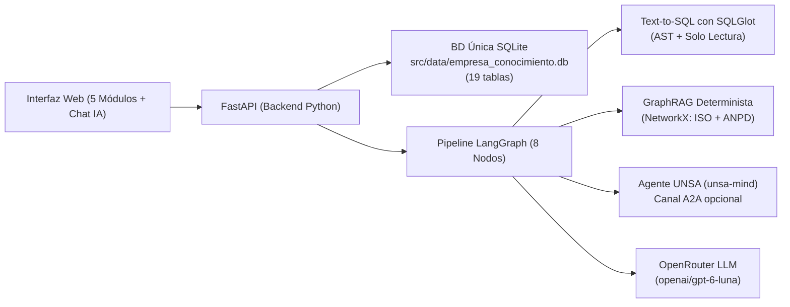

# Guía Práctica del Sistema — UNSA PIMS Agente 6 (ISO/IEC 27701:2025)

Guía directa para operar la interfaz al 100% y explicar qué hace cada módulo, documento y agente de inteligencia artificial.

---

## 1. ¿Qué es y qué problema resuelve? (Resumen en 30 segundos)

**UNSA PIMS Agente 6** es un sistema de gestión de **incidentes de seguridad, brechas de datos personales (PII) y medidas correctivas**, diseñado alrededor de la norma **ISO/IEC 27701:2025**:

- **Foco principal (ISO/IEC 27701:2025):**
  - **Cláusula 8.1 / Controles `A.3.11` y `A.3.12` (`B.3.12`):** registro, triaje, evaluación de impacto, contención, remediación y comunicación de incidentes.
  - **Control `A.3.14`:** bitácora cronológica inmutable y custodia de evidencias.
  - **Cláusula 10.2 (Formulario D34):** análisis de causa raíz y medida correctiva permanente.
  - **Cláusula 9.3 (Reporte D35):** informe consolidado para Revisión por la Dirección.
  - **Anexo A completo:** catálogo oficial verificado de **78 controles** (`31` de Controlador `A.1`, `18` de Encargado `A.2` y `29` de Seguridad `A.3`).
- **¿Incidentes = Brechas?** No siempre. Siguiendo **ISO/IEC 27701:2025 `B.3.12 Note 1`**, el sistema separa:
  - **Brecha PII (`BF`, `BI`, `BD`, `PI`):** incidente que compromete datos personales (confidencialidad, integridad, disponibilidad o no conformidad con principios).
  - **Incidente Técnico (`IT`):** falla de seguridad operativa sin exposición de datos personales.
- **¿Qué rol cumple la ANPD / Ley 29733?** Es **conocimiento auxiliar** para consultas normativas en el chat y un **registro documental opcional** dentro de cada expediente (número de oficio, fecha y justificación). **No existe un reloj artificial de 48 horas**, porque el sistema gestiona tanto expedientes históricos (`2023–2026`) como incidentes actuales.

---

## 2. Cómo funciona por debajo (Arquitectura y Tecnologías)



Cuatro piezas técnicas explican por qué el sistema responde con datos reales y sin inventar normas:

1. **Base de datos única (`src/data/empresa_conocimiento.db`):** una sola BD SQLite concentra las 19 tablas del sistema (18 empleados UNSA, 10 activos `core_asset`, 6 destinatarios, 15 incidentes históricos base 2023–2026, 10 medidas correctivas D34, 16 evidencias PDF y tablas del Inspector DSPM).
2. **Text-to-SQL seguro con `SQLGlot`:** traduce preguntas en español a `SELECT`, valida la estructura SQL mediante el árbol sintáctico (AST) de `SQLGlot` —bloqueando `INSERT`, `UPDATE`, `DELETE`, `DROP`, la columna `auth_user.password` y `SELECT *` sobre `auth_user`—, restringe a tablas permitidas con `LIMIT <= 100` y consulta SQLite en modo estrictamente solo lectura (`?mode=ro` + `PRAGMA query_only = ON`). Si falla la sintaxis, se autocorrige hasta 2 veces.
3. **GraphRAG determinista (NetworkX):** grafo normativo en memoria que conecta los **78 controles ISO/IEC 27701:2025**, los **11 principios ISO/IEC 29100**, el puente legal con la **Ley 29733 / Directiva R.D. 019-2013-JUS** y **588 resoluciones de la ANPD**. El LLM no cita controles "de memoria": lee los nodos exactos que entrega el grafo.
4. **Orquestación LangGraph + Canal A2A (`unsa-mind`):** coordina 8 nodos especializados con trazabilidad visible paso a paso en el chat, e incluye consulta opcional al agente institucional UNSA vía protocolo A2A.

---

## 3. Los 8 Subagentes de LangGraph (+ Canal A2A UNSA)

Cada pregunta al Asistente IA recorre este flujo de nodos (visible en el botón `Flujo de Agentes` debajo de cada respuesta):

| Orden | Nodo / Agente | Archivo | ¿Qué hace realmente? | Valor concreto frente a un chat normal |
| :--- | :--- | :--- | :--- | :--- |
| **1** | **Supervisor (Orquestador)** | `supervisor.py` | Clasifica la intención de la pregunta (`sql_query`, `hibrido`, `normativo`, `remediacion`, `contexto`, `dictamen`). | Decide en milisegundos si hace falta consultar SQLite en vivo o ir directo a normativa, evitando lentitud y errores innecesarios. |
| **2** | **SQL Query Agent (SQLGlot)** | `sql_agent.py` | Convierte preguntas operativas a SQL `SELECT`, las valida con AST `SQLGlot`, las ejecuta en solo lectura y reintenta hasta 2 veces si hay error. | Permite preguntar conteos, tablas, responsables, fechas y estados reales de la BD sin riesgo de modificar datos ni exponer contraseñas. |
| **3** | **Context Agent** | `context_agent.py` | Carga el inventario de archivos `.sql`, `.pdf`, `.md`, `.txt` analizados en el Inspector DSPM y sus tablas/cláusulas. | El asistente sabe qué documentos de la empresa están cargados actualmente para cruzar hallazgos técnicos. |
| **4** | **Data Profiler Agent** | `profiler_agent.py` | Detecta y clasifica columnas afectadas (`tabla.columna`) en categorías LPDP (`DATOS_SALUD`, `CREDENCIALES_ACCESO`, `DATOS_BIOMETRICOS`, etc.). | Traduce columnas técnicas de una BD a categorías legales de sensibilidad de datos personales. |
| **5** | **DSPM Risk Engine** | `dspm_agent.py` | Mapea el hallazgo al control ISO/IEC 27701:2025 (`A.3.26`, `A.3.23`, etc.), severidad y exposición referencial en UIT. | Convierte una falla técnica en riesgo cuantificado y control auditable bajo ISO 27701. |
| **6** | **Normative & Jurisprudence Agent** + **`Agente UNSA (A2A)`** | `normative_agent.py` | Extrae el subgrafo exacto en NetworkX (ISO 27701 + ISO 29100 + Ley 29733 + precedentes ANPD) y consulta al agente `unsa-mind` por A2A si la pregunta menciona reglamentos o áreas UNSA. | Fundamenta cada respuesta con controles verificados (con página del estándar ISO) y muestra con badge **Rojo UNSA** si el agente A2A respondió o **Amarillo** si está desconectado. |
| **7** | **Forensic Coach Agent** | `coach_agent.py` | Redacta la respuesta final en español con `openai/gpt-6-luna`, leyendo el expediente abierto (`ui_context`), las filas SQL reales y el subgrafo normativo. | Exige regla estricta anti-alucinación: solo puede reportar fechas, responsables y totales que llegaron en el SQL o expediente real. |
| **8** | **Senior Quality Critic (Reflection)** | `reflection.py` | Audita el borrador generado: verifica sustancia mínima y que cualquier parche SQL DDL incluya bloque transaccional `BEGIN; ... COMMIT;`. | Si el borrador tiene fallas técnicas o está incompleto, lo devuelve automáticamente al Coach (hasta 2 ciclos) antes de mostrarlo al usuario. |

---

## 4. Mapa Completo de la Interfaz

### Barra lateral izquierda fija (siempre visible)

- **Navegación entre los 5 módulos:**
  1. `Incidentes y Brechas` (`A.3.12`)
  2. `Medidas Correctivas` (`Cl. 10.2`)
  3. `Inspector SQL / PDF` (`DSPM`)
  4. `Controles ISO y Docs` (`78 • UNSA`)
  5. `Responsables y Activos` (`PIMS`)
- **Botón `Asistente IA PIMS` (`SQL • ISO`):** abre el panel derecho de chat desde **cualquier módulo** y mantiene visible el código del expediente activo (ej. `Contexto: INC-UNSA-2026-004`) para preguntarle directamente sobre lo que estás viendo.
- **`Paleta Institucional`:** 4 temas visuales (`Lacre`, `Cobalto`, `Terracota`, `Pizarra`).
- **`Usuario en sesión (Mock)`:** selector con los 18 empleados UNSA (incluye `DPO` y `CISO`). El usuario elegido aquí firma automáticamente cada creación, cambio de estado, acción o evidencia adjunta en la bitácora `A.3.14` (cabecera HTTP `X-Actor-Id`).

### ¿Qué hace cada uno de los 5 módulos?

| Módulo | Para qué sirve | Elementos principales |
| :--- | :--- | :--- |
| **1. Incidentes y Brechas** | Bandeja principal del ciclo de vida de incidentes y brechas PII (`2023–2026`). | 4 tarjetas KPI (`Incidentes Abiertos`, `Críticos Sin Cerrar`, `Brechas PII vs Técnicos`, `Medidas Correctivas 10.2`), filtros (búsqueda, año, estado, severidad, tipo), lista maestra izquierda, expediente detallado derecha con **4 pestañas** y botón `+ Registrar Incidente`. |
| **2. Medidas Correctivas** | Tablero consolidado de todas las No Conformidades y Medidas Correctivas (Cláusula 10.2 / D34). | Filtros por estado (`ABIERTA`, `EN_PROGRESO`, `IMPLEMENTADA`, `VERIFICADA`), botón `Editar` (salta directo a la pestaña `3. Medida 10.2` del incidente), descarga individual `.docx` (D34) y generación del **Reporte D35 (Cl. 9.3)** en vista previa, `.md` o `.docx`. |
| **3. Inspector SQL / PDF** | Motor DSPM para auditar archivos externos o el corpus UNSA y convertir hallazgos en incidentes reales. | `+ Subir SQL / PDF`, `Cargar y Auditar Corpus UNSA`, lista de hallazgos (`R-001` a `R-007`) con botón `Promover a Incidente BD`, y previsualización estructurada (`Inspeccionar`) de archivos analizados. |
| **4. Controles ISO y Docs** | Biblioteca normativa y documental de respaldo. | Subpestaña `78 Controles ISO 27701` (filtro `A.1`/`A.2`/`A.3`, buscador, badge con cantidad de incidentes vinculados y botón `Puente Legal`); subpestaña `Documentos UNSA` (botón `Cláusulas` y `Abrir` archivo original). |
| **5. Responsables y Activos** | Directorio organizacional, configuración PIMS y gestión de snapshots de la BD. | 4 subpestañas: `Responsables` (18 empleados), `Activos UNSA` (10 activos `core_asset`), `Destinatarios` (lista de correos activos/inactivos) y `Configuración PIMS` (parámetros DPO/UIT + **Puntos de Control / Reset Demo**). |

---

## 5. Flujo Completo del Usuario: "Soy nuevo y quiero crear y gestionar una brecha"

### Paso 0: Selecciona quién eres
En la esquina inferior izquierda, elige tu usuario en **`Usuario en sesión (Mock)`** (por ejemplo, el DPO o CISO). Todo lo que registres quedará auditado bajo ese nombre.

### Paso 1: Clic en `+ Registrar Incidente` (Módulo 1)
Se abre un formulario guiado de **3 pasos**. Aquí tienes el detalle exacto de **cada campo**:

#### Paso 1 de 3 — `1. Datos Básicos` (`Identificación y Activo`)
| Campo | Obligatorio | Qué ingresar | Ejemplo |
| :--- | :--- | :--- | :--- |
| **Título del Incidente \*** | Sí | Resumen claro del evento o brecha detectada. | `Exposición temporal de actas académicas en portal docente` |
| **Descripción técnica de los hechos** | No | Qué pasó, cómo se detectó y alcance preliminar. | `Configuración de Nginx permitió listar archivos PDF de actas sin sesión durante 2 horas.` |
| **Fecha del Incidente** | No (hoy por defecto) | Fecha real en que ocurrió (admite fechas históricas 2023–2026). | `2026-04-10` |
| **Fecha de Detección** | No (hoy por defecto) | Fecha en que el equipo lo identificó. | `2026-04-11` |
| **Activo UNSA Afectado** | No | Selector con los 10 activos oficiales UNSA (`core_asset`). | `[SYS-SISUNSA] Servidor de Base de Datos SISUNSA (PostgreSQL)` |
| **Sistema / Endpoint / URL** | No | Ruta web, servidor o tabla afectada. | `https://portal.unsa.edu.pe/actas/export` |

#### Paso 2 de 3 — `2. Triaje B.3.12` (`Triaje B.3.12 y Control`)
| Campo | Qué define | Opciones / Ejemplo |
| :--- | :--- | :--- |
| **¿Involucra Datos Personales (PII)?** | Separa brechas de privacidad de incidentes técnicos puros (`B.3.12 Note 1`). | `SÍ (PII)` (si se desmarca, cambia automáticamente la clasificación a `IT`). |
| **Clasificación** | Tipo de evento según naturaleza del daño o desvío. | `BF` (Confidencialidad), `BI` (Integridad), `BD` (Disponibilidad), `PI` (No Conformidad Principios), `IT` (Incidente Técnico sin PII). |
| **Severidad** | Nivel de criticidad e impacto evaluado. | `C` (Crítico), `A` (Alto), `M` (Medio), `B` (Bajo). |
| **Titulares Afectados** | Número aproximado de personas afectadas (`0` o más). | `340` |
| **Control ISO/IEC 27701:2025 Asociado** | Buscador + selector de los **78 controles** oficiales. | Buscar `A.3.26` (`Use of cryptography`) o mantener `A.3.12`. |
| **Consecuencias Observadas (B.3.12)** | Impacto sobre titulares, imagen u operación universitaria. | `Exposición de notas y código universitario; sin evidencia de indexación externa.` |

#### Paso 3 de 3 — `3. Asignación y MC` (`Responsable y Acción 10.2`)
| Campo | Qué hace | Ejemplo |
| :--- | :--- | :--- |
| **Responsable Asignado (Empleado UNSA)** | Persona a cargo de investigar y cerrar el caso. Si se deja vacío, asigna al DPO por defecto. | `Sofía Paredes Huamán — Ingeniera de Seguridad Aplicativa` |
| **Tipo Acción Inicial** + **Acción Inicial de Respuesta A.3.12** *(opcional)* | Permite dejar registrada de inmediato la primera acción ejecutada. | `Contención (C)` — `Bloqueo del listado de directorio en Nginx y purga de caché.` |
| **Casilla `Generar automáticamente borrador de Formulario D34...`** *(marcada por defecto)* | Crea en paralelo la ficha de Medida Correctiva (Cláusula 10.2) prellenada con el incidente. | Mantener marcada para trabajar luego la pestaña `3. Medida 10.2`. |

---

### Paso 2: ¿Qué sucede automáticamente al pulsar `Registrar Incidente`?
1. Se asigna un código correlativo por año: `INC-UNSA-YYYY-NNN` (ej. `INC-UNSA-2026-009`).
2. El expediente nace en estado **`I` (En Investigación)** dentro de la BD SQLite.
3. Si escribiste acción inicial, se guarda en `acciones` (`A.3.12`).
4. Si dejaste marcada la casilla D34, se crea automáticamente el borrador `MC-YYYY-NNN` en `corrective_actions` (Cl. 10.2).
5. Se graba el primer evento `CREACION` en la **Bitácora Inmutable `A.3.14`**.
6. El expediente nuevo aparece arriba en la lista izquierda y queda seleccionado a la derecha.

---

### Paso 3: Dónde verlo y qué hacer dentro del Expediente
En la cabecera del expediente derecho puedes:
- Hacer clic en el badge **`ISO 27701 <código>`** para abrir el modal **`Puente Legal`** (texto del control ISO + guía del Anexo B + relación ISO 29100 y Ley 29733).
- Hacer clic en **`Consultar IA sobre este caso`** para abrir el chat lateral con ese incidente fijado como contexto.
- Hacer clic en **`Exportar Ficha`** para descargar su ficha pericial `.txt`.
- Cambiar el **`Responsable`** (registra evento `ASIGNACION` en bitácora `A.3.14`).
- Cambiar el **`Estado`** entre `En Investigación (I)`, `En Mitigación (E)` y `Cerrado (C)` respetando **dos candados de auditoría**:
  - **Bloqueo de cierre:** el backend impide pasar a `Cerrado (C)` si el incidente tiene **`0` acciones** registradas en la pestaña 2.
  - **Reapertura auditada:** si pasas de `Cerrado (C)` hacia `I` o `E`, un modal exige escribir un **motivo obligatorio** (registrado como `REAPERTURA` en `A.3.14`) y limpia `resolved_date`.

Debajo de la cabecera tienes **4 pestañas**:

1. **`1. Evaluación B.3.12`:** ajusta el triaje PII, severidad, control ISO, titulares, **`Estado Recuperación de Datos (B.3.12)`** (`RECUPERADO_TOTAL`, `RECUPERADO_PARCIAL`, `NO_RECUPERADO`, `NO_APLICA`), detalle de recuperación y el bloque **`Registro Documental de Comunicaciones`** (casilla `Autoridad notificada (ANPD)`, `Fecha / Hora de Oficio`, `Nro. Oficio / Expediente`, `Justificación`, más notificación a `Titulares comunicados`, fecha y `Canal empleado`). Finaliza con **`Guardar Evaluación B.3.12`**.
2. **`2. Acciones (N)`:** registra acciones de `Contención (C)`, `Remediación Técnica/Legal (R)` o `Mitigación / Organizativa (M)` con evidencia/ticket (commit, firewall, oficio) y consulta las trazas técnicas `core_securitylog` asociadas al activo.
3. **`3. Medida 10.2`:** gestiona el **Formulario D34** completo (`Estado MC`, `Fecha Límite`, `¿Es necesario tomar medidas?`, `1. Descripción de la no-conformidad`, `3. Causa raíz`, `6. Medida correctiva a implementar`, `Responsable Implementación`, `Aprobado por`, `¿Quién debe estar informado?`, `Implementada el`, `Efectividad revisada el` y `Cambios al documento PIMS`). Incluye el botón **`Autocompletar con IA`** para proponer causa raíz y plan técnico, **`Guardar Medida Correctiva 10.2`** y **`Exportar .docx (D34)`**.
4. **`4. Evidencias (N)`:** sube archivos de respaldo con **`+ Adjuntar Evidencia`**, descarga los PDFs ya adjuntos (`Descargar`) y revisa la **`Bitácora Cronológica Inmutable (A.3.14)`** con todo el historial de cambios del caso.

---

## 6. Documentos: Qué puedes importar, ver y generar/exportar

| Acción | Dónde en la interfaz | Formatos / Qué contiene |
| :--- | :--- | :--- |
| **Importar esquemas y documentos fuente** | Módulo `3. Inspector SQL / PDF` → **`+ Subir SQL / PDF`** o **`Cargar y Auditar Corpus UNSA`** | Acepta `.sql`, `.pdf`, `.md`, `.txt`. El motor DSPM los escanea contra reglas `R-001` a `R-007` (ej. contraseñas MD5, datos médicos sin cifrar, retención indefinida). Cada hallazgo tiene **`Promover a Incidente BD`** para convertirlo en expediente real. |
| **Adjuntar evidencias a un incidente** | Módulo `1` → Expediente → Pestaña `4. Evidencias` → **`+ Adjuntar Evidencia`** | Cualquier archivo (PDFs de informes, capturas, logs). Queda vinculado al incidente y disponible para descarga. |
| **Ver documentos y normativa sin salir** | Módulo `4. Controles ISO y Docs` y Módulo `3` | En `Documentos UNSA`: **`Cláusulas`** abre un inspector con las cláusulas detectadas y **`Abrir`** muestra el archivo original. En `78 Controles ISO 27701`: **`Puente Legal`** muestra el detalle ISO 27701:2025 y normativa peruana vinculada. |
| **Generar Formulario D34 (`.docx`)** | Módulo `1` (Pestaña `3. Medida 10.2` → **`Exportar .docx (D34)`**) o Módulo `2` (botón **`.docx`**) | Rellena automáticamente las **12 filas oficiales** de la plantilla Word de Medida Correctiva (Cláusula 10.2). |
| **Generar Reporte Dirección D35 (Cl. 9.3)** | Módulo `2. Medidas Correctivas` → **`Vista Previa Reporte D35`** / **`Descargar D35 (.docx)`** | Genera el informe consolidado para Alta Dirección (KPIs globales, tabla histórica de incidentes y estado de medidas 10.2) descargable en **`.docx`** y **`.md`**. |
| **Exportar Ficha Pericial (`.txt`)** | Módulo `1` → Cabecera del expediente → **`Exportar Ficha`** | Descarga un resumen pericial de texto plano con hechos, triaje, acciones y medida correctiva del incidente seleccionado. |
| **Descargar evidencias PDF** | Módulo `1` → Pestaña `4. Evidencias` → **`Descargar`** | Descarga cualquiera de las evidencias adjuntas (incluidos los 16 PDFs precargados en `media/evidencias/`). |

---

## 7. Cómo usar y demostrar el Asistente IA PIMS

Abre el **`Asistente IA PIMS`** desde la barra izquierda (o con **`Consultar IA sobre este caso`** en un expediente). Después de recibir cada respuesta, puedes abrir dos pruebas transparentes dentro de la burbuja del chat:
- **`▼ Ver SQL de solo lectura (SQLGlot)`:** muestra exactamente la consulta `SELECT` ejecutada contra SQLite.
- **`▼ Ver Nodos` (`Flujo de Agentes`):** muestra qué nodos de LangGraph participaron, el tiempo/estado y si el **`Agente UNSA (unsa-mind A2A)`** respondió.

### Preguntas recomendadas para probar o exponer

**A. Consultas en tiempo real a la BD (disparan `SQLGlot`):**
1. *«¿Cuántas incidencias tenemos registradas en total? Dame una tabla con código, título, estado, severidad, responsable y fecha de cada una.»*
2. *«¿Cuál es la incidencia más crítica sin cerrar que debe resolverse ya y por qué?»*
3. *«¿Cuáles son los incidentes que quedaron pendientes entre 2023 y 2025?»*

**B. Consultas sobre el expediente que tienes abierto en pantalla:**
*(Selecciona primero un incidente en la lista, por ejemplo `INC-UNSA-2026-004`, y pregunta):*
1. *«¿De qué trata esta incidencia, cuándo se abrió, quién es el responsable y qué acciones registradas tiene?»*
2. *«Como auditor PIMS, ¿qué pronóstico y qué acciones recomiendas para cerrarla según ISO/IEC 27701:2025?»*
3. *«¿Cómo se relaciona este caso con la Ley 29733 y la ANPD?»*

**C. Consultas normativas (disparan `GraphRAG` sin tocar la BD):**
1. *«¿Qué exige el control A.3.12 (B.3.12) de la ISO/IEC 27701:2025 para gestionar una brecha de PII?»*
2. *«¿Qué diferencia hay entre A.3.26 y A.3.23 en ISO/IEC 27701:2025 frente a brechas de cifrado y contraseñas?»*

---

## 8. Puntos de Control (Snapshots), Reset de Demo y Arranque Local

En el Módulo **`5. Responsables y Activos`** tienes tres herramientas clave de administración y demostración:
- **Subpestañas `Responsables`, `Activos UNSA` y `Destinatarios`:** consulta el padrón de los 18 empleados, los 10 activos `core_asset` (con custodios y retención) y agrega o activa/inactiva correos destinatarios de alertas.
- **Subpestaña `Configuración PIMS`:**
  - Edita Entidad, RUC, Representante Legal, DPO, correo DPO y valor de la UIT (`S/`).
  - **`Base de Datos Única & Puntos de Control (Snapshots)`:**
    1. **`1. Guardar Punto de Control Actual`**: crea una copia limpia en caliente (`sqlite3.backup()`). Úsalo antes de empezar una demo o antes de hacer cambios de prueba.
    2. **`2. Volver al Punto Guardado`**: revierte todos los cambios que hayas hecho y deja la BD exactamente como estaba en tu snapshot.
    3. **`3. Restaurar Estado Inicial de Demo (15 incidentes)`**: reinicia la base al estado limpio original de demostración (15 incidentes canónicos 2023–2026 y 10 MC D34).

### Arranque en local (Windows / PowerShell)
```powershell
python -m uvicorn src.backend.app:app --host 127.0.0.1 --port 8000
```
Luego abre en tu navegador: `http://127.0.0.1:8000`
