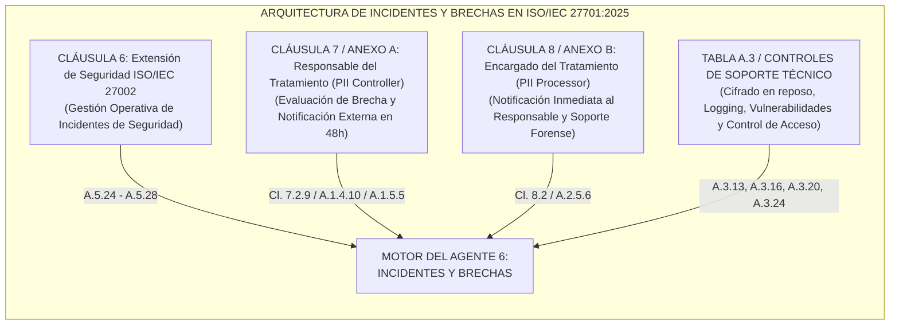
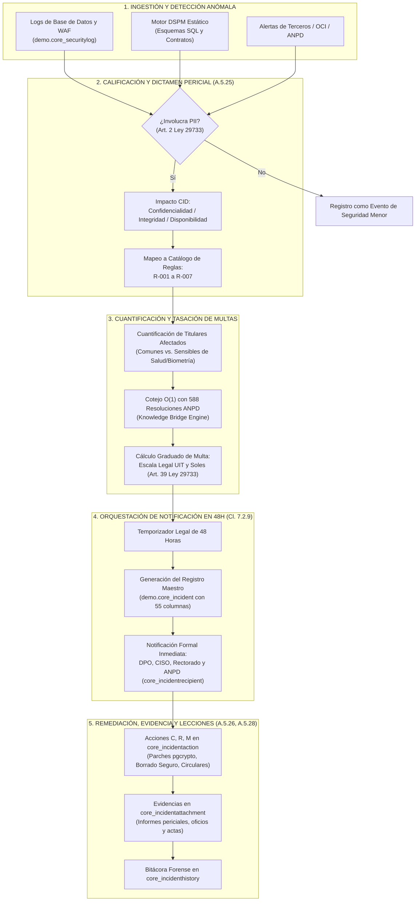

# Alcance Normativo y Catálogo de Controles ISO/IEC 27701:2025: Agente de Incidentes y Brechas de PII

**Módulo Especializado:** Agente 6 - Gestión Pericial de Incidentes de Seguridad y Brechas de Datos Personales (PII Breaches)  
**Institución de Aplicación:** Universidad Nacional de San Agustín de Arequipa (UNSA)  
**Normas de Referencia:** ISO/IEC 27701:2025, ISO/IEC 27001:2022 (A.5.24 - A.5.28), ISO/IEC 29100:2024, Ley Peruana N° 29733, D.S. 003-2013-JUS, D.S. 016-2024-JUS y Directiva de Seguridad R.D. 019-2013-JUS  
**Archivo de Especificación:** `docs/ALCANCE_CONTROLES_ISO27701_AGENTE_INCIDENTES.md`

---

## 1. Misión y Definición del Agente

El **Agente de Incidentes y Brechas de Privacidad** no es un formulario web ni un módulo administrativo genérico de registro. Es un **motor autónomo de peritaje forense digital, análisis de impacto legal y orquestación de respuesta ante incidentes** diseñado para salvaguardar el Sistema de Gestión de Privacidad de la Información (PIMS) de la universidad.

Su alcance operativo se concentra exclusivamente en:
1. Detectar, interceptar y calificar eventos anómalos para dictaminar si constituyen una **brecha de datos personales (PII Breach)** conforme a los criterios de confidencialidad, integridad y disponibilidad (CID).
2. Cuantificar el daño potencial, identificar los tipos de datos afectados (comunes vs. sensibles de salud, biométricos o financieros) y calcular la tasación de multas en UIT según precedentes de la Autoridad Nacional de Protección de Datos Personales (ANPD).
3. Asegurar el cumplimiento del plazo perentorio de **48 horas** para la notificación formal a la autoridad de control y las comunicaciones obligatorias a los titulares afectados.
4. Generar parches técnicos inmediatos (scripts transaccionales en SQL con `pgcrypto`, borrado seguro, tokenización) y formular planes de remediación y contención legal.
5. Gestionar la cadena de custodia probatoria y la trazabilidad forense de cada incidente.

---

## 2. Marco Estructural de la Norma ISO/IEC 27701:2025

La norma ISO/IEC 27701 amplía los requisitos de ISO/IEC 27001 y las directrices de ISO/IEC 27002 para establecer, implementar, mantener y mejorar continuamente un PIMS. La gestión de incidentes y brechas se estructura en tres dimensiones complementarias dentro del estándar:



---

## 3. Matriz Maestra de Controles ISO/IEC 27701:2025 Asignados al Agente

A continuación se consolidan todos los controles normativos que delimitan el alcance funcional del agente:

| Cláusula / Control | Nombre del Control | Dimensión / Rol | Exigencia Clave del Estándar | Vínculo Legal Perú |
| :--- | :--- | :---: | :--- | :--- |
| **Cl. 6.5.24 / A.5.24** | Planificación y preparación de la gestión de incidentes de seguridad | Extensión ISO 27002 (Shared) | Establecer procedimientos para detectar y responder ante eventos de seguridad que involucren PII. | Art. 9 Ley 29733 (Principio de Seguridad); R.D. 019-2013-JUS |
| **Cl. 6.5.25 / A.5.25** | Evaluación y decisión sobre eventos de seguridad de la información | Extensión ISO 27002 (Shared) | Evaluar eventos de seguridad para determinar si califican como brecha de datos personales (PII breach). | Art. 38 D.S. 003-2013-JUS; Directiva de Seguridad |
| **Cl. 6.5.26 / A.5.26** | Respuesta a incidentes de seguridad de la información | Extensión ISO 27002 (Shared) | Ejecutar acciones inmediatas de contención, aislamiento, mitigación y recuperación de sistemas con PII. | Art. 39 D.S. 003-2013-JUS; D.S. 016-2024-JUS |
| **Cl. 6.5.27 / A.5.27** | Aprendizaje derivado de los incidentes de seguridad | Extensión ISO 27002 (Shared) | Realizar análisis de causa raíz (RCA) para prevenir recurrencias y alimentar la gestión de riesgos. | Directiva de Seguridad Título I; Mejora Continua PIMS |
| **Cl. 6.5.28 / A.5.28** | Recolección de evidencia | Extensión ISO 27002 (Shared) | Asegurar la identificación, recolección y preservación de evidencia forense admisible legalmente. | Código Procesal Penal; Art. 28 Ley 29733 (Trazabilidad) |
| **Cl. 7.2.9** | Notificación de brechas de datos personales (PII breach notification) | Responsable (PII Controller) | Procedimiento documentado para notificar a la autoridad de control y a los titulares sin dilación indebida. | **Plazo estricto de 48 horas** ante la ANPD (Art. 38 D.S. 003-2013-JUS / D.S. 016-2024-JUS) |
| **Cl. 8.2** | Notificación de brechas al responsable del tratamiento | Encargado (PII Processor) | Notificar sin dilación al responsable tras tomar conocimiento de una brecha en servicios delegados. | Art. 17 Ley 29733; Art. 38.3.c D.S. 003-2013-JUS |
| **A.1.4.10** | Controles de transmisión de PII (PII transmission controls) | Responsable (PII Controller) | Proteger los datos personales en tránsito y detectar fugas en canales telemáticos no autorizados. | R.D. 019-2013-JUS Nivel Complejo; Regla R-006 |
| **A.3.16** | Gestión de derechos de acceso privilegiado | Control Técnico (Shared) | Monitoreo estricto y bitácora de actividad de administradores sobre bases de datos con PII. | Directiva de Seguridad Nivel Medio/Complejo; Regla R-003 |
| **A.3.20** | Registro de eventos y monitoreo (Logging and monitoring) | Control Técnico (Shared) | Generar trazas inmutables de acceso, modificación y exportación masiva de datos personales. | Art. 39 num. 2 D.S. 003-2013-JUS; Retención mín. 2 años |
| **A.3.22** | Gestión de vulnerabilidades técnicas | Control Técnico (Shared) | Identificación y remediación de fallas técnicas (inyecciones SQL, hashes rotos) que posibilitan brechas. | Art. 39 num. 3 D.S. 003-2013-JUS; Reglas R-001, R-002 |
| **A.3.24** | Uso de criptografía | Control Técnico (Shared) | Cifrado en reposo para neutralizar el impacto de una brecha en bases de datos con datos sensibles. | Art. 39 num. 4 D.S. 003-2013-JUS (AES-256); Regla R-001 |

---

## 4. Fichas Técnicas por Control: Definición, Significado y Funcionalidades del Agente

### 4.1. Cláusula 6.5.25 / Control A.5.25: Evaluación y Decisión sobre Eventos de Seguridad (Calificación de Brecha)
* **Texto Normativo de ISO/IEC 27701:**  
  *"La organización debe evaluar los eventos de seguridad de la información y decidir si se clasifican como incidentes de seguridad de la información. Adicionalmente, el PIMS debe establecer criterios para determinar si un incidente de seguridad de la información involucra datos personales (PII) y constituye una brecha de datos personales (PII breach)."*
* **Ubicación en el Estándar:** Cláusula 6 (Requisitos PIMS ampliados de ISO/IEC 27002) &rarr; Tema 5: Controles Organizacionales &rarr; Control A.5.25.
* **Significado Práctico en Privacidad:**  
  No todo incidente informático es una brecha de privacidad (ej. una caída de red sin datos afectados es un incidente de disponibilidad técnica, pero no una brecha de datos). Una brecha de datos personales ocurre cuando se vulnera la seguridad y se produce la destrucción, pérdida, alteración, revelación o acceso no autorizado a datos personales transmitidos, almacenados o procesados.
* **Funcionalidades que Ejecuta Nuestro Agente:**
  1. **Motor de Triaje Pericial:** Ingesta eventos técnicos de `demo.core_securitylog` (logs de inyección SQL, volcados anómalos, exportaciones masivas).
  2. **Evaluación de Impacto CID:** Determina si el evento compromete la **Confidencialidad** (`confidentiality=true`), **Integridad** (`integrity=true`) o **Disponibilidad** (`availability=true`).
  3. **Activación del Catálogo de Reglas Canónicas:** Asigna el arquetipo correspondiente (`R-001` a `R-007`).
  4. **Categorización del Incidente:** Clasifica el incidente en `demo.core_incident` bajo los tipos oficiales: `BF` (Confidencialidad), `BI` (Integridad), `BD` (Disponibilidad), o `PI` (Infracción de Principios).

---

### 4.2. Cláusula 7.2.9: Notificación de Brechas de Datos Personales (PII Breach Notification)
* **Texto Normativo de ISO/IEC 27701:**  
  *"La organización que actúa como responsable del tratamiento (PII controller) debe establecer, implementar y mantener un procedimiento documentado para notificar las brechas de datos personales a las autoridades supervisoras competentes y, cuando corresponda, a los titulares de los datos (PII principals), sin dilación indebida. La notificación debe describir la naturaleza de la brecha, las categorías y número aproximado de titulares y datos afectados, las consecuencias probables y las medidas adoptadas o propuestas para mitigar sus efectos."*
* **Ubicación en el Estándar:** Cláusula 7 (Directrices adicionales para Responsables / PII Controllers) &rarr; Subcláusula 7.2.9.
* **Significado Práctico en Privacidad:**  
  Es la obligación jurídica y operativa más crítica en la gestión de brechas. El silencio o la notificación tardía constituye por sí misma una **Infracción Grave o Muy Grave**. En el Perú, el plazo legal establecido por la Directiva de Seguridad y el D.S. 016-2024-JUS es de **48 horas improrrogables** desde la toma de conocimiento.
* **Funcionalidades que Ejecuta Nuestro Agente:**
  1. **Temporizador de 48 Horas:** Inicia el conteo regresivo legal desde el campo `detection_date` y `detection_time`.
  2. **Generador del Informe Oficial para la ANPD:** Estructura de forma automatizada los 55 campos de `demo.core_incident`, incluyendo: datos del representante legal (Rector UNSA), RUC, fecha/hora de ocurrencia, origen de la vulnerabilidad, volumen de registros, medidas de contención y contacto del DPO.
  3. **Despacho Multicanal a Destinatarios:** Consulta `demo.core_incidentrecipient` y remite las alertas prioritarias a `anpd.denuncias@minjus.gob.pe`, `dpo@unsa.edu.pe`, `ciso@unsa.edu.pe` y `rectorado@unsa.edu.pe`.
  4. **Evaluación de Notificación a Titulares:** Si la brecha entraña un riesgo alto (ej. robo de contraseñas R-002 o datos de salud R-001), redacta el pliego informativo y la plantilla de comunicación para los afectados.

---

### 4.3. Cláusula 6.5.26 / Control A.5.26: Respuesta a Incidentes de Seguridad de la Información
* **Texto Normativo de ISO/IEC 27701:**  
  *"Los incidentes de seguridad de la información deben responderse de acuerdo con los procedimientos documentados. El PIMS debe asegurar que las respuestas incluyan medidas de contención inmediata para frenar la exposición de PII, remediación técnica del vector de ataque y mitigación del daño hacia los titulares."*
* **Ubicación en el Estándar:** Cláusula 6 &rarr; Tema 5: Controles Organizacionales &rarr; Control A.5.26.
* **Significado Práctico en Privacidad:**  
  La respuesta no puede ser solo administrativa. Debe contener la fuga en tiempo real y eliminar la vulnerabilidad en la infraestructura de datos para frenar la comisión de la infracción continuada.
* **Funcionalidades que Ejecuta Nuestro Agente:**
  1. **Generación de Parches Técnicos Transaccionales:**
     * *Ante R-001 (Salud sin cifrar):* Genera script transaccional en PostgreSQL con `CREATE EXTENSION pgcrypto;` y migración a `pgp_sym_encrypt`.
     * *Ante R-002 (MD5 débil):* Genera script de invalidación de credenciales y migración a esquema seguro `Argon2id` con *salt*.
     * *Ante R-003 (CVV indebido):* Genera script destructivo transaccional `ALTER TABLE DROP COLUMN cvv;` con sobreescritura aleatoria.
  2. **Formulación de Medidas Administrativas:** Emisión de proyectos de resolución rectoral o circulares de cese (ej. gratuidad ARCO ante R-007, directiva de purga ante R-005).
  3. **Registro en `demo.core_incidentaction`:** Documenta cada acción bajo los tipos tipificados: `C` (Contención), `R` (Remediación), `M` (Mitigación).

---

### 4.4. Cláusula 6.5.28 / Control A.5.28: Recolección y Preservación de Evidencia Forense
* **Texto Normativo de ISO/IEC 27701:**  
  *"La organización debe definir y aplicar procedimientos para la identificación, recolección, adquisición y preservación de evidencia relacionada con incidentes de seguridad de la información que involucren PII, asegurando la cadena de custodia y su validez ante autoridades administrativas o judiciales."*
* **Ubicación en el Estándar:** Cláusula 6 &rarr; Tema 5: Controles Organizacionales &rarr; Control A.5.28.
* **Significado Práctico en Privacidad:**  
  Todo dictamen del agente debe estar respaldado por pruebas técnicas inmutables. La ANPD o el Poder Judicial exigen cadena de custodia para determinar la responsabilidad administrativa o penal de los involucrados.
* **Funcionalidades que Ejecuta Nuestro Agente:**
  1. **Gestión de Evidencias en `demo.core_incidentattachment`:** Asocia archivos periciales (informes forenses, oficios con cargo de recepción, scripts ejecutados, volcados de logs).
  2. **Línea de Tiempo Inmutable en `demo.core_incidenthistory`:** Registra cronológicamente cada cambio de estado, actor interviniente y evidencia generada.
  3. **Generación de Dictamen Pericial Completo:** Emite informes periciales estructurados en 5 secciones (Diagnóstico, Fundamento Normativo, Cuantificación con Precedente ANPD, Parche SQL/Cláusula y Acciones Administrativas).

---

### 4.5. Cláusula 8.2: Notificación de Brechas al Responsable (Rol de Encargado / Processor)
* **Texto Normativo de ISO/IEC 27701:**  
  *"La organización que actúa como encargado del tratamiento (PII processor) debe notificar al responsable del tratamiento (PII controller) sin dilación indebida tras tomar conocimiento de una brecha de datos personales confirmada o sospechada, y debe proporcionar la información necesaria para que el responsable cumpla con sus obligaciones de notificación."*
* **Ubicación en el Estándar:** Cláusula 8 (Directrices adicionales para Encargados / PII Processors) &rarr; Subcláusula 8.2.
* **Significado Práctico en Privacidad:**  
  Cuando la universidad delega el procesamiento en un proveedor externo (ej. AWS para copias de seguridad o proveedores de pasarelas de pago), o cuando la universidad actúa como encargada de entidades terceras, el agente debe fiscalizar las alertas recibidas y exigir el cumplimiento de los Acuerdos de Tratamiento de Datos (DPA).
* **Funcionalidades que Ejecuta Nuestro Agente:**
  1. **Detección de Fugas en Proveedores (Regla R-006):** Identifica cuando un proveedor cloud o procesador externo sufre un incidente o transfiere datos a destinos no autorizados.
  2. **Interconexión con el Agente 7 (Terceros y Contratos):** Notifica al módulo de contratos si un proveedor incumple sus obligaciones de reporte inmediato de incidentes estipuladas en las Cláusulas Contractuales Tipo (SCC).

---

### 4.6. Controles Técnicos de Soporte y Prevención (Tabla A.3 de ISO/IEC 27701:2025)

El agente audita y actúa directamente sobre los siguientes controles técnicos de seguridad que actúan como barreras de prevención o vectores de origen de las brechas:

```text
+-----------+------------------------------------+---------------------------------------------------------------+----------------------------------------+
| Control   | Nombre del Control                 | Función del Agente ante este Control                          | Regla Canónica Relacionada             |
+-----------+------------------------------------+---------------------------------------------------------------+----------------------------------------+
| A.3.13    | Access control                     | Detecta contraseñas débiles o hashes obsoletos (MD5/SHA1).   | R-002 (Hashes débiles en Admisión)     |
| A.3.16    | Privileged access management       | Supervisa exportaciones no autorizadas de operadores con rol. | R-003 (Extracción de tarjetas y CVV)  |
| A.3.20    | Logging and monitoring             | Consume eventos de seguridad y detecta patrones de brecha.    | Disparador de todo el flujo forense    |
| A.3.22    | Technical vulnerability management | Identifica endpoints con inyección SQL o fallas críticas.     | R-001 (Inyección SQL en Ficha Médica)  |
| A.3.24    | Use of cryptography                | Dictamina la ausencia de cifrado en reposo para PII sensible. | R-001 (Cifrado AES-256 pgcrypto)       |
+-----------+------------------------------------+---------------------------------------------------------------+----------------------------------------+
```

---

## 5. Arquitectura Funcional Especializada del Agente (Pipeline de 5 Fases)

Para operar con rigor pericial sin depender de interfaces de usuario, el agente implementa un pipeline autónomo de procesamiento dividido en 5 capas especializadas:



---

## 6. Mapeo entre Controles ISO/IEC 27701 y las Tablas de Base de Datos

Cada tabla asignada a nuestro agente en la base de datos de la UNSA implementa de forma directa los requerimientos del estándar:

| Tabla de Base de Datos | Controles ISO/IEC 27701 Implementados | Atributos Críticos de Cumplimiento |
| :--- | :--- | :--- |
| **`demo.core_incident`** | **Cl. 7.2.9** (Notificación de brecha)<br/>**A.5.25** (Evaluación de brecha)<br/>**A.5.26** (Respuesta a incidentes) | `incident_code`, `involves_personal_data`, `affected_data_types`, `num_affected_subjects`, `affected_cid`, `compromised_system`, `security_measures_adopted`, `detection_date`, `detection_time`, `measure_reported_authorities`. |
| **`demo.core_incidentaction`** | **A.5.26** (Respuesta y contención)<br/>**A.3.24** (Criptografía)<br/>**A.3.22** (Remediación de vulnerabilidades) | `action_type` ('C' Contención, 'R' Remediación, 'M' Mitigación), `responsible`, `action_date`, `description`, `evidence`. |
| **`demo.core_incidenthistory`** | **A.5.28** (Recolección de evidencia)<br/>**A.5.27** (Lecciones aprendidas)<br/>**Cl. 7.2.9** (Plazos de notificación) | `event_type` ('DETECCION', 'NOTIFICACION_ANPD', 'CONTENCION', 'CIERRE'), `changed_at`, `actor`, `recipients_snapshot`. |
| **`demo.core_incidentrecipient`** | **Cl. 7.2.9** (Directorio de notificación)<br/>**Cl. 8.2** (Canales de comunicación formal) | `email`, `label`, `is_active` (DPO, CISO, CSIRT UNSA, Rectorado, ANPD). |
| **`demo.core_incidentattachment`** | **A.5.28** (Preservación de evidencia forense) | `file`, `file_name`, `uploaded_at`, `uploaded_by_id` (Informes periciales forenses, oficios ANPD). |
| **`demo.core_securitylog`** | **A.3.20** (Registro y monitoreo)<br/>**A.3.16** (Auditoría de accesos) | `action`, `module`, `object_type`, `detail` (payloads SQLi, registros exfiltrados, hashes), `ip_address`. |

---

## 7. Conclusión: El Núcleo de Especialización de Nuestro Agente

Nuestro agente no es un asistente genérico ni una interfaz administrativa pasiva. Su especialización técnica absoluta es ser un **Perito Forense Autónomo en Privacidad** capaz de:
1. **Auditar el código y los datos:** Identificar las condiciones técnicas `R-001` a `R-007` que violan la ISO 27701 y la Ley 29733.
2. **Dictaminar con base jurídica real:** Citar precedentes sancionadores vinculantes de la ANPD y tasar multas con exactitud matemática en UIT y Soles.
3. **Actuar en los plazos de ley:** Garantizar la generación y envío del reporte formal de brecha en menos de 48 horas.
4. **Entregar soluciones de ingeniería:** Redactar parches SQL transaccionales inmediatos y directivas institucionales que cierren la brecha de raíz.

