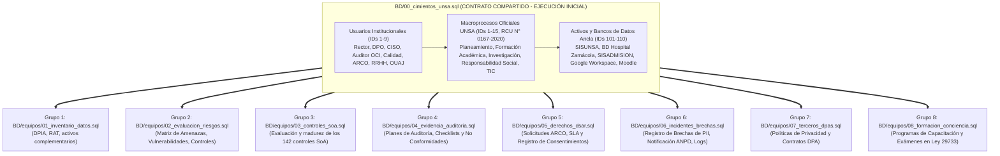

# Guía de Flujo de Trabajo y Población de la Base de Datos PIMS UNSA
## Arquitectura de Desacoplamiento por Contrato Base para los 8 Agentes de Auditoría (ISO/IEC 27001:2022, ISO/IEC 27701:2025 y Ley 29733)

**Institución:** Universidad Nacional de San Agustín de Arequipa (UNSA)  
**Proyecto:** Sistema de Gestión de Privacidad de la Información (PIMS) Multi-Agente  
**Propósito:** Definir el estándar de datos, las fuentes institucionales verificadas y la metodología de trabajo en paralelo para que los 8 grupos de desarrollo puedan poblar la base de datos sin dependencias cruzadas ni bloqueos de claves foráneas.  

---

## 1. Fundamento Normativo del Mapa de Procesos de la UNSA

La clasificación del Mapa de Procesos de la UNSA en tres categorías (**Estratégicos**, **Misionales** y **de Apoyo**) responde a la normativa técnica obligatoria del Estado peruano y a resoluciones del Consejo Universitario:

1. **Marco Legal Nacional (PCM):**
   * **Norma Técnica N° 001-2018-PCM/SGP** (*"Norma Técnica para la Gestión por Procesos en las Entidades de la Administración Pública"*), aprobada por la **Resolución de Secretaría de Gestión Pública N° 006-2018-PCM/SGP**.
   * Dispone que toda entidad pública en el Perú estructura su Mapa de Procesos de Nivel 0 en tres tipos estandarizados:
     * **Procesos Estratégicos (PE):** Conducen la gobernanza, planificación, calidad y control institucional.
     * **Procesos Misionales / Operativos (PM):** Constituyen la cadena de valor sustantiva universitaria (formación académica, investigación y responsabilidad social).
     * **Procesos de Apoyo / Soporte (PA):** Proveen recursos administrativos, financieros, jurídicos, logísticos y tecnológicos.

2. **Resoluciones Institucionales de la UNSA:**
   * **Resolución de Consejo Universitario (RCU) N° 0679-2019:** Aprobó el Mapa de Procesos inicial a nivel cero.
   * **Resolución de Consejo Universitario (RCU) N° 0167-2020 (12 de marzo de 2020):** Aprobó formalmente el documento de gestión *Mapa de Procesos de la Universidad Nacional de San Agustín de Arequipa*, estableciendo los **15 macroprocesos institucionales exactos** (4 Estratégicos, 3 Misionales y 8 de Apoyo).
   * **Resolución de Consejo Universitario (RCU) N° 0103-2026:** Dispuso la adecuación continua del Mapa de Procesos al marco normativo de universidades públicas del MINEDU.
   * **Repositorio Oficial de Consulta:** [Repositorio Documental DSpace Transparencia UNSA - RCU N° 0167-2020](https://transparencia.unsa.edu.pe/handle/123456789/252).

---

## 2. Metodología de Desacoplamiento: Contrato de Datos Base (Fase 0)

La base de datos original [`BD/gestitel_base_de_datos.sql`](../BD/gestitel_base_de_datos.sql) contiene **130 restricciones de Clave Foránea (Foreign Key)**. Si los grupos trabajan en serie esperando a que otros terminen de poblar dependencias, el avance se detiene.

Para eliminar cuellos de botella, se aplica la estrategia **Contract-First Data Seeding**:
* Se ejecuta previamente el script [`BD/00_cimientos_unsa.sql`](../BD/00_cimientos_unsa.sql), el cual inserta los **IDs canónicos compartidos** de usuarios institucionales, los 15 macroprocesos oficiales y los 10 activos ancla de la UNSA.
* **Resultado:** Cada uno de los 8 grupos de desarrollo puede trabajar y poblar su módulo de forma simultánea, apuntando a identificadores predefinidos y estables.



---

## 3. Catálogo de Identificadores Fijos Compartidos (Fase 0)

Los registros detallados a continuación están creados en [`BD/00_cimientos_unsa.sql`](../BD/00_cimientos_unsa.sql) y constituyen el contrato de interoperabilidad entre grupos.

### 3.1. Usuarios Institucionales Compartidos (`demo.auth_user` y `demo.core_userprofile`)

| ID | Username | Nombre y Apellidos | Dependencia Orgánica (ROF) | Rol Funcional en el SGPI / PIMS | Fuente Oficial / Enlace Verificado |
| :---: | :--- | :--- | :--- | :--- | :--- |
| **`1`** | `admin_sgpi` | Dr. Hugo Rojas Flores | Despacho Rectoral | Rector de la UNSA; aprueba alcance y políticas generales del SGSI. | [Despacho Rectoral UNSA](https://www.unsa.edu.pe/rector-de-la-universidad/) |
| **`2`** | `rat_inventario` | Ing. Pedro Cornejo Quispe | Oficina de Tecnologías de la Información (OTI) | Administrador de Bases de Datos; custodio del RAT y activos TI. | [Directorio OTI UNSA](https://oti.unsa.edu.pe) |
| **`3`** | `ciso_riesgos` | Ing. Marcos Ruiz Benavente | Unidad de Seguridad de la Información (USIRT / OTI) | Oficial de Seguridad de la Información (CISO); evalúa riesgos. | [Directorio OTI UNSA](https://oti.unsa.edu.pe) |
| **`4`** | `soa_calidad` | Mg. Elena Cornejo Valdivia | Dirección Universitaria de Calidad Académica | Coordinadora de Gestión; monitorea controles de ISO 27001/27701. | [Dirección de Acreditación y Calidad](https://acreditacion.unsa.edu.pe/) |
| **`5`** | `auditor_oci` | Ing. Roberto Gómez Salazar | Órgano de Control Institucional (OCI - Contraloría) | Auditor Líder; suscribe actas y hallazgos de auditoría de privacidad. | Estatuto UNSA / Ley N° 27785 (Control Gubernamental) |
| **`6`** | `operador_arco` | Lic. Rosa Fuentes Morales | Secretaría General / Mesa de Partes | Operadora de Mesa de Partes; atiende solicitudes ARCO en TRAMITED. | [Sistema TRAMITED UNSA](https://ouis.unsa.edu.pe/tramited/) |
| **`7`** | `dpo_incidentes`| Abog. Carlos Mendoza Valdivia | Oficina de Protección de Datos Personales | Oficial de Protección de Datos (DPO); investiga brechas y oficia a ANPD. | [Política de Protección de Datos UNSA](https://www.unsa.edu.pe/servicios/politica-proteccion-datos.html) |
| **`8`** | `legal_terceros`| Dr. Alberto Carpio Pinto | Oficina Universitaria de Asesoría Jurídica (OUAJ) | Asesor Legal; suscribe contratos de encargo (DPAs) con proveedores. | Estatuto UNSA / ROF Institucional |
| **`9`** | `rrhh_formacion`| Lic. Teresa Zúñiga Paredes | Subdirección de Recursos Humanos | Coordinadora de Capacitación; gestiona exámenes y asistencia formativa. | Estatuto UNSA Art. 38 / Subdirección de RRHH |

---

### 3.2. Los 15 Macroprocesos Oficiales de la UNSA (`demo.core_process`)

Conforme a la **RCU N° 0167-2020** y la **Norma Técnica N° 001-2018-PCM/SGP**, el Mapa de Procesos de Nivel 0 de la UNSA contiene **exactamente 15 macroprocesos**. Los sistemas y subprocesos operativos no son macroprocesos independientes de Nivel 0, sino componentes que se articulan dentro de su respectivo macroproceso padre:

| ID | Código | Macroproceso Institucional | Tipo | Dependencia Responsable | Subprocesos y Sistemas que Articula | Base Legal / Enlace Verificado |
| :---: | :--- | :--- | :---: | :--- | :--- | :--- |
| **`1`** | `PE.01` | Gestión del Planeamiento Estratégico y Presupuesto | E | Oficina Universitaria de Planeamiento y Desarrollo | POI, PEI, Presupuesto Institucional de Apertura (PIA). | [RCU N° 0167-2020 en DSpace Transparencia](https://transparencia.unsa.edu.pe/handle/123456789/252) |
| **`2`** | `PE.02` | Gestión de la Calidad y Acreditación Institucional | E | Dirección Universitaria de Calidad Académica | Licenciamiento SUNEDU, acreditación de carreras ICACIT/SINEACE. | [Dirección de Acreditación UNSA](https://acreditacion.unsa.edu.pe/) / [Política de Calidad](https://www.unsa.edu.pe/politica-de-calidad-institucional/) |
| **`3`** | `PE.03` | Gestión de la Internacionalización y Convenios | E | Dirección de Cooperación y Relaciones Internacionales | Convenios interinstitucionales, movilidad académica internacional. | RCU N° 0167-2020 / Estatuto UNSA |
| **`4`** | `PE.04` | Gestión de Riesgos y Control Institucional | E | Órgano de Control Institucional (OCI - Contraloría) | Sistema de Control Interno (SCI), auditorías de cumplimiento. | RCU N° 0167-2020 / Ley N° 27785 |
| **`5`** | `PM.01` | Formación Académica Integral | O | Vicerrectorado Académico / DUFA | Admisión, Matrícula, Aulas Virtuales, Tutoría académica y Grados. | [Admisión UNSA](https://admision.unsa.edu.pe) / [Portal Matrícula](http://matricula.unsa.edu.pe/) / [VRA](https://vra.unsa.edu.pe) |
| **`6`** | `PM.02` | Investigación, Innovación y Emprendedurismo | O | Vicerrectorado de Investigación (VRI) | Fondos concursables canon minero (UNSA Investiga), patentes, semilleros. | [Portal VRI UNSA](https://vri.unsa.edu.pe) |
| **`7`** | `PM.03` | Responsabilidad Social Universitaria y Extensión Cultural | O | Dirección Universitaria de Responsabilidad Social (DURS) | Atención de salud en Hospital Docente UNSA (Zamácola), voluntariado. | [Dirección de Responsabilidad Social](https://www.unsa.edu.pe/ouresponsabilidadsocial/) / IPRESS SUSALUD N° 00012398 |
| **`8`** | `PA.01` | Gestión Financiera y Contable | A | Dirección General de Administración / Tesorería | Cobro de tasas por Banco de la Nación, caja central y conciliación. | [Portal Págalo.pe Banco de la Nación](https://pagalo.pe) / Tesorería UNSA |
| **`9`** | `PA.02` | Gestión del Talento Humano | A | Subdirección de Recursos Humanos | Legajos del personal, control de asistencia biométrica, planillas. | Estatuto UNSA / Subdirección de RRHH |
| **`10`**| `PA.03` | Gestión de Logística, Abastecimiento e Infraestructura | A | Subdirección de Logística | Contrataciones del Estado (OSCE), almacén central y mantenimiento. | Ley N° 30225 (Contrataciones del Estado) / Logística |
| **`11`**| `PA.04` | Gestión Legal y Asesoría Jurídica | A | Oficina Universitaria de Asesoría Jurídica (OUAJ) | Dictámenes legales, convenios de encargo de tratamiento con terceros (DPAs). | Estatuto UNSA / ROF Institucional |
| **`12`**| `PA.05` | Gestión de Tecnologías de la Información y Comunicación (TIC) | A | Oficina de Tecnologías de la Información (OTI) | Data Center Central, cluster virtualizado, redes y correos institucionales. | [Directorio OTI UNSA](https://oti.unsa.edu.pe) |
| **`13`**| `PA.06` | Gestión del Bienestar Universitario | A | Dirección Universitaria de Desarrollo Estudiantil (DUDE) | Comedores universitarios de campus, becas alimentarias y servicio social. | Estatuto UNSA Art. 50 / DUDE |
| **`14`**| `PA.07` | Gestión de la Comunicación e Imagen Institucional | A | Oficina de Comunicación e Imagen Institucional | Portal web institucional, comunicados oficiales y prensa universitaria. | [Portal Institucional UNSA](https://www.unsa.edu.pe) |
| **`15`**| `PA.08` | Gestión Documentaria y Archivo Institucional | A | Secretaría General / Mesa de Partes / Archivo Central | Recepción de expedientes CUT y custodia de legajos y actas históricas. | [Sistema TRAMITED UNSA](https://ouis.unsa.edu.pe/tramited/) / Calle San Agustín 115 |

---

### 3.3. Activos de Información Ancla y Bancos de Datos Reales (`demo.core_asset`)

Los 10 activos ancla insertados en la Fase 0 cuentan con identificadores inmutables (`id = 101` al `110`) y están vinculados formalmente a su macroproceso padre:

| ID | Código | Nombre del Activo / Banco de Datos | Rol PIMS | Macroproceso Vinculado (`process_id`) | Ubicación Física / Lógica | Verificación / Enlace Operativo |
| :---: | :--- | :--- | :---: | :---: | :--- | :--- |
| **`101`** | `SYS-SISUNSA` | Servidor de Base de Datos SISUNSA (PostgreSQL) | Controller | `PM.01` (Formación Académica, id=5) | Data Center OTI - Pabellón Central Ingenierías | [Portal Matrícula UNSA](http://matricula.unsa.edu.pe/) / [Sistema Académico Docente](http://extranet.unsa.edu.pe/sisacad/libretas/) |
| **`102`** | `SYS-HOSPITAL`| Servidor de Historias Clínicas - Hospital Docente | Controller | `PM.03` (Resp. Social / Salud, id=7) | Av. Aeropuerto N° 504, Zamácola, Cerro Colorado | IPRESS SUSALUD N° 00012398 / [Responsabilidad Social](https://www.unsa.edu.pe/ouresponsabilidadsocial/) |
| **`103`** | `SYS-SISADMIS`| Portal Web SISADMISION y Banco de Postulantes | Controller | `PM.01` (Formación Académica, id=5) | Servidores DMZ OTI | [Portal Admisión UNSA](https://admision.unsa.edu.pe) |
| **`104`** | `CLOUD-GSUITE`| Google Workspace for Education Fundamentals | Processor | `PA.05` (Gestión de TIC, id=12) | Centros de Datos Google Cloud (EE.UU. / Irlanda) | [mail.google.com](https://mail.google.com) (Dominio `@unsa.edu.pe` vía [OTI](https://oti.unsa.edu.pe)) |
| **`105`** | `APP-MOODLE` | Plataforma Aula Virtual Moodle UNSA | Controller | `PM.01` (Formación Académica, id=5) | Cluster Virtualizado OTI | [Aula Virtual UNSA](https://aulavirtual.unsa.edu.pe) |
| **`106`** | `ARCH-SANAGUSTIN`| Archivo Central Físico de Grados, Títulos y Actas | Controller | `PA.08` (Gestión Documentaria, id=15) | Calle San Agustín N° 115, Cercado de Arequipa | Archivo físico permanente / Sistema Nacional de Archivos (sin portal web) |
| **`107`** | `APP-TRAMITED`| Sistema de Trámite Documentario (TRAMITED) | Controller | `PA.08` (Gestión Documentaria, id=15) | Servidores Web OTI | [Sistema TRAMITED UNSA](https://ouis.unsa.edu.pe/tramited/) |
| **`108`** | `APP-UNSAPAY` | Pasarela de Pago de Tasas (Convenio Banco de la Nación) | Controller | `PA.01` (Gestión Financiera, id=8) | Pasarela bancaria y Caja Central de Tesorería | [pagalo.pe](https://pagalo.pe) (Tasa UNSA - Código 01540 / Sin web independiente) |
| **`109`** | `APP-SISTUTORIA`| Sistema de Tutoría y Acompañamiento Psicopedagógico| Controller | `PM.01` (Formación Académica, id=5) | Servidores Internos OTI / Módulo docente | Módulo dentro de [extranet.unsa.edu.pe/sisacad](http://extranet.unsa.edu.pe/sisacad/libretas/) y [VRA](https://vra.unsa.edu.pe) |
| **`110`** | `APP-SISCOM` | Control de Comedor Universitario (DUDE) | Controller | `PA.06` (Bienestar Universitario, id=13)| Red local de comedores (Ingenierías, Sociales, Biomédicas) | Sistema interno administrado por DUDE (sin portal web público) |

---

### 3.4. Origen Institucional y Verificación de los Activos de Información

Los 10 activos de información seleccionados responden a la realidad operativa de la UNSA y se fundamentan en tres fuentes comprobadas:

1. **Sistemas y Servicios con Portales Web en Producción:**
   * La universidad opera servicios web activos bajo el dominio institucional `unsa.edu.pe`:
     * Admisión de postulantes: [admision.unsa.edu.pe](https://admision.unsa.edu.pe)
     * Matrícula universitaria: [matricula.unsa.edu.pe](http://matricula.unsa.edu.pe/)
     * Aulas virtuales Moodle: [aulavirtual.unsa.edu.pe](https://aulavirtual.unsa.edu.pe)
     * Trámite documentario y mesa de partes: [ouis.unsa.edu.pe/tramited/](https://ouis.unsa.edu.pe/tramited/)
     * Infraestructura tecnológica y USIRT: [oti.unsa.edu.pe](https://oti.unsa.edu.pe)
     * Vicerrectorado de Investigación: [vri.unsa.edu.pe](https://vri.unsa.edu.pe)
     * Acreditación y Calidad: [acreditacion.unsa.edu.pe](https://acreditacion.unsa.edu.pe/)
     * Política de Protección de Datos Personales: [unsa.edu.pe/servicios/politica-proteccion-datos.html](https://www.unsa.edu.pe/servicios/politica-proteccion-datos.html)

2. **Sistemas de Red Local, Pasarelas Bancarias y Sin Portal Web Independiente:**
   * No todos los sistemas universitarios cuentan con un subdominio web propio:
     * **Comedor Universitario (SISCOM):** Opera como un aplicativo administrativo interno de la Dirección Universitaria de Desarrollo Estudiantil (DUDE) en las redes de los tres campus (Ingenierías, Sociales y Biomédicas).
     * **Tutoría:** Se gestiona como módulo dentro del sistema académico docente (`http://extranet.unsa.edu.pe/sisacad/`) y supervisado por el VRA.
     * **Recaudo de Tasas (UNSApay / Tesorería):** La UNSA no hospeda un banco propio; las tasas se recaudan a través del convenio oficial con el Banco de la Nación mediante la plataforma estatal [pagalo.pe](https://pagalo.pe) (código de tasa institucional 01540) y ventanillas de Caja Central.

3. **Infraestructura Física y Sanitaria Oficial:**
   * **Hospital Docente de la UNSA:** Establecimiento de Salud con código IPRESS categorizado ante SUSALUD y la Gerencia Regional de Salud (GERESA Arequipa), con sede en Av. Aeropuerto N° 504, Zamácola, distrito de Cerro Colorado. Custodia historias clínicas bajo la Norma Técnica de Salud NTS N° 139-MINSA/DGIEM.
   * **Data Center Central OTI:** Sala de servidores e hipervisores ubicada en el Pabellón Central del Área de Ingenierías (Av. Independencia s/n), sede física del almacenamiento relacional y enlaces de fibra óptica institucional.
   * **Archivo Central Histórico:** Inmueble del Rectorado en Calle San Agustín N° 115, Cercado de Arequipa, donde se custodian físicamente actas de notas y legajos de títulos que no cuentan con soporte digitalizado previo.

---

## 4. Distribución de Trabajo y Mecanismo de Identificadores (IDs)

### 4.1. Fundamento de la Asignación de Rangos de IDs

*¿Por qué se asignan rangos numéricos de IDs si cada grupo trabaja en tablas distintas?*

1. **Tablas Exclusivas (Sin Riesgo de Colisión):**
   * Cada grupo dispone de tablas dedicadas donde ningún otro grupo inserta datos:
     * Grupo 6: `core_incident` (registro unificado de brechas PII con 55 atributos normativos), `core_incidentaction`, `core_incidenthistory`, `core_incidentrecipient`, `core_incidentattachment`, `core_securitylog`.
     * Grupo 4: `core_audit`, `core_auditfinding`, `core_auditchecklistitem`.
     * Grupo 5: `core_arcorequest`, `core_arcohistory`, `core_consent`.
   * En estas tablas no existe riesgo técnico de colisión primaria. Un grupo podría usar IDs 1, 2, 3 sin interferir con otros módulos exclusivos.

2. **Tablas Compartidas Transversales (Punto Crítico de Colisión):**
   * Existen tablas que deben ser utilizadas o ampliadas por más de un grupo:
     * **`demo.core_asset` (Activos):** La Fase 0 fija los activos ancla 101 al 110. Si el Grupo 1 (Inventario) registra activos adicionales para catalogar el RAT y el Grupo 7 (Terceros) registra un software de proveedor externo en la misma tabla, ambos escribirán en `demo.core_asset`. Si ambos grupos usan `INSERT INTO demo.core_asset (id) VALUES (11)`, la ejecución del script maestro `BD/run_poblar_bd.sql` fallará con el error:
       ```text
       ERROR: duplicate key value violates unique constraint "core_asset_pkey"
       ```
     * **`demo.core_document` (Políticas y Contratos):** El Grupo 3 registra políticas SoA en `core_document`, mientras que el Grupo 7 registra contratos de encargo DPA en la misma tabla `core_document`. Si no existen rangos asignados, se producirá un choque de claves primarias.
     * **`demo.core_assessment` (Evaluaciones):** Puede ser referenciada tanto por evaluaciones de riesgo (Grupo 2) como por DPIAs (Grupo 1).

3. **Trazabilidad y Auditoría Directa:**
   * Utilizar prefijos estandarizados (1xx para Grupo 1, 2xx para Grupo 2, ... 6xx para Grupo 6) permite que cualquier consulta SQL revele inmediatamente el grupo responsable de cada fila, simplificando la evaluación del docente y la verificación de integridad.

### 4.2. Matriz de Asignación por Grupo

| Archivo SQL de Entrega | Grupo Responsable | Rango de IDs Primarios | Tablas Principales a Poblar | Dependencias Pre-resueltas de Fase 0 |
| :--- | :--- | :---: | :--- | :--- |
| `BD/00_cimientos_unsa.sql` | **Fase 0 (Común)** | `1` - `99` (y activos `101`-`110`) | `demo.auth_group`, `demo.core_roleprofile`, `demo.auth_user`, `demo.core_userprofile`, `demo.auth_user_groups`, `demo.auth_group_permissions`, `demo.auth_user_user_permissions`, `demo.core_process` (15 macroprocesos), `demo.core_asset` (10 anclas), `public.customer_license`, `public.customer_platformlog`, `public.auth_user`, `public.auth_group`, `public.auth_user_groups`, `public.auth_group_permissions`, `public.auth_user_user_permissions`, `public.django_admin_log`, `public.django_session` | Ejecución inicial obligatoria |
| `BD/equipos/01_inventario_datos.sql` | **Grupo 1: Inventario** | `111` - `199` | `demo.core_personaldataimpactassessment`, `demo.core_personaldataoperation`, activos complementarios en `demo.core_asset` | Vincula a `asset_id=101` a `110`; creador `created_by_id=2` |
| `BD/equipos/02_evaluacion_riesgos.sql`| **Grupo 2: Riesgos** | `201` - `299` | `demo.core_riskperiod`, `demo.core_riskevaluation`, `demo.core_riskevaluationasset`, `demo.core_riskcontrol`, `demo.core_riskcontrol_annex_a_controls`, `demo.core_risktreatment`, `demo.core_risktreatmentactivity` | Periodo `period_id=1`; activos `asset_id=101` a `110`; creador `created_by_id=3` |
| `BD/equipos/03_controles_soa.sql` | **Grupo 3: SoA & Controles** | *Actualiza filas 1 a 142* | `demo.core_gapannexaassessment` (UPDATE de 142 controles), `demo.core_dashboardsnapshot` (KPIs mensuales) | Controles del Anexo A precargados; actualizador `updated_by_id=4` |
| `BD/equipos/04_evidencia_auditoria.sql`| **Grupo 4: Auditoría** | `401` - `499` | `demo.core_audit`, `demo.core_auditchecklistitem`, `demo.core_auditfinding`, `demo.core_auditactionplan` | Procesos `process_id=5`, `7`, `8`; auditor líder `created_by_id=5` |
| `BD/equipos/05_derechos_dsar.sql` | **Grupo 5: Derechos ARCO** | `501` - `599` | `demo.core_arcorequest`, `demo.core_arcohistory`, `demo.core_arcoattachment` (DNI adjunto), `demo.core_consent`, `demo.core_consenthistory` | Canal TRAMITED (`asset_id=107`); operador `created_by_id=6` |
| `BD/equipos/06_incidentes_brechas.sql`| **Grupo 6: Incidentes** | `601` - `699` | `demo.core_incident` (registro unificado de brechas PII con 55 atributos), `demo.core_incidentaction`, `demo.core_incidenthistory`, `demo.core_incidentrecipient`, `demo.core_incidentattachment` (peritajes), `demo.core_securitylog` | Activos vulnerados `101`, `102`, `103`, `107`, `108`, `110`; DPO `created_by_id=7` |
| `BD/equipos/07_terceros_dpas.sql` | **Grupo 7: Terceros / DPAs** | `701` - `799` | `demo.core_document` (contratos y políticas), `demo.core_documentversion`, `demo.core_document_gap_requirements`, `demo.core_document_related_documents` | Activo Cloud (`asset_id=104`); aprobador legal `created_by_id=8` |
| `BD/equipos/08_formacion_conciencia.sql`| **Grupo 8: Formación** | `801` - `899` | `demo.core_training`, `demo.core_trainingassignment`, `demo.core_trainingquestion`, `demo.core_trainingquestionoption` (alternativas), `demo.core_trainingexamattempt`, `demo.core_certificate` (diplomas) | Usuarios a capacitar `user_id=2` al `9`; creador `created_by_id=9` |

### 4.3. Verificación de Cobertura Total (Cero Tablas Vacías)

Con la integración de estos scripts a través de `BD/run_poblar_bd.sql`, se alcanza una **cobertura del 100%** sobre la base de datos:
* **Esquema `demo` (Universidad):** 58 de 58 tablas pobladas (0 tablas vacías).
* **Esquema `public` (Plataforma):** 15 de 15 tablas pobladas (0 tablas vacías).
* **Total General:** Las 73 tablas del sistema disponen de registros consistentes y vinculados por clave foránea.

---

## 5. Instrucciones de Ejecución e Integración

### Paso 1: Inicialización Limpia (Ejecutar una sola vez)
```bash
# Crear base de datos en PostgreSQL
createdb -U postgres unsa_pims_db

# Restaurar estructura DDL y catálogos normativos originales
psql -U postgres -d unsa_pims_db -f "BD/gestitel_base_de_datos.sql"

# Cargar el contrato institucional de la UNSA (Fase 0)
psql -U postgres -d unsa_pims_db -f "BD/00_cimientos_unsa.sql"
```

### Paso 2: Desarrollo Autónomo
Cada grupo redacta su script SQL utilizando exclusivamente los identificadores de su rango numérico y las referencias fijadas en la Sección 3.

### Paso 3: Integración General
Cuando los grupos concluyan sus scripts, se ejecuta el archivo orquestador:
```bash
psql -U postgres -d unsa_pims_db -f "BD/run_poblar_bd.sql"
```

### Paso 4: Consulta SQL de Validación de Integridad
Para comprobar que no existen tablas vacías ni inconsistencias:
```sql
SELECT 'Usuarios Institucionales' AS modulo, COUNT(*) AS total FROM demo.auth_user
UNION ALL
SELECT 'Macroprocesos UNSA', COUNT(*) FROM demo.core_process
UNION ALL
SELECT 'Activos y Bancos de Datos', COUNT(*) FROM demo.core_asset
UNION ALL
SELECT 'Evaluaciones de Riesgo', COUNT(*) FROM demo.core_riskevaluation
UNION ALL
SELECT 'Controles SoA Justificados', COUNT(*) FROM demo.core_gapannexaassessment WHERE applicability_justification IS NOT NULL
UNION ALL
SELECT 'Auditorías y Hallazgos', COUNT(*) FROM demo.core_auditfinding
UNION ALL
SELECT 'Solicitudes ARCO y Consentimientos', COUNT(*) FROM demo.core_arcorequest
UNION ALL
SELECT 'Incidentes y Brechas Registradas', COUNT(*) FROM demo.core_incident
UNION ALL
SELECT 'Documentos y Contratos DPAs', COUNT(*) FROM demo.core_document
UNION ALL
SELECT 'Capacitaciones y Evaluaciones', COUNT(*) FROM demo.core_training;
```
