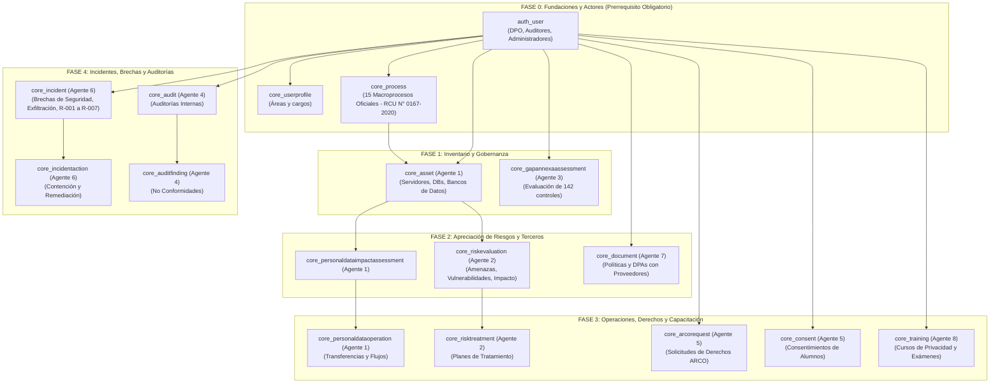

# MAPEO INTEGRAL Y ARQUITECTURA DE DATOS PARA EL SISTEMA PIMS UNSA
## Guía Maestra de Asignación de Tablas, Dependencias Relacionales, Diccionario de Datos y Mapeo Normativo (ISO/IEC 27001:2022, ISO/IEC 27701:2025 y Ley 29733)

**Institución:** Universidad Nacional de San Agustín de Arequipa (UNSA)  
**Proyecto:** Privacy Coach Multi-Agent System - Sistema de Gestión de Privacidad de la Información (PIMS)  
**Archivo de Base de Datos Base:** `BD/gestitel_base_de_datos.sql`  
**Versión del Documento:** 1.0 (Definitiva y Exhaustiva)  

---

## 1. RESUMEN EJECUTIVO Y RADIOGRAFÍA DEL ARCHIVO SQL

El archivo [`BD/gestitel_base_de_datos.sql`](file:gestitel_base_de_datos.sql) contiene la estructura completa (DDL) y los catálogos normativos (DML Semilla) de una plataforma de auditoría y gestión de privacidad basada en **PostgreSQL 13+** (exportada mediante `pg_dump 18.4`).

### Métricas Clave de la Base de Datos:

- **Total de Tablas:** **73 tablas**.
- **Esquemas:** **2 esquemas** (`public` con 15 tablas y `demo` con 58 tablas).
- **Claves Primarias (PK):** 73 (100% de tablas tienen PK basada en `id bigint` o `integer`).
- **Claves Foráneas (FK):** **130 restricciones de integridad relacional** activas.
- **Índices de Optimización:** 180 índices (`btree` y `jsonb_path_ops`).
- **Tablas Precargadas (Semilla / Catálogos):** **21 tablas** (contienen normativas, controles ISO, matrices de riesgo y catálogos maestros).
- **Tablas Vacías a Poblar con Datos de la UNSA:** **52 tablas** (deben ser repartidas de forma estricta entre los 8 grupos de trabajo).

### Semáforo de Estado de Datos en el Dump SQL:

| Esquema | Tipo de Tabla | Cantidad | Estado de Datos | Acción Requerida |
| :--- | :--- | :---: | :--- | :--- |
| `public` | Plataforma SaaS Tenancy | 15 | 4 tablas con datos base, 11 vacías | **FUERA DE ALCANCE**. No modificar. Gestionado por la plataforma. |
| `demo` | Motor Interno Django | 9 | 4 tablas con datos base, 5 vacías | **FUERA DE ALCANCE**. Autogestionado por Django. |
| `demo` | Catálogos Normativos y Matrices | 13 | Precargadas (142 controles ISO, 69 requisitos, matrices) | **SOLO LECTURA / ACTUALIZACIÓN**. Es la base de auditoría. |
| `demo` | Tablas Fundacionales UNSA | 4 | Vacías (0 filas) | **PRERREQUISITO NIVEL 0**. Poblar antes de iniciar cualquier agente. |
| `demo` | Módulos Operativos de los 8 Agentes | 32 | Vacías (0 filas) | **POBLACIÓN OBLIGATORIA POR GRUPOS**. Datos ficticios de la UNSA. |
| **TOTAL** | **Todas las tablas** | **73** | **21 Precargadas / 52 Vacías** | **100% de cobertura del esquema**. |

---

## 2. ARQUITECTURA MULTI-TENANT: ¿POR QUÉ EXISTEN DOS ESQUEMAS?

La base de datos utiliza la arquitectura multi-inquilino de `django-tenants` mediante separación por esquemas lógicos en PostgreSQL:

1. **Esquema `public`:** Es la capa de gestión global de la empresa proveedora de software (Gestitel). Administra qué organizaciones tienen acceso al sistema, sus licencias comerciales, dominios DNS y configuraciones globales de IA. En este esquema, el registro `customer_client` con ID=2 ya define a la **UNSA ('Empresa Demo')** apuntando al esquema `demo`.

2. **Esquema `demo`:** Es el espacio de trabajo privado y aislado de la **Universidad Nacional de San Agustín (UNSA)**. Contiene todas las tablas del SGPI / PIMS bajo **ISO/IEC 27001:2022** e **ISO/IEC 27701:2025**. **Todo el trabajo de los 8 agentes se concentra al 100% en este esquema**.

---

## 3. EL GRAFO DE DEPENDENCIAS Y EL ORDEN ESTRICTO DE POBLACIÓN (ROADMAP TOPOLÓGICO)

> [!CRITICAL]

> **ADVERTENCIA DE INTEGRIDAD RELACIONAL (130 FOREIGN KEYS)**

> Los grupos **NO pueden poblar sus tablas de forma aislada o aleatoria**. Si el Agente de Incidentes o el Agente de Riesgos intenta insertar un registro antes de que el Agente de Inventario haya creado los activos (`core_asset`), o antes de que se hayan creado los usuarios (`auth_user`) y procesos (`core_process`), **PostgreSQL rechazará todas las transacciones por violación de claves foráneas (FK Violation Error: 23503)**.

### Grafo de Fases Obligatorias (Orden de Inserción):



---

## 4. MATRIZ GENERAL DE RESPONSABILIDAD POR AGENTE

| Agente | Cláusulas ISO 27701:2025 / 27001:2022 | Artículos Ley 29733 | Tablas Principales a Poblar | Tablas de Lectura / Referencia | Dependencias Previas |
| :--- | :--- | :--- | :--- | :--- | :--- |
| **Prerrequisitos (Fase 0)** | ISO 27001 Cl. 4, 5 / ISO 27701 Cl. 5.2.1 | Principios de Legalidad y Finalidad | `auth_user`, `core_userprofile`, `core_roleprofile`, `core_process` | `customer_client` | Ninguna |
| **Agente 1: Inventario de Datos** | ISO 27701 Cl. 7.2.2, 7.2.5, 7.2.8 / ISO 27001 A.5.9 | Art. 11, 34 (Inscripción de bancos de datos) | `core_asset`, `core_personaldataoperation`, `core_personaldataimpactassessment` | `core_process`, `auth_user`, `core_systemcatalogitem` | Fase 0 (`core_process`, `auth_user`) |
| **Agente 2: Evaluación de Riesgos** | ISO 27701 Cl. 5.2.4, 5.2.5 / ISO 27001 Cl. 6.1.2, 6.1.3 | Art. 38, 39 (Medidas de seguridad) | `core_riskevaluation`, `core_riskevaluationasset`, `core_riskcontrol`, `core_riskcontrol_annex_a_controls`, `core_risktreatment`, `core_risktreatmentactivity` | `core_evaluationmatrix`, `core_matrixlevel`, `core_riskrange`, `core_annexacontrol` | Fase 0 y Fase 1 (`core_asset`) |
| **Agente 3: Controles y SoA** | ISO 27701 Cl. 5.2.6, Anexo A y B / ISO 27001 Cl. 6.1.3 d) | Directiva de Seguridad D.S. 003-2013-JUS | `core_gapannexaassessment` (actualización de 142 filas), `core_dashboardsnapshot` | `core_annexacontrol`, `core_gaprequirement`, `core_dashboardtarget` | Fase 0 (`auth_user`) |
| **Agente 4: Evidencia y Auditoría** | ISO 27701 Cl. 5.7.2 / ISO 27001 Cl. 9.2, 10.1 | Art. 38 (Fiscalización y auditoría) | `core_audit`, `core_auditchecklistitem`, `core_auditfinding`, `core_auditactionplan` | `core_gaprequirement`, `core_process`, `auth_user` | Fase 0 (`core_process`, `auth_user`) |
| **Agente 5: Derechos ARCO (DSAR)** | ISO 27701 Cl. 7.3.2, 7.2.3 | Art. 18-22 (Derechos ARCO), Art. 12 (Consentimiento) | `core_arcorequest`, `core_arcohistory`, `core_arcoattachment`, `core_consent`, `core_consenthistory` | `auth_user`, `core_asset` | Fase 0 (`auth_user`) |
| **Agente 6: Incidentes y Brechas ** | ISO 27701 Cl. 7.2.9 / ISO 27001 A.5.24-A.5.28 | Art. 38, Directiva de Seguridad (Notificación 48h a ANPD) | `core_incident`, `core_incidentaction`, `core_incidenthistory`, `core_incidentattachment`, `core_incidentrecipient`, `core_securitylog` | `core_asset`, `auth_user`, `core_auditfinding` | Fase 0 (`auth_user`) y Fase 1 (`core_asset`) |
| **Agente 7: Terceros y DPAs** | ISO 27701 Cl. 7.2.6, 7.2.7 / ISO 27001 A.5.19-A.5.23 | Art. 15 (Encargo), Art. 17 (Flujo transfronterizo) | `core_document`, `demo.core_documentversion`, `demo.core_document_gap_requirements`, `demo.core_document_related_documents` | `core_gaprequirement`, `auth_user` | Fase 0 (`auth_user`) |
| **Agente 8: Formación y Conciencia** | ISO 27701 Cl. 5.4.2 / ISO 27001 Cl. 7.2, A.6.3 | Principio de Responsabilidad | `core_training`, `core_trainingassignment`, `core_trainingquestion`, `core_trainingquestionoption`, `core_trainingexamattempt`, `core_certificate` | `auth_user` | Fase 0 (`auth_user`) |

---

## 5. ANÁLISIS DETALLADO TABLA POR TABLA (LAS 73 TABLAS DEL ESQUEMA)

### 5.1 Tablas Fuera de Alcance: Infraestructura SaaS Global (Esquema 'public')

**Rol / Responsable:** Fuera del Alcance de los Agentes de Auditoría (Gestión SaaS Gestitel)  
**Justificación Normativa:** Aislamiento multi-inquilino de base de datos.  

Estas tablas forman la capa de orquestación de inquilinos de la plataforma web en Django. El cliente 'demo' (que representa a la UNSA) ya se encuentra registrado con id=2 apuntando al esquema 'demo'. Ningún agente de privacidad debe insertar ni modificar registros en este esquema.

#### Tabla `public.auth_group`: auth_group

- **Esquema:** `public`
- **Nombre de Tabla:** `auth_group`
- **Estado en el SQL Dump:** **Vacía (0 filas)** - Debe ser poblada
- **Agente / Módulo Asignado:** Fuera del Alcance de los Agentes de Auditoría (Gestión SaaS Gestitel)
- **Fundamento Normativo:** Aislamiento multi-inquilino de base de datos.
- **Propósito Funcional para la UNSA:** Tabla del sistema.
- **Prerrequisito de Inserción:** Requiere tablas de Fase 0.

##### Diccionario de Columnas:
| Columna | Tipo de Dato | Requerido | Descripción y Significado para la UNSA |
| :--- | :--- | :---: | :--- |
| `id` | `integer` | SÍ (Obligatorio) | Identificador primario único autoincremental de la fila. |
| `name` | `character varying(150)` | SÍ (Obligatorio) | Nombre formal del proceso, activo o entidad en la UNSA. |

##### Relaciones de Integridad Relacional (FKs):
**Claves Foráneas Salientes:** Ninguna (Tabla independiente de nivel raíz).

**Claves Foráneas Entrantes (Tablas que dependen de esta):**
- Desde [`public.auth_group_permissions`](#publicauth_group_permissions) (columna `group_id`)
- Desde [`public.auth_user_groups`](#publicauth_user_groups) (columna `group_id`)

##### Registro Ficticio de Ejemplo para la UNSA:
```python
# Ejemplo de registro contextualizado para la UNSA:
Ejemplo de tupla estándar.
```

---

#### Tabla `public.auth_group_permissions`: auth_group_permissions

- **Esquema:** `public`
- **Nombre de Tabla:** `auth_group_permissions`
- **Estado en el SQL Dump:** **Vacía (0 filas)** - Debe ser poblada
- **Agente / Módulo Asignado:** Fuera del Alcance de los Agentes de Auditoría (Gestión SaaS Gestitel)
- **Fundamento Normativo:** Aislamiento multi-inquilino de base de datos.
- **Propósito Funcional para la UNSA:** Tabla del sistema.
- **Prerrequisito de Inserción:** Requiere tablas de Fase 0.

##### Diccionario de Columnas:
| Columna | Tipo de Dato | Requerido | Descripción y Significado para la UNSA |
| :--- | :--- | :---: | :--- |
| `id` | `bigint` | SÍ (Obligatorio) | Identificador primario único autoincremental de la fila. |
| `group_id` | `integer` | SÍ (Obligatorio) | Clave foránea hacia la tabla relacionada `group`. |
| `permission_id` | `integer` | SÍ (Obligatorio) | Clave foránea hacia la tabla relacionada `permission`. |

##### Relaciones de Integridad Relacional (FKs):
**Claves Foráneas Salientes (Hacia qué tablas apunta):**
- Columna `permission_id` &rarr; [`public.auth_permission`](#publicauth_permission) (`id`)
- Columna `group_id` &rarr; [`public.auth_group`](#publicauth_group) (`id`)

**Claves Foráneas Entrantes:** Ninguna tabla apunta hacia esta.

##### Registro Ficticio de Ejemplo para la UNSA:
```python
# Ejemplo de registro contextualizado para la UNSA:
Ejemplo de tupla estándar.
```

---

#### Tabla `public.auth_permission`: auth_permission

- **Esquema:** `public`
- **Nombre de Tabla:** `auth_permission`
- **Estado en el SQL Dump:** **Precargada** (235 filas en el dump)
- **Agente / Módulo Asignado:** Fuera del Alcance de los Agentes de Auditoría (Gestión SaaS Gestitel)
- **Fundamento Normativo:** Aislamiento multi-inquilino de base de datos.
- **Propósito Funcional para la UNSA:** Tabla del sistema.
- **Prerrequisito de Inserción:** Requiere tablas de Fase 0.

##### Diccionario de Columnas:
| Columna | Tipo de Dato | Requerido | Descripción y Significado para la UNSA |
| :--- | :--- | :---: | :--- |
| `id` | `integer` | SÍ (Obligatorio) | Identificador primario único autoincremental de la fila. |
| `name` | `character varying(255)` | SÍ (Obligatorio) | Nombre formal del proceso, activo o entidad en la UNSA. |
| `content_type_id` | `integer` | SÍ (Obligatorio) | Clave foránea hacia la tabla relacionada `content_type`. |
| `codename` | `character varying(100)` | SÍ (Obligatorio) | Campo `codename` representativo de la entidad en la UNSA. |

##### Relaciones de Integridad Relacional (FKs):
**Claves Foráneas Salientes (Hacia qué tablas apunta):**
- Columna `content_type_id` &rarr; [`public.django_content_type`](#publicdjango_content_type) (`id`)

**Claves Foráneas Entrantes (Tablas que dependen de esta):**
- Desde [`public.auth_group_permissions`](#publicauth_group_permissions) (columna `permission_id`)
- Desde [`public.auth_user_user_permissions`](#publicauth_user_user_permissions) (columna `permission_id`)

##### Registro Ficticio de Ejemplo para la UNSA:
```python
# Ejemplo de registro contextualizado para la UNSA:
Ejemplo de tupla estándar.
```

---

#### Tabla `public.auth_user`: auth_user

- **Esquema:** `public`
- **Nombre de Tabla:** `auth_user`
- **Estado en el SQL Dump:** **Vacía (0 filas)** - Debe ser poblada
- **Agente / Módulo Asignado:** Fuera del Alcance de los Agentes de Auditoría (Gestión SaaS Gestitel)
- **Fundamento Normativo:** Aislamiento multi-inquilino de base de datos.
- **Propósito Funcional para la UNSA:** Tabla del sistema.
- **Prerrequisito de Inserción:** Requiere tablas de Fase 0.

##### Diccionario de Columnas:
| Columna | Tipo de Dato | Requerido | Descripción y Significado para la UNSA |
| :--- | :--- | :---: | :--- |
| `id` | `integer` | SÍ (Obligatorio) | Identificador primario único autoincremental de la fila. |
| `password` | `character varying(128)` | SÍ (Obligatorio) | Campo `password` representativo de la entidad en la UNSA. |
| `last_login` | `timestamp with time zone` | NO (Opcional) | Campo `last_login` representativo de la entidad en la UNSA. |
| `is_superuser` | `boolean` | SÍ (Obligatorio) | Campo `is_superuser` representativo de la entidad en la UNSA. |
| `username` | `character varying(150)` | SÍ (Obligatorio) | Campo `username` representativo de la entidad en la UNSA. |
| `first_name` | `character varying(150)` | SÍ (Obligatorio) | Campo `first_name` representativo de la entidad en la UNSA. |
| `last_name` | `character varying(150)` | SÍ (Obligatorio) | Campo `last_name` representativo de la entidad en la UNSA. |
| `email` | `character varying(254)` | SÍ (Obligatorio) | Campo `email` representativo de la entidad en la UNSA. |
| `is_staff` | `boolean` | SÍ (Obligatorio) | Campo `is_staff` representativo de la entidad en la UNSA. |
| `is_active` | `boolean` | SÍ (Obligatorio) | Campo `is_active` representativo de la entidad en la UNSA. |
| `date_joined` | `timestamp with time zone` | SÍ (Obligatorio) | Fecha o registro temporal relevante para el control normativo. |

##### Relaciones de Integridad Relacional (FKs):
**Claves Foráneas Salientes:** Ninguna (Tabla independiente de nivel raíz).

**Claves Foráneas Entrantes (Tablas que dependen de esta):**
- Desde [`public.auth_user_groups`](#publicauth_user_groups) (columna `user_id`)
- Desde [`public.auth_user_user_permissions`](#publicauth_user_user_permissions) (columna `user_id`)
- Desde [`public.customer_license`](#publiccustomer_license) (columna `created_by_id`)
- Desde [`public.customer_platformaisettings`](#publiccustomer_platformaisettings) (columna `updated_by_id`)
- Desde [`public.customer_platformlog`](#publiccustomer_platformlog) (columna `user_id`)
- Desde [`public.django_admin_log`](#publicdjango_admin_log) (columna `user_id`)

##### Registro Ficticio de Ejemplo para la UNSA:
```python
# Ejemplo de registro contextualizado para la UNSA:
Ejemplo de tupla estándar.
```

---

#### Tabla `public.auth_user_groups`: auth_user_groups

- **Esquema:** `public`
- **Nombre de Tabla:** `auth_user_groups`
- **Estado en el SQL Dump:** **Vacía (0 filas)** - Debe ser poblada
- **Agente / Módulo Asignado:** Fuera del Alcance de los Agentes de Auditoría (Gestión SaaS Gestitel)
- **Fundamento Normativo:** Aislamiento multi-inquilino de base de datos.
- **Propósito Funcional para la UNSA:** Tabla del sistema.
- **Prerrequisito de Inserción:** Requiere tablas de Fase 0.

##### Diccionario de Columnas:
| Columna | Tipo de Dato | Requerido | Descripción y Significado para la UNSA |
| :--- | :--- | :---: | :--- |
| `id` | `bigint` | SÍ (Obligatorio) | Identificador primario único autoincremental de la fila. |
| `user_id` | `integer` | SÍ (Obligatorio) | Clave foránea hacia la tabla relacionada `user`. |
| `group_id` | `integer` | SÍ (Obligatorio) | Clave foránea hacia la tabla relacionada `group`. |

##### Relaciones de Integridad Relacional (FKs):
**Claves Foráneas Salientes (Hacia qué tablas apunta):**
- Columna `group_id` &rarr; [`public.auth_group`](#publicauth_group) (`id`)
- Columna `user_id` &rarr; [`public.auth_user`](#publicauth_user) (`id`)

**Claves Foráneas Entrantes:** Ninguna tabla apunta hacia esta.

##### Registro Ficticio de Ejemplo para la UNSA:
```python
# Ejemplo de registro contextualizado para la UNSA:
Ejemplo de tupla estándar.
```

---

#### Tabla `public.auth_user_user_permissions`: auth_user_user_permissions

- **Esquema:** `public`
- **Nombre de Tabla:** `auth_user_user_permissions`
- **Estado en el SQL Dump:** **Vacía (0 filas)** - Debe ser poblada
- **Agente / Módulo Asignado:** Fuera del Alcance de los Agentes de Auditoría (Gestión SaaS Gestitel)
- **Fundamento Normativo:** Aislamiento multi-inquilino de base de datos.
- **Propósito Funcional para la UNSA:** Tabla del sistema.
- **Prerrequisito de Inserción:** Requiere tablas de Fase 0.

##### Diccionario de Columnas:
| Columna | Tipo de Dato | Requerido | Descripción y Significado para la UNSA |
| :--- | :--- | :---: | :--- |
| `id` | `bigint` | SÍ (Obligatorio) | Identificador primario único autoincremental de la fila. |
| `user_id` | `integer` | SÍ (Obligatorio) | Clave foránea hacia la tabla relacionada `user`. |
| `permission_id` | `integer` | SÍ (Obligatorio) | Clave foránea hacia la tabla relacionada `permission`. |

##### Relaciones de Integridad Relacional (FKs):
**Claves Foráneas Salientes (Hacia qué tablas apunta):**
- Columna `permission_id` &rarr; [`public.auth_permission`](#publicauth_permission) (`id`)
- Columna `user_id` &rarr; [`public.auth_user`](#publicauth_user) (`id`)

**Claves Foráneas Entrantes:** Ninguna tabla apunta hacia esta.

##### Registro Ficticio de Ejemplo para la UNSA:
```python
# Ejemplo de registro contextualizado para la UNSA:
Ejemplo de tupla estándar.
```

---

#### Tabla `public.customer_client`: customer_client

- **Esquema:** `public`
- **Nombre de Tabla:** `customer_client`
- **Estado en el SQL Dump:** **Precargada** (2 filas en el dump)
- **Agente / Módulo Asignado:** Fuera del Alcance de los Agentes de Auditoría (Gestión SaaS Gestitel)
- **Fundamento Normativo:** Aislamiento multi-inquilino de base de datos.
- **Propósito Funcional para la UNSA:** Tabla del sistema.
- **Prerrequisito de Inserción:** Requiere tablas de Fase 0.

##### Diccionario de Columnas:
| Columna | Tipo de Dato | Requerido | Descripción y Significado para la UNSA |
| :--- | :--- | :---: | :--- |
| `id` | `bigint` | SÍ (Obligatorio) | Identificador primario único autoincremental de la fila. |
| `schema_name` | `character varying(63)` | SÍ (Obligatorio) | Campo `schema_name` representativo de la entidad en la UNSA. |
| `name` | `character varying(100)` | SÍ (Obligatorio) | Nombre formal del proceso, activo o entidad en la UNSA. |
| `tax_id` | `character varying(20)` | NO (Opcional) | Clave foránea hacia la tabla relacionada `tax`. |
| `contact_email` | `character varying(254)` | NO (Opcional) | Campo `contact_email` representativo de la entidad en la UNSA. |
| `is_active` | `boolean` | SÍ (Obligatorio) | Campo `is_active` representativo de la entidad en la UNSA. |
| `created_at` | `timestamp with time zone` | SÍ (Obligatorio) | Marca temporal de creación del registro en el sistema (auditoría). |
| `updated_at` | `timestamp with time zone` | SÍ (Obligatorio) | Marca temporal de última modificación del registro. |
| `document_limit` | `integer` | NO (Opcional) | Campo `document_limit` representativo de la entidad en la UNSA. |
| `compliance_standard` | `character varying(20)` | SÍ (Obligatorio) | Campo `compliance_standard` representativo de la entidad en la UNSA. |

##### Relaciones de Integridad Relacional (FKs):
**Claves Foráneas Salientes:** Ninguna (Tabla independiente de nivel raíz).

**Claves Foráneas Entrantes (Tablas que dependen de esta):**
- Desde [`public.customer_domain`](#publiccustomer_domain) (columna `tenant_id`)
- Desde [`public.customer_license`](#publiccustomer_license) (columna `client_id`)
- Desde [`public.customer_platformlog`](#publiccustomer_platformlog) (columna `target_client_id`)

##### Registro Ficticio de Ejemplo para la UNSA:
```python
# Ejemplo de registro contextualizado para la UNSA:
Ejemplo de tupla estándar.
```

---

#### Tabla `public.customer_domain`: customer_domain

- **Esquema:** `public`
- **Nombre de Tabla:** `customer_domain`
- **Estado en el SQL Dump:** **Precargada** (2 filas en el dump)
- **Agente / Módulo Asignado:** Fuera del Alcance de los Agentes de Auditoría (Gestión SaaS Gestitel)
- **Fundamento Normativo:** Aislamiento multi-inquilino de base de datos.
- **Propósito Funcional para la UNSA:** Tabla del sistema.
- **Prerrequisito de Inserción:** Requiere tablas de Fase 0.

##### Diccionario de Columnas:
| Columna | Tipo de Dato | Requerido | Descripción y Significado para la UNSA |
| :--- | :--- | :---: | :--- |
| `id` | `bigint` | SÍ (Obligatorio) | Identificador primario único autoincremental de la fila. |
| `domain` | `character varying(253)` | SÍ (Obligatorio) | Campo `domain` representativo de la entidad en la UNSA. |
| `is_primary` | `boolean` | SÍ (Obligatorio) | Campo `is_primary` representativo de la entidad en la UNSA. |
| `tenant_id` | `bigint` | SÍ (Obligatorio) | Clave foránea hacia la tabla relacionada `tenant`. |

##### Relaciones de Integridad Relacional (FKs):
**Claves Foráneas Salientes (Hacia qué tablas apunta):**
- Columna `tenant_id` &rarr; [`public.customer_client`](#publiccustomer_client) (`id`)

**Claves Foráneas Entrantes:** Ninguna tabla apunta hacia esta.

##### Registro Ficticio de Ejemplo para la UNSA:
```python
# Ejemplo de registro contextualizado para la UNSA:
Ejemplo de tupla estándar.
```

---

#### Tabla `public.customer_license`: customer_license

- **Esquema:** `public`
- **Nombre de Tabla:** `customer_license`
- **Estado en el SQL Dump:** **Vacía (0 filas)** - Debe ser poblada
- **Agente / Módulo Asignado:** Fuera del Alcance de los Agentes de Auditoría (Gestión SaaS Gestitel)
- **Fundamento Normativo:** Aislamiento multi-inquilino de base de datos.
- **Propósito Funcional para la UNSA:** Tabla del sistema.
- **Prerrequisito de Inserción:** Requiere tablas de Fase 0.

##### Diccionario de Columnas:
| Columna | Tipo de Dato | Requerido | Descripción y Significado para la UNSA |
| :--- | :--- | :---: | :--- |
| `id` | `bigint` | SÍ (Obligatorio) | Identificador primario único autoincremental de la fila. |
| `start_date` | `date` | SÍ (Obligatorio) | Fecha o registro temporal relevante para el control normativo. |
| `end_date` | `date` | SÍ (Obligatorio) | Fecha o registro temporal relevante para el control normativo. |
| `status` | `character varying(1)` | SÍ (Obligatorio) | Estado operativo del ciclo de vida (ej. Pendiente, En Evaluación, Resuelto, Cerrado). |
| `notes` | `text` | NO (Opcional) | Campo `notes` representativo de la entidad en la UNSA. |
| `created_at` | `timestamp with time zone` | SÍ (Obligatorio) | Marca temporal de creación del registro en el sistema (auditoría). |
| `updated_at` | `timestamp with time zone` | SÍ (Obligatorio) | Marca temporal de última modificación del registro. |
| `client_id` | `bigint` | SÍ (Obligatorio) | Clave foránea hacia la tabla relacionada `client`. |
| `created_by_id` | `integer` | SÍ (Obligatorio) | FK hacia `auth_user`. ID del usuario/operador de la UNSA que creó el registro. |

##### Relaciones de Integridad Relacional (FKs):
**Claves Foráneas Salientes (Hacia qué tablas apunta):**
- Columna `client_id` &rarr; [`public.customer_client`](#publiccustomer_client) (`id`)
- Columna `created_by_id` &rarr; [`public.auth_user`](#publicauth_user) (`id`)

**Claves Foráneas Entrantes:** Ninguna tabla apunta hacia esta.

##### Registro Ficticio de Ejemplo para la UNSA:
```python
# Ejemplo de registro contextualizado para la UNSA:
Ejemplo de tupla estándar.
```

---

#### Tabla `public.customer_platformaisettings`: customer_platformaisettings

- **Esquema:** `public`
- **Nombre de Tabla:** `customer_platformaisettings`
- **Estado en el SQL Dump:** **Precargada** (1 filas en el dump)
- **Agente / Módulo Asignado:** Fuera del Alcance de los Agentes de Auditoría (Gestión SaaS Gestitel)
- **Fundamento Normativo:** Aislamiento multi-inquilino de base de datos.
- **Propósito Funcional para la UNSA:** Tabla del sistema.
- **Prerrequisito de Inserción:** Requiere tablas de Fase 0.

##### Diccionario de Columnas:
| Columna | Tipo de Dato | Requerido | Descripción y Significado para la UNSA |
| :--- | :--- | :---: | :--- |
| `id` | `bigint` | SÍ (Obligatorio) | Identificador primario único autoincremental de la fila. |
| `enabled` | `boolean` | SÍ (Obligatorio) | Campo `enabled` representativo de la entidad en la UNSA. |
| `provider` | `character varying(20)` | SÍ (Obligatorio) | Campo `provider` representativo de la entidad en la UNSA. |
| `model_name` | `character varying(100)` | SÍ (Obligatorio) | Campo `model_name` representativo de la entidad en la UNSA. |
| `api_key_encrypted` | `bytea` | NO (Opcional) | Campo `api_key_encrypted` representativo de la entidad en la UNSA. |
| `api_key_hint` | `character varying(12)` | SÍ (Obligatorio) | Campo `api_key_hint` representativo de la entidad en la UNSA. |
| `updated_at` | `timestamp with time zone` | SÍ (Obligatorio) | Marca temporal de última modificación del registro. |
| `updated_by_id` | `integer` | NO (Opcional) | FK hacia `auth_user`. ID del usuario que realizó la última actualización. |

##### Relaciones de Integridad Relacional (FKs):
**Claves Foráneas Salientes (Hacia qué tablas apunta):**
- Columna `updated_by_id` &rarr; [`public.auth_user`](#publicauth_user) (`id`)

**Claves Foráneas Entrantes:** Ninguna tabla apunta hacia esta.

##### Registro Ficticio de Ejemplo para la UNSA:
```python
# Ejemplo de registro contextualizado para la UNSA:
Ejemplo de tupla estándar.
```

---

#### Tabla `public.customer_platformlog`: customer_platformlog

- **Esquema:** `public`
- **Nombre de Tabla:** `customer_platformlog`
- **Estado en el SQL Dump:** **Vacía (0 filas)** - Debe ser poblada
- **Agente / Módulo Asignado:** Fuera del Alcance de los Agentes de Auditoría (Gestión SaaS Gestitel)
- **Fundamento Normativo:** Aislamiento multi-inquilino de base de datos.
- **Propósito Funcional para la UNSA:** Tabla del sistema.
- **Prerrequisito de Inserción:** Requiere tablas de Fase 0.

##### Diccionario de Columnas:
| Columna | Tipo de Dato | Requerido | Descripción y Significado para la UNSA |
| :--- | :--- | :---: | :--- |
| `id` | `bigint` | SÍ (Obligatorio) | Identificador primario único autoincremental de la fila. |
| `action` | `character varying(50)` | SÍ (Obligatorio) | Campo `action` representativo de la entidad en la UNSA. |
| `detail` | `jsonb` | NO (Opcional) | Estructura JSON con atributos y metadatos estructurados. |
| `created_at` | `timestamp with time zone` | SÍ (Obligatorio) | Marca temporal de creación del registro en el sistema (auditoría). |
| `target_client_id` | `bigint` | NO (Opcional) | Clave foránea hacia la tabla relacionada `target_client`. |
| `user_id` | `integer` | SÍ (Obligatorio) | Clave foránea hacia la tabla relacionada `user`. |

##### Relaciones de Integridad Relacional (FKs):
**Claves Foráneas Salientes (Hacia qué tablas apunta):**
- Columna `target_client_id` &rarr; [`public.customer_client`](#publiccustomer_client) (`id`)
- Columna `user_id` &rarr; [`public.auth_user`](#publicauth_user) (`id`)

**Claves Foráneas Entrantes:** Ninguna tabla apunta hacia esta.

##### Registro Ficticio de Ejemplo para la UNSA:
```python
# Ejemplo de registro contextualizado para la UNSA:
Ejemplo de tupla estándar.
```

---

#### Tabla `public.django_admin_log`: django_admin_log

- **Esquema:** `public`
- **Nombre de Tabla:** `django_admin_log`
- **Estado en el SQL Dump:** **Vacía (0 filas)** - Debe ser poblada
- **Agente / Módulo Asignado:** Fuera del Alcance de los Agentes de Auditoría (Gestión SaaS Gestitel)
- **Fundamento Normativo:** Aislamiento multi-inquilino de base de datos.
- **Propósito Funcional para la UNSA:** Tabla del sistema.
- **Prerrequisito de Inserción:** Requiere tablas de Fase 0.

##### Diccionario de Columnas:
| Columna | Tipo de Dato | Requerido | Descripción y Significado para la UNSA |
| :--- | :--- | :---: | :--- |
| `id` | `integer` | SÍ (Obligatorio) | Identificador primario único autoincremental de la fila. |
| `action_time` | `timestamp with time zone` | SÍ (Obligatorio) | Fecha o registro temporal relevante para el control normativo. |
| `object_id` | `text` | NO (Opcional) | Clave foránea hacia la tabla relacionada `object`. |
| `object_repr` | `character varying(200)` | SÍ (Obligatorio) | Campo `object_repr` representativo de la entidad en la UNSA. |
| `action_flag` | `smallint` | SÍ (Obligatorio) | Campo `action_flag` representativo de la entidad en la UNSA. |
| `change_message` | `text` | SÍ (Obligatorio) | Campo `change_message` representativo de la entidad en la UNSA. |
| `content_type_id` | `integer` | NO (Opcional) | Clave foránea hacia la tabla relacionada `content_type`. |
| `user_id` | `integer` | SÍ (Obligatorio) | Clave foránea hacia la tabla relacionada `user`. |

##### Relaciones de Integridad Relacional (FKs):
**Claves Foráneas Salientes (Hacia qué tablas apunta):**
- Columna `content_type_id` &rarr; [`public.django_content_type`](#publicdjango_content_type) (`id`)
- Columna `user_id` &rarr; [`public.auth_user`](#publicauth_user) (`id`)

**Claves Foráneas Entrantes:** Ninguna tabla apunta hacia esta.

##### Registro Ficticio de Ejemplo para la UNSA:
```python
# Ejemplo de registro contextualizado para la UNSA:
Ejemplo de tupla estándar.
```

---

#### Tabla `public.django_content_type`: django_content_type

- **Esquema:** `public`
- **Nombre de Tabla:** `django_content_type`
- **Estado en el SQL Dump:** **Precargada** (58 filas en el dump)
- **Agente / Módulo Asignado:** Fuera del Alcance de los Agentes de Auditoría (Gestión SaaS Gestitel)
- **Fundamento Normativo:** Aislamiento multi-inquilino de base de datos.
- **Propósito Funcional para la UNSA:** Tabla del sistema.
- **Prerrequisito de Inserción:** Requiere tablas de Fase 0.

##### Diccionario de Columnas:
| Columna | Tipo de Dato | Requerido | Descripción y Significado para la UNSA |
| :--- | :--- | :---: | :--- |
| `id` | `integer` | SÍ (Obligatorio) | Identificador primario único autoincremental de la fila. |
| `app_label` | `character varying(100)` | SÍ (Obligatorio) | Campo `app_label` representativo de la entidad en la UNSA. |
| `model` | `character varying(100)` | SÍ (Obligatorio) | Campo `model` representativo de la entidad en la UNSA. |

##### Relaciones de Integridad Relacional (FKs):
**Claves Foráneas Salientes:** Ninguna (Tabla independiente de nivel raíz).

**Claves Foráneas Entrantes (Tablas que dependen de esta):**
- Desde [`public.auth_permission`](#publicauth_permission) (columna `content_type_id`)
- Desde [`public.django_admin_log`](#publicdjango_admin_log) (columna `content_type_id`)

##### Registro Ficticio de Ejemplo para la UNSA:
```python
# Ejemplo de registro contextualizado para la UNSA:
Ejemplo de tupla estándar.
```

---

#### Tabla `public.django_migrations`: django_migrations

- **Esquema:** `public`
- **Nombre de Tabla:** `django_migrations`
- **Estado en el SQL Dump:** **Precargada** (72 filas en el dump)
- **Agente / Módulo Asignado:** Fuera del Alcance de los Agentes de Auditoría (Gestión SaaS Gestitel)
- **Fundamento Normativo:** Aislamiento multi-inquilino de base de datos.
- **Propósito Funcional para la UNSA:** Tabla del sistema.
- **Prerrequisito de Inserción:** Requiere tablas de Fase 0.

##### Diccionario de Columnas:
| Columna | Tipo de Dato | Requerido | Descripción y Significado para la UNSA |
| :--- | :--- | :---: | :--- |
| `id` | `bigint` | SÍ (Obligatorio) | Identificador primario único autoincremental de la fila. |
| `app` | `character varying(255)` | SÍ (Obligatorio) | Campo `app` representativo de la entidad en la UNSA. |
| `name` | `character varying(255)` | SÍ (Obligatorio) | Nombre formal del proceso, activo o entidad en la UNSA. |
| `applied` | `timestamp with time zone` | SÍ (Obligatorio) | Campo `applied` representativo de la entidad en la UNSA. |

##### Relaciones de Integridad Relacional (FKs):
**Claves Foráneas Salientes:** Ninguna (Tabla independiente de nivel raíz).

**Claves Foráneas Entrantes:** Ninguna tabla apunta hacia esta.

##### Registro Ficticio de Ejemplo para la UNSA:
```python
# Ejemplo de registro contextualizado para la UNSA:
Ejemplo de tupla estándar.
```

---

#### Tabla `public.django_session`: django_session

- **Esquema:** `public`
- **Nombre de Tabla:** `django_session`
- **Estado en el SQL Dump:** **Vacía (0 filas)** - Debe ser poblada
- **Agente / Módulo Asignado:** Fuera del Alcance de los Agentes de Auditoría (Gestión SaaS Gestitel)
- **Fundamento Normativo:** Aislamiento multi-inquilino de base de datos.
- **Propósito Funcional para la UNSA:** Tabla del sistema.
- **Prerrequisito de Inserción:** Requiere tablas de Fase 0.

##### Diccionario de Columnas:
| Columna | Tipo de Dato | Requerido | Descripción y Significado para la UNSA |
| :--- | :--- | :---: | :--- |
| `session_key` | `character varying(40)` | SÍ (Obligatorio) | Campo `session_key` representativo de la entidad en la UNSA. |
| `session_data` | `text` | SÍ (Obligatorio) | Campo `session_data` representativo de la entidad en la UNSA. |
| `expire_date` | `timestamp with time zone` | SÍ (Obligatorio) | Fecha o registro temporal relevante para el control normativo. |

##### Relaciones de Integridad Relacional (FKs):
**Claves Foráneas Salientes:** Ninguna (Tabla independiente de nivel raíz).

**Claves Foráneas Entrantes:** Ninguna tabla apunta hacia esta.

##### Registro Ficticio de Ejemplo para la UNSA:
```python
# Ejemplo de registro contextualizado para la UNSA:
Ejemplo de tupla estándar.
```

---

### 5.2 Tablas Fuera de Alcance: Motor Interno de Django (Esquema 'demo')

**Rol / Responsable:** Mantenido Automáticamente por el Framework Django  
**Justificación Normativa:** Control de sesiones y catálogo de modelos del framework web.  

Tablas técnicas generadas por Django para el seguimiento de migraciones, tipos de contenido, sesiones web de navegadores y bitácora del panel de administración (/admin). No deben ser pobladas manualmente por los agentes.

#### Tabla `demo.auth_group`: auth_group

- **Esquema:** `demo`
- **Nombre de Tabla:** `auth_group`
- **Estado en el SQL Dump:** **Vacía (0 filas)** - Debe ser poblada
- **Agente / Módulo Asignado:** Mantenido Automáticamente por el Framework Django
- **Fundamento Normativo:** Control de sesiones y catálogo de modelos del framework web.
- **Propósito Funcional para la UNSA:** Tabla del sistema.
- **Prerrequisito de Inserción:** Requiere tablas de Fase 0.

##### Diccionario de Columnas:
| Columna | Tipo de Dato | Requerido | Descripción y Significado para la UNSA |
| :--- | :--- | :---: | :--- |
| `id` | `integer` | SÍ (Obligatorio) | Identificador primario único autoincremental de la fila. |
| `name` | `character varying(150)` | SÍ (Obligatorio) | Nombre formal del proceso, activo o entidad en la UNSA. |

##### Relaciones de Integridad Relacional (FKs):
**Claves Foráneas Salientes:** Ninguna (Tabla independiente de nivel raíz).

**Claves Foráneas Entrantes (Tablas que dependen de esta):**
- Desde [`demo.auth_group_permissions`](#demoauth_group_permissions) (columna `group_id`)
- Desde [`demo.auth_user_groups`](#demoauth_user_groups) (columna `group_id`)
- Desde [`demo.core_roleprofile`](#democore_roleprofile) (columna `group_id`)

##### Registro Ficticio de Ejemplo para la UNSA:
```python
# Ejemplo de registro contextualizado para la UNSA:
Ejemplo de tupla estándar.
```

---

#### Tabla `demo.auth_group_permissions`: auth_group_permissions

- **Esquema:** `demo`
- **Nombre de Tabla:** `auth_group_permissions`
- **Estado en el SQL Dump:** **Vacía (0 filas)** - Debe ser poblada
- **Agente / Módulo Asignado:** Mantenido Automáticamente por el Framework Django
- **Fundamento Normativo:** Control de sesiones y catálogo de modelos del framework web.
- **Propósito Funcional para la UNSA:** Tabla del sistema.
- **Prerrequisito de Inserción:** Requiere tablas de Fase 0.

##### Diccionario de Columnas:
| Columna | Tipo de Dato | Requerido | Descripción y Significado para la UNSA |
| :--- | :--- | :---: | :--- |
| `id` | `bigint` | SÍ (Obligatorio) | Identificador primario único autoincremental de la fila. |
| `group_id` | `integer` | SÍ (Obligatorio) | Clave foránea hacia la tabla relacionada `group`. |
| `permission_id` | `integer` | SÍ (Obligatorio) | Clave foránea hacia la tabla relacionada `permission`. |

##### Relaciones de Integridad Relacional (FKs):
**Claves Foráneas Salientes (Hacia qué tablas apunta):**
- Columna `permission_id` &rarr; [`demo.auth_permission`](#demoauth_permission) (`id`)
- Columna `group_id` &rarr; [`demo.auth_group`](#demoauth_group) (`id`)

**Claves Foráneas Entrantes:** Ninguna tabla apunta hacia esta.

##### Registro Ficticio de Ejemplo para la UNSA:
```python
# Ejemplo de registro contextualizado para la UNSA:
Ejemplo de tupla estándar.
```

---

#### Tabla `demo.auth_permission`: auth_permission

- **Esquema:** `demo`
- **Nombre de Tabla:** `auth_permission`
- **Estado en el SQL Dump:** **Precargada** (235 filas en el dump)
- **Agente / Módulo Asignado:** Mantenido Automáticamente por el Framework Django
- **Fundamento Normativo:** Control de sesiones y catálogo de modelos del framework web.
- **Propósito Funcional para la UNSA:** Tabla del sistema.
- **Prerrequisito de Inserción:** Requiere tablas de Fase 0.

##### Diccionario de Columnas:
| Columna | Tipo de Dato | Requerido | Descripción y Significado para la UNSA |
| :--- | :--- | :---: | :--- |
| `id` | `integer` | SÍ (Obligatorio) | Identificador primario único autoincremental de la fila. |
| `name` | `character varying(255)` | SÍ (Obligatorio) | Nombre formal del proceso, activo o entidad en la UNSA. |
| `content_type_id` | `integer` | SÍ (Obligatorio) | Clave foránea hacia la tabla relacionada `content_type`. |
| `codename` | `character varying(100)` | SÍ (Obligatorio) | Campo `codename` representativo de la entidad en la UNSA. |

##### Relaciones de Integridad Relacional (FKs):
**Claves Foráneas Salientes (Hacia qué tablas apunta):**
- Columna `content_type_id` &rarr; [`demo.django_content_type`](#demodjango_content_type) (`id`)

**Claves Foráneas Entrantes (Tablas que dependen de esta):**
- Desde [`demo.auth_group_permissions`](#demoauth_group_permissions) (columna `permission_id`)
- Desde [`demo.auth_user_user_permissions`](#demoauth_user_user_permissions) (columna `permission_id`)

##### Registro Ficticio de Ejemplo para la UNSA:
```python
# Ejemplo de registro contextualizado para la UNSA:
Ejemplo de tupla estándar.
```

---

#### Tabla `demo.auth_user_groups`: auth_user_groups

- **Esquema:** `demo`
- **Nombre de Tabla:** `auth_user_groups`
- **Estado en el SQL Dump:** **Vacía (0 filas)** - Debe ser poblada
- **Agente / Módulo Asignado:** Mantenido Automáticamente por el Framework Django
- **Fundamento Normativo:** Control de sesiones y catálogo de modelos del framework web.
- **Propósito Funcional para la UNSA:** Tabla del sistema.
- **Prerrequisito de Inserción:** Requiere tablas de Fase 0.

##### Diccionario de Columnas:
| Columna | Tipo de Dato | Requerido | Descripción y Significado para la UNSA |
| :--- | :--- | :---: | :--- |
| `id` | `bigint` | SÍ (Obligatorio) | Identificador primario único autoincremental de la fila. |
| `user_id` | `integer` | SÍ (Obligatorio) | Clave foránea hacia la tabla relacionada `user`. |
| `group_id` | `integer` | SÍ (Obligatorio) | Clave foránea hacia la tabla relacionada `group`. |

##### Relaciones de Integridad Relacional (FKs):
**Claves Foráneas Salientes (Hacia qué tablas apunta):**
- Columna `group_id` &rarr; [`demo.auth_group`](#demoauth_group) (`id`)
- Columna `user_id` &rarr; [`demo.auth_user`](#demoauth_user) (`id`)

**Claves Foráneas Entrantes:** Ninguna tabla apunta hacia esta.

##### Registro Ficticio de Ejemplo para la UNSA:
```python
# Ejemplo de registro contextualizado para la UNSA:
Ejemplo de tupla estándar.
```

---

#### Tabla `demo.auth_user_user_permissions`: auth_user_user_permissions

- **Esquema:** `demo`
- **Nombre de Tabla:** `auth_user_user_permissions`
- **Estado en el SQL Dump:** **Vacía (0 filas)** - Debe ser poblada
- **Agente / Módulo Asignado:** Mantenido Automáticamente por el Framework Django
- **Fundamento Normativo:** Control de sesiones y catálogo de modelos del framework web.
- **Propósito Funcional para la UNSA:** Tabla del sistema.
- **Prerrequisito de Inserción:** Requiere tablas de Fase 0.

##### Diccionario de Columnas:
| Columna | Tipo de Dato | Requerido | Descripción y Significado para la UNSA |
| :--- | :--- | :---: | :--- |
| `id` | `bigint` | SÍ (Obligatorio) | Identificador primario único autoincremental de la fila. |
| `user_id` | `integer` | SÍ (Obligatorio) | Clave foránea hacia la tabla relacionada `user`. |
| `permission_id` | `integer` | SÍ (Obligatorio) | Clave foránea hacia la tabla relacionada `permission`. |

##### Relaciones de Integridad Relacional (FKs):
**Claves Foráneas Salientes (Hacia qué tablas apunta):**
- Columna `permission_id` &rarr; [`demo.auth_permission`](#demoauth_permission) (`id`)
- Columna `user_id` &rarr; [`demo.auth_user`](#demoauth_user) (`id`)

**Claves Foráneas Entrantes:** Ninguna tabla apunta hacia esta.

##### Registro Ficticio de Ejemplo para la UNSA:
```python
# Ejemplo de registro contextualizado para la UNSA:
Ejemplo de tupla estándar.
```

---

#### Tabla `demo.django_content_type`: django_content_type

- **Esquema:** `demo`
- **Nombre de Tabla:** `django_content_type`
- **Estado en el SQL Dump:** **Precargada** (58 filas en el dump)
- **Agente / Módulo Asignado:** Mantenido Automáticamente por el Framework Django
- **Fundamento Normativo:** Control de sesiones y catálogo de modelos del framework web.
- **Propósito Funcional para la UNSA:** Tabla del sistema.
- **Prerrequisito de Inserción:** Requiere tablas de Fase 0.

##### Diccionario de Columnas:
| Columna | Tipo de Dato | Requerido | Descripción y Significado para la UNSA |
| :--- | :--- | :---: | :--- |
| `id` | `integer` | SÍ (Obligatorio) | Identificador primario único autoincremental de la fila. |
| `app_label` | `character varying(100)` | SÍ (Obligatorio) | Campo `app_label` representativo de la entidad en la UNSA. |
| `model` | `character varying(100)` | SÍ (Obligatorio) | Campo `model` representativo de la entidad en la UNSA. |

##### Relaciones de Integridad Relacional (FKs):
**Claves Foráneas Salientes:** Ninguna (Tabla independiente de nivel raíz).

**Claves Foráneas Entrantes (Tablas que dependen de esta):**
- Desde [`demo.auth_permission`](#demoauth_permission) (columna `content_type_id`)

##### Registro Ficticio de Ejemplo para la UNSA:
```python
# Ejemplo de registro contextualizado para la UNSA:
Ejemplo de tupla estándar.
```

---

#### Tabla `demo.django_migrations`: django_migrations

- **Esquema:** `demo`
- **Nombre de Tabla:** `django_migrations`
- **Estado en el SQL Dump:** **Precargada** (72 filas en el dump)
- **Agente / Módulo Asignado:** Mantenido Automáticamente por el Framework Django
- **Fundamento Normativo:** Control de sesiones y catálogo de modelos del framework web.
- **Propósito Funcional para la UNSA:** Tabla del sistema.
- **Prerrequisito de Inserción:** Requiere tablas de Fase 0.

##### Diccionario de Columnas:
| Columna | Tipo de Dato | Requerido | Descripción y Significado para la UNSA |
| :--- | :--- | :---: | :--- |
| `id` | `bigint` | SÍ (Obligatorio) | Identificador primario único autoincremental de la fila. |
| `app` | `character varying(255)` | SÍ (Obligatorio) | Campo `app` representativo de la entidad en la UNSA. |
| `name` | `character varying(255)` | SÍ (Obligatorio) | Nombre formal del proceso, activo o entidad en la UNSA. |
| `applied` | `timestamp with time zone` | SÍ (Obligatorio) | Campo `applied` representativo de la entidad en la UNSA. |

##### Relaciones de Integridad Relacional (FKs):
**Claves Foráneas Salientes:** Ninguna (Tabla independiente de nivel raíz).

**Claves Foráneas Entrantes:** Ninguna tabla apunta hacia esta.

##### Registro Ficticio de Ejemplo para la UNSA:
```python
# Ejemplo de registro contextualizado para la UNSA:
Ejemplo de tupla estándar.
```

---

### 5.3 Tablas Fundacionales y Prerrequisitos Comunes de la UNSA (NIVEL 0)

**Rol / Responsable:** Equipo de Coordinación / Administrador del SGPI de la UNSA (OBLIGATORIO PRIMERO)  
**Justificación Normativa:** ISO 27001:2022 Cláusula 4 y 5. ISO 27701:2025 Cláusula 5.2.1. Ley 29733 Principio de Legalidad y Finalidad.  

Son las tablas estructurales sobre las que descansan TODOS los demás agentes. Contienen los usuarios institucionales (DPO, Oficial de Seguridad, Administradores TI, Auditores), perfiles, la configuración global del sistema y los macroprocesos de la universidad (Admisión, Matrícula, SISUNSA, Hospital Docente). **NINGÚN OTRO AGENTE PUEDE POBLAR DATOS SI ESTAS TABLAS ESTÁN VACÍAS**.

#### Tabla `demo.auth_user`: Usuarios y Actores del SGPI de la UNSA

- **Esquema:** `demo`
- **Nombre de Tabla:** `auth_user`
- **Estado en el SQL Dump:** **Vacía (0 filas)** - Debe ser poblada
- **Agente / Módulo Asignado:** Equipo de Coordinación / Administrador del SGPI de la UNSA (OBLIGATORIO PRIMERO)
- **Fundamento Normativo:** ISO 27001:2022 Control A.5.15 (Gestión de identidades) y A.5.16 (Autenticación). ISO 27701:2025 Cláusula 5.4.1.
- **Propósito Funcional para la UNSA:** Almacena los usuarios con acceso al sistema o responsabilidades en el PIMS (DPO, Oficial de Seguridad, Administradores TI, Auditores, Decanos). La gran mayoría de tablas tienen FKs a esta tabla (created_by_id, updated_by_id, assigned_to_id).
- **Prerrequisito de Inserción:** Ninguno. Es la tabla raíz absoluta de usuarios en el esquema demo.

##### Diccionario de Columnas:
| Columna | Tipo de Dato | Requerido | Descripción y Significado para la UNSA |
| :--- | :--- | :---: | :--- |
| `id` | `integer` | SÍ (Obligatorio) | Identificador primario único autoincremental de la fila. |
| `password` | `character varying(128)` | SÍ (Obligatorio) | Campo `password` representativo de la entidad en la UNSA. |
| `last_login` | `timestamp with time zone` | NO (Opcional) | Campo `last_login` representativo de la entidad en la UNSA. |
| `is_superuser` | `boolean` | SÍ (Obligatorio) | Campo `is_superuser` representativo de la entidad en la UNSA. |
| `username` | `character varying(150)` | SÍ (Obligatorio) | Campo `username` representativo de la entidad en la UNSA. |
| `first_name` | `character varying(150)` | SÍ (Obligatorio) | Campo `first_name` representativo de la entidad en la UNSA. |
| `last_name` | `character varying(150)` | SÍ (Obligatorio) | Campo `last_name` representativo de la entidad en la UNSA. |
| `email` | `character varying(254)` | SÍ (Obligatorio) | Campo `email` representativo de la entidad en la UNSA. |
| `is_staff` | `boolean` | SÍ (Obligatorio) | Campo `is_staff` representativo de la entidad en la UNSA. |
| `is_active` | `boolean` | SÍ (Obligatorio) | Campo `is_active` representativo de la entidad en la UNSA. |
| `date_joined` | `timestamp with time zone` | SÍ (Obligatorio) | Fecha o registro temporal relevante para el control normativo. |

##### Relaciones de Integridad Relacional (FKs):
**Claves Foráneas Salientes:** Ninguna (Tabla independiente de nivel raíz).

**Claves Foráneas Entrantes (Tablas que dependen de esta):**
- Desde [`demo.auth_user_groups`](#demoauth_user_groups) (columna `user_id`)
- Desde [`demo.auth_user_user_permissions`](#demoauth_user_user_permissions) (columna `user_id`)
- Desde [`demo.core_appraisalrange`](#democore_appraisalrange) (columna `created_by_id`)
- Desde [`demo.core_appraisalrange`](#democore_appraisalrange) (columna `deleted_by_id`)
- Desde [`demo.core_appraisalrange`](#democore_appraisalrange) (columna `updated_by_id`)
- Desde [`demo.core_arcoattachment`](#democore_arcoattachment) (columna `uploaded_by_id`)
- Desde [`demo.core_arcohistory`](#democore_arcohistory) (columna `changed_by_id`)
- Desde [`demo.core_arcorequest`](#democore_arcorequest) (columna `created_by_id`)
- Desde [`demo.core_arcorequest`](#democore_arcorequest) (columna `deleted_by_id`)
- Desde [`demo.core_arcorequest`](#democore_arcorequest) (columna `updated_by_id`)
- Desde [`demo.core_asset`](#democore_asset) (columna `created_by_id`)
- Desde [`demo.core_asset`](#democore_asset) (columna `deleted_by_id`)
- Desde [`demo.core_asset`](#democore_asset) (columna `updated_by_id`)
- Desde [`demo.core_audit`](#democore_audit) (columna `created_by_id`)
- Desde [`demo.core_audit`](#democore_audit) (columna `deleted_by_id`)
- Desde [`demo.core_audit`](#democore_audit) (columna `updated_by_id`)
- Desde [`demo.core_consent`](#democore_consent) (columna `created_by_id`)
- Desde [`demo.core_consent`](#democore_consent) (columna `deleted_by_id`)
- Desde [`demo.core_consent`](#democore_consent) (columna `revoked_by_id`)
- Desde [`demo.core_consent`](#democore_consent) (columna `updated_by_id`)
- Desde [`demo.core_consenthistory`](#democore_consenthistory) (columna `changed_by_id`)
- Desde [`demo.core_dashboardtarget`](#democore_dashboardtarget) (columna `created_by_id`)
- Desde [`demo.core_dashboardtarget`](#democore_dashboardtarget) (columna `deleted_by_id`)
- Desde [`demo.core_dashboardtarget`](#democore_dashboardtarget) (columna `updated_by_id`)
- Desde [`demo.core_document`](#democore_document) (columna `approved_by_id`)
- Desde [`demo.core_document`](#democore_document) (columna `created_by_id`)
- Desde [`demo.core_document`](#democore_document) (columna `deleted_by_id`)
- Desde [`demo.core_document`](#democore_document) (columna `updated_by_id`)
- Desde [`demo.core_documentversion`](#democore_documentversion) (columna `created_by_id`)
- Desde [`demo.core_documentversion`](#democore_documentversion) (columna `deleted_by_id`)
- Desde [`demo.core_documentversion`](#democore_documentversion) (columna `updated_by_id`)
- Desde [`demo.core_evaluationmatrix`](#democore_evaluationmatrix) (columna `created_by_id`)
- Desde [`demo.core_evaluationmatrix`](#democore_evaluationmatrix) (columna `deleted_by_id`)
- Desde [`demo.core_evaluationmatrix`](#democore_evaluationmatrix) (columna `updated_by_id`)
- Desde [`demo.core_gapannexaassessment`](#democore_gapannexaassessment) (columna `created_by_id`)
- Desde [`demo.core_gapannexaassessment`](#democore_gapannexaassessment) (columna `deleted_by_id`)
- Desde [`demo.core_gapannexaassessment`](#democore_gapannexaassessment) (columna `updated_by_id`)
- Desde [`demo.core_gaprequirement`](#democore_gaprequirement) (columna `created_by_id`)
- Desde [`demo.core_gaprequirement`](#democore_gaprequirement) (columna `deleted_by_id`)
- Desde [`demo.core_gaprequirement`](#democore_gaprequirement) (columna `updated_by_id`)
- Desde [`demo.core_incident`](#democore_incident) (columna `created_by_id`)
- Desde [`demo.core_incident`](#democore_incident) (columna `deleted_by_id`)
- Desde [`demo.core_incident`](#democore_incident) (columna `updated_by_id`)
- Desde [`demo.core_incidentattachment`](#democore_incidentattachment) (columna `uploaded_by_id`)
- Desde [`demo.core_incidenthistory`](#democore_incidenthistory) (columna `changed_by_id`)
- Desde [`demo.core_personaldataimpactassessment`](#democore_personaldataimpactassessment) (columna `created_by_id`)
- Desde [`demo.core_personaldataimpactassessment`](#democore_personaldataimpactassessment) (columna `deleted_by_id`)
- Desde [`demo.core_personaldataimpactassessment`](#democore_personaldataimpactassessment) (columna `updated_by_id`)
- Desde [`demo.core_personaldataoperation`](#democore_personaldataoperation) (columna `created_by_id`)
- Desde [`demo.core_process`](#democore_process) (columna `created_by_id`)
- Desde [`demo.core_process`](#democore_process) (columna `deleted_by_id`)
- Desde [`demo.core_process`](#democore_process) (columna `updated_by_id`)
- Desde [`demo.core_riskevaluation`](#democore_riskevaluation) (columna `created_by_id`)
- Desde [`demo.core_riskevaluation`](#democore_riskevaluation) (columna `deleted_by_id`)
- Desde [`demo.core_riskevaluation`](#democore_riskevaluation) (columna `updated_by_id`)
- Desde [`demo.core_riskperiod`](#democore_riskperiod) (columna `created_by_id`)
- Desde [`demo.core_riskperiod`](#democore_riskperiod) (columna `deleted_by_id`)
- Desde [`demo.core_riskperiod`](#democore_riskperiod) (columna `updated_by_id`)
- Desde [`demo.core_securitylog`](#democore_securitylog) (columna `user_id`)
- Desde [`demo.core_systemcatalog`](#democore_systemcatalog) (columna `created_by_id`)
- Desde [`demo.core_systemcatalog`](#democore_systemcatalog) (columna `deleted_by_id`)
- Desde [`demo.core_systemcatalog`](#democore_systemcatalog) (columna `updated_by_id`)
- Desde [`demo.core_systemcatalogitem`](#democore_systemcatalogitem) (columna `created_by_id`)
- Desde [`demo.core_systemcatalogitem`](#democore_systemcatalogitem) (columna `deleted_by_id`)
- Desde [`demo.core_systemcatalogitem`](#democore_systemcatalogitem) (columna `updated_by_id`)
- Desde [`demo.core_systemsettings`](#democore_systemsettings) (columna `updated_by_id`)
- Desde [`demo.core_training`](#democore_training) (columna `created_by_id`)
- Desde [`demo.core_training`](#democore_training) (columna `deleted_by_id`)
- Desde [`demo.core_training`](#democore_training) (columna `updated_by_id`)
- Desde [`demo.core_trainingassignment`](#democore_trainingassignment) (columna `user_id`)
- Desde [`demo.core_userprofile`](#democore_userprofile) (columna `user_id`)

##### Registro Ficticio de Ejemplo para la UNSA:
```python
# Ejemplo de registro contextualizado para la UNSA:
id=1, username='dpo_unsa', first_name='Carlos', last_name='Mendoza', email='dpo@unsa.edu.pe', is_staff=True, is_active=True, is_superuser=False
```

---

#### Tabla `demo.core_userprofile`: Perfiles Institucionales y Dependencias de la UNSA

- **Esquema:** `demo`
- **Nombre de Tabla:** `core_userprofile`
- **Estado en el SQL Dump:** **Vacía (0 filas)** - Debe ser poblada
- **Agente / Módulo Asignado:** Equipo de Coordinación / Administrador del SGPI de la UNSA (OBLIGATORIO PRIMERO)
- **Fundamento Normativo:** ISO 27001:2022 Control A.5.2 (Roles y responsabilidades de seguridad).
- **Propósito Funcional para la UNSA:** Extiende la información del usuario en 'auth_user', asignándole su dependencia universitaria (facultad u oficina), cargo formal y marcas de seguridad.
- **Prerrequisito de Inserción:** Requiere que exista el usuario correspondiente en 'demo.auth_user'.

##### Diccionario de Columnas:
| Columna | Tipo de Dato | Requerido | Descripción y Significado para la UNSA |
| :--- | :--- | :---: | :--- |
| `id` | `bigint` | SÍ (Obligatorio) | Identificador primario único autoincremental de la fila. |
| `area` | `character varying(100)` | NO (Opcional) | Dependencia universitaria (ej. 'Facultad de Medicina', 'Dirección de Admisión', 'OTIC'). |
| `position` | `character varying(100)` | NO (Opcional) | Orden o secuencia ordinal de visualización en la interfaz o reporte. |
| `user_id` | `integer` | SÍ (Obligatorio) | Clave foránea hacia la tabla relacionada `user`. |
| `is_platform_admin` | `boolean` | SÍ (Obligatorio) | Campo `is_platform_admin` representativo de la entidad en la UNSA. |
| `must_change_password` | `boolean` | SÍ (Obligatorio) | Campo `must_change_password` representativo de la entidad en la UNSA. |

##### Relaciones de Integridad Relacional (FKs):
**Claves Foráneas Salientes (Hacia qué tablas apunta):**
- Columna `user_id` &rarr; [`demo.auth_user`](#demoauth_user) (`id`)

**Claves Foráneas Entrantes:** Ninguna tabla apunta hacia esta.

##### Registro Ficticio de Ejemplo para la UNSA:
```python
# Ejemplo de registro contextualizado para la UNSA:
id=1, user_id=1, area='Oficina de Tecnología de la Información y Comunicaciones (OTIC)', position='Oficial de Protección de Datos Personales (DPO)', is_platform_admin=False, must_change_password=False
```

---

#### Tabla `demo.core_roleprofile`: Perfiles de Rol de Privacidad

- **Esquema:** `demo`
- **Nombre de Tabla:** `core_roleprofile`
- **Estado en el SQL Dump:** **Vacía (0 filas)** - Debe ser poblada
- **Agente / Módulo Asignado:** Equipo de Coordinación / Administrador del SGPI de la UNSA (OBLIGATORIO PRIMERO)
- **Fundamento Normativo:** ISO 27001:2022 Control A.5.18 (Derechos de acceso).
- **Propósito Funcional para la UNSA:** Vincula los grupos de Django con la descripción funcional del rol de privacidad en la universidad.
- **Prerrequisito de Inserción:** Requiere que exista el grupo en 'demo.auth_group'.

##### Diccionario de Columnas:
| Columna | Tipo de Dato | Requerido | Descripción y Significado para la UNSA |
| :--- | :--- | :---: | :--- |
| `id` | `bigint` | SÍ (Obligatorio) | Identificador primario único autoincremental de la fila. |
| `description` | `text` | NO (Opcional) | Detalle descriptivo, hechos constatados o justificación técnica. |
| `is_system` | `boolean` | SÍ (Obligatorio) | Campo `is_system` representativo de la entidad en la UNSA. |
| `group_id` | `integer` | SÍ (Obligatorio) | Clave foránea hacia la tabla relacionada `group`. |

##### Relaciones de Integridad Relacional (FKs):
**Claves Foráneas Salientes (Hacia qué tablas apunta):**
- Columna `group_id` &rarr; [`demo.auth_group`](#demoauth_group) (`id`)

**Claves Foráneas Entrantes:** Ninguna tabla apunta hacia esta.

##### Registro Ficticio de Ejemplo para la UNSA:
```python
# Ejemplo de registro contextualizado para la UNSA:
id=1, group_id=1, description='Rol Oficial de Protección de Datos con facultades de dictamen e investigación de brechas', is_system=True
```

---

#### Tabla `demo.core_process`: Los 15 Macroprocesos Oficiales de la UNSA (RCU N° 0167-2020)

- **Esquema:** `demo`
- **Nombre de Tabla:** `core_process`
- **Estado en el SQL Dump:** **Vacía (0 filas)** - Debe ser poblada
- **Agente / Módulo Asignado:** Equipo de Coordinación / Administrador del SGPI de la UNSA (OBLIGATORIO PRIMERO)
- **Fundamento Normativo:** ISO 27701:2025 Cláusula 5.2.1 (Contexto de la organización) y 7.2.2 (Finalidad y contexto de PII). ISO 27001:2022 Control A.5.9. Ley 29733 Art. 11.
- **Propósito Funcional para la UNSA:** Define el mapa de procesos de la UNSA donde se tratan datos personales. Es la piedra angular de la cual dependen los activos (core_asset), las evaluaciones de impacto (core_personaldataimpactassessment) y las auditorías.
- **Prerrequisito de Inserción:** Requiere que exista al menos un usuario en 'demo.auth_user' para created_by_id.

##### Diccionario de Columnas:
| Columna | Tipo de Dato | Requerido | Descripción y Significado para la UNSA |
| :--- | :--- | :---: | :--- |
| `id` | `bigint` | SÍ (Obligatorio) | Identificador primario único autoincremental de la fila. |
| `created_at` | `timestamp with time zone` | SÍ (Obligatorio) | Marca temporal de creación del registro en el sistema (auditoría). |
| `updated_at` | `timestamp with time zone` | SÍ (Obligatorio) | Marca temporal de última modificación del registro. |
| `is_deleted` | `boolean` | SÍ (Obligatorio) | Bandera de borrado lógico (Soft-delete). Preserva la trazabilidad de auditoría. |
| `deleted_at` | `timestamp with time zone` | NO (Opcional) | Fecha y hora en que el registro fue marcado como eliminado lógicamente. |
| `code` | `character varying(45)` | SÍ (Obligatorio) | Código institucional único (ej. 'PROC-ADM-01', 'ACT-SISUNSA-01'). |
| `name` | `character varying(100)` | SÍ (Obligatorio) | Nombre formal del proceso, activo o entidad en la UNSA. |
| `type` | `character varying(1)` | SÍ (Obligatorio) | Clasificación por tipo de proceso ('E'=Estratégico, 'O'=Operativo, 'A'=Apoyo). |
| `area` | `character varying(100)` | SÍ (Obligatorio) | Dependencia universitaria (ej. 'Facultad de Medicina', 'Dirección de Admisión', 'OTIC'). |
| `responsible` | `character varying(100)` | SÍ (Obligatorio) | Funcionario, docente o directivo responsable formal del tratamiento o activo. |
| `objective` | `text` | SÍ (Obligatorio) | Campo `objective` representativo de la entidad en la UNSA. |
| `status` | `character varying(1)` | SÍ (Obligatorio) | Estado operativo del ciclo de vida (ej. Pendiente, En Evaluación, Resuelto, Cerrado). |
| `created_by_id` | `integer` | SÍ (Obligatorio) | FK hacia `auth_user`. ID del usuario/operador de la UNSA que creó el registro. |
| `deleted_by_id` | `integer` | NO (Opcional) | FK hacia `auth_user`. ID del usuario que ejecutó la eliminación lógica. |
| `updated_by_id` | `integer` | NO (Opcional) | FK hacia `auth_user`. ID del usuario que realizó la última actualización. |

##### Relaciones de Integridad Relacional (FKs):
**Claves Foráneas Salientes (Hacia qué tablas apunta):**
- Columna `created_by_id` &rarr; [`demo.auth_user`](#demoauth_user) (`id`)
- Columna `deleted_by_id` &rarr; [`demo.auth_user`](#demoauth_user) (`id`)
- Columna `updated_by_id` &rarr; [`demo.auth_user`](#demoauth_user) (`id`)

**Claves Foráneas Entrantes (Tablas que dependen de esta):**
- Desde [`demo.core_asset`](#democore_asset) (columna `process_id`)

##### Registro Ficticio de Ejemplo para la UNSA:
```python
# Ejemplo de registro contextualizado para la UNSA:
id=1, code='PROC-ADM-01', name='Admisión y Selección de Postulantes', type='O' (Operativo), area='Dirección General de Admisión', responsible='Dr. Juan Valdivia', is_deleted=False, created_by_id=1
```

---

#### Tabla `demo.core_systemsettings`: Configuración del Sistema SGPI

- **Esquema:** `demo`
- **Nombre de Tabla:** `core_systemsettings`
- **Estado en el SQL Dump:** **Precargada** (1 filas en el dump)
- **Agente / Módulo Asignado:** Equipo de Coordinación / Administrador del SGPI de la UNSA (OBLIGATORIO PRIMERO)
- **Fundamento Normativo:** ISO 27001:2022 Cláusula 4.3 (Alcance del SGSI/PIMS).
- **Propósito Funcional para la UNSA:** Configura los parámetros globales del motor de gestión de riesgos y estándares de cumplimiento para la UNSA.
- **Prerrequisito de Inserción:** Ya viene precargada con 1 fila en el dump. No requiere inserción adicional.

##### Diccionario de Columnas:
| Columna | Tipo de Dato | Requerido | Descripción y Significado para la UNSA |
| :--- | :--- | :---: | :--- |
| `id` | `bigint` | SÍ (Obligatorio) | Identificador primario único autoincremental de la fila. |
| `fonafe_enabled` | `boolean CONSTRAINT core_systemsettings_fonabe_enabled_not_null` | SÍ (Obligatorio) | Campo `fonafe_enabled` representativo de la entidad en la UNSA. |
| `updated_at` | `timestamp with time zone` | SÍ (Obligatorio) | Marca temporal de última modificación del registro. |
| `updated_by_id` | `integer` | NO (Opcional) | FK hacia `auth_user`. ID del usuario que realizó la última actualización. |
| `risk_asset_scope` | `character varying(1)` | SÍ (Obligatorio) | Campo `risk_asset_scope` representativo de la entidad en la UNSA. |
| `risk_treatment_levels` | `jsonb` | SÍ (Obligatorio) | Estructura JSON con atributos y metadatos estructurados. |
| `compliance_standard` | `character varying(20)` | NO (Opcional) | Campo `compliance_standard` representativo de la entidad en la UNSA. |

##### Relaciones de Integridad Relacional (FKs):
**Claves Foráneas Salientes (Hacia qué tablas apunta):**
- Columna `updated_by_id` &rarr; [`demo.auth_user`](#demoauth_user) (`id`)

**Claves Foráneas Entrantes:** Ninguna tabla apunta hacia esta.

##### Registro Ficticio de Ejemplo para la UNSA:
```python
# Ejemplo de registro contextualizado para la UNSA:
id=1, fonafe_enabled=False, risk_asset_scope='A' (Activos), risk_treatment_levels={'low': 'Aceptar', 'high': 'Mitigar'}, compliance_standard='ISO27701_2025'
```

---

#### Tabla `demo.core_systemcatalog`: Catálogos Maestros del Sistema

- **Esquema:** `demo`
- **Nombre de Tabla:** `core_systemcatalog`
- **Estado en el SQL Dump:** **Precargada** (10 filas en el dump)
- **Agente / Módulo Asignado:** Equipo de Coordinación / Administrador del SGPI de la UNSA (OBLIGATORIO PRIMERO)
- **Fundamento Normativo:** Taxonomía de riesgos y privacidad (ISO 27005 e ISO 27701).
- **Propósito Funcional para la UNSA:** Cabecera de los 10 catálogos de clasificación del sistema (Activos, Amenazas, Vulnerabilidades, Tipos de Brechas, Naturaleza de Datos).
- **Prerrequisito de Inserción:** Ya viene precargada con 10 filas completas en el dump.

##### Diccionario de Columnas:
| Columna | Tipo de Dato | Requerido | Descripción y Significado para la UNSA |
| :--- | :--- | :---: | :--- |
| `id` | `bigint` | SÍ (Obligatorio) | Identificador primario único autoincremental de la fila. |
| `created_at` | `timestamp with time zone` | SÍ (Obligatorio) | Marca temporal de creación del registro en el sistema (auditoría). |
| `updated_at` | `timestamp with time zone` | SÍ (Obligatorio) | Marca temporal de última modificación del registro. |
| `is_deleted` | `boolean` | SÍ (Obligatorio) | Bandera de borrado lógico (Soft-delete). Preserva la trazabilidad de auditoría. |
| `deleted_at` | `timestamp with time zone` | NO (Opcional) | Fecha y hora en que el registro fue marcado como eliminado lógicamente. |
| `code` | `character varying(50)` | SÍ (Obligatorio) | Código institucional único (ej. 'PROC-ADM-01', 'ACT-SISUNSA-01'). |
| `name` | `character varying(100)` | SÍ (Obligatorio) | Nombre formal del proceso, activo o entidad en la UNSA. |
| `description` | `text` | NO (Opcional) | Detalle descriptivo, hechos constatados o justificación técnica. |
| `is_active` | `boolean` | SÍ (Obligatorio) | Campo `is_active` representativo de la entidad en la UNSA. |
| `created_by_id` | `integer` | NO (Opcional) | FK hacia `auth_user`. ID del usuario/operador de la UNSA que creó el registro. |
| `deleted_by_id` | `integer` | NO (Opcional) | FK hacia `auth_user`. ID del usuario que ejecutó la eliminación lógica. |
| `updated_by_id` | `integer` | NO (Opcional) | FK hacia `auth_user`. ID del usuario que realizó la última actualización. |

##### Relaciones de Integridad Relacional (FKs):
**Claves Foráneas Salientes (Hacia qué tablas apunta):**
- Columna `created_by_id` &rarr; [`demo.auth_user`](#demoauth_user) (`id`)
- Columna `deleted_by_id` &rarr; [`demo.auth_user`](#demoauth_user) (`id`)
- Columna `updated_by_id` &rarr; [`demo.auth_user`](#demoauth_user) (`id`)

**Claves Foráneas Entrantes (Tablas que dependen de esta):**
- Desde [`demo.core_systemcatalogitem`](#democore_systemcatalogitem) (columna `catalog_id`)

##### Registro Ficticio de Ejemplo para la UNSA:
```python
# Ejemplo de registro contextualizado para la UNSA:
id=1, code='ASSET_CATEGORIES', name='Categorías de Activos de Información', is_active=True
```

---

#### Tabla `demo.core_systemcatalogitem`: Elementos de los Catálogos Maestros

- **Esquema:** `demo`
- **Nombre de Tabla:** `core_systemcatalogitem`
- **Estado en el SQL Dump:** **Precargada** (177 filas en el dump)
- **Agente / Módulo Asignado:** Equipo de Coordinación / Administrador del SGPI de la UNSA (OBLIGATORIO PRIMERO)
- **Fundamento Normativo:** Definiciones estandarizadas para el SGPI.
- **Propósito Funcional para la UNSA:** Detalle de los 177 elementos catalogados que se utilizan en los selectores de activos, tipos de datos sensibles, amenazas y brechas.
- **Prerrequisito de Inserción:** Ya viene precargada con 177 filas completas en el dump.

##### Diccionario de Columnas:
| Columna | Tipo de Dato | Requerido | Descripción y Significado para la UNSA |
| :--- | :--- | :---: | :--- |
| `id` | `bigint` | SÍ (Obligatorio) | Identificador primario único autoincremental de la fila. |
| `created_at` | `timestamp with time zone` | SÍ (Obligatorio) | Marca temporal de creación del registro en el sistema (auditoría). |
| `updated_at` | `timestamp with time zone` | SÍ (Obligatorio) | Marca temporal de última modificación del registro. |
| `is_deleted` | `boolean` | SÍ (Obligatorio) | Bandera de borrado lógico (Soft-delete). Preserva la trazabilidad de auditoría. |
| `deleted_at` | `timestamp with time zone` | NO (Opcional) | Fecha y hora en que el registro fue marcado como eliminado lógicamente. |
| `code` | `character varying(50)` | SÍ (Obligatorio) | Código institucional único (ej. 'PROC-ADM-01', 'ACT-SISUNSA-01'). |
| `label` | `character varying(150)` | SÍ (Obligatorio) | Campo `label` representativo de la entidad en la UNSA. |
| `description` | `text` | NO (Opcional) | Detalle descriptivo, hechos constatados o justificación técnica. |
| `position` | `integer` | SÍ (Obligatorio) | Orden o secuencia ordinal de visualización en la interfaz o reporte. |
| `is_active` | `boolean` | SÍ (Obligatorio) | Campo `is_active` representativo de la entidad en la UNSA. |
| `catalog_id` | `bigint` | SÍ (Obligatorio) | Clave foránea hacia la tabla relacionada `catalog`. |
| `created_by_id` | `integer` | NO (Opcional) | FK hacia `auth_user`. ID del usuario/operador de la UNSA que creó el registro. |
| `deleted_by_id` | `integer` | NO (Opcional) | FK hacia `auth_user`. ID del usuario que ejecutó la eliminación lógica. |
| `updated_by_id` | `integer` | NO (Opcional) | FK hacia `auth_user`. ID del usuario que realizó la última actualización. |
| `category` | `character varying(100)` | NO (Opcional) | Campo `category` representativo de la entidad en la UNSA. |
| `subtype` | `character varying(100)` | NO (Opcional) | Campo `subtype` representativo de la entidad en la UNSA. |
| `abbreviation` | `character varying(10)` | NO (Opcional) | Campo `abbreviation` representativo de la entidad en la UNSA. |

##### Relaciones de Integridad Relacional (FKs):
**Claves Foráneas Salientes (Hacia qué tablas apunta):**
- Columna `catalog_id` &rarr; [`demo.core_systemcatalog`](#democore_systemcatalog) (`id`)
- Columna `created_by_id` &rarr; [`demo.auth_user`](#demoauth_user) (`id`)
- Columna `deleted_by_id` &rarr; [`demo.auth_user`](#demoauth_user) (`id`)
- Columna `updated_by_id` &rarr; [`demo.auth_user`](#demoauth_user) (`id`)

**Claves Foráneas Entrantes:** Ninguna tabla apunta hacia esta.

##### Registro Ficticio de Ejemplo para la UNSA:
```python
# Ejemplo de registro contextualizado para la UNSA:
id=15, catalog_id=1, code='DATABASE', label='Base de Datos Relacional / NoSQL', is_active=True
```

---

### 5.4 Agente 1: Inventario de Datos Personales (RAT & DPIA)

**Rol / Responsable:** Grupo Agente de Inventario de Datos  
**Justificación Normativa:** ISO/IEC 27701:2025 Cláusula 7.2.2 (Identificación de PII), 7.2.5 (Registro de actividades de tratamiento - RAT), 7.2.8 (Evaluación de impacto en privacidad - DPIA). ISO/IEC 27001:2022 A.5.9. Ley 29733 Art. 11 y 34 (Inscripción de bancos de datos personales ante el Registro Nacional de la ANPD).  

Responsable de catalogar todos los activos tecnológicos, servidores, bases de datos y repositorios documentales de la UNSA, así como registrar formalmente las actividades de tratamiento de datos personales (RAT) y las Evaluaciones de Impacto (DPIA/EIPD) en procesos críticos.

#### Tabla `demo.core_asset`: Inventario de Activos de Información y Bancos de Datos (RAT Core)

- **Esquema:** `demo`
- **Nombre de Tabla:** `core_asset`
- **Estado en el SQL Dump:** **Vacía (0 filas)** - Debe ser poblada
- **Agente / Módulo Asignado:** Grupo Agente de Inventario de Datos
- **Fundamento Normativo:** ISO 27001:2022 Control A.5.9. ISO 27701:2025 Cláusula 7.2.2 y 7.2.5. Ley 29733 Art. 11, 34 y 39.
- **Propósito Funcional para la UNSA:** Tabla central de inventario. Contiene no solo los activos tecnológicos y de hardware/software, sino también la estructura del Registro de Actividades de Tratamiento (RAT): categorías de datos tratados, finalidades, plazos de conservación, transferencias nacionales e internacionales, y flujos transfronterizos.
- **Prerrequisito de Inserción:** Requiere que existan procesos en 'demo.core_process' y usuarios en 'demo.auth_user'.

##### Diccionario de Columnas:
| Columna | Tipo de Dato | Requerido | Descripción y Significado para la UNSA |
| :--- | :--- | :---: | :--- |
| `id` | `bigint` | SÍ (Obligatorio) | Identificador primario único autoincremental de la fila. |
| `created_at` | `timestamp with time zone` | SÍ (Obligatorio) | Marca temporal de creación del registro en el sistema (auditoría). |
| `updated_at` | `timestamp with time zone` | SÍ (Obligatorio) | Marca temporal de última modificación del registro. |
| `is_deleted` | `boolean` | SÍ (Obligatorio) | Bandera de borrado lógico (Soft-delete). Preserva la trazabilidad de auditoría. |
| `deleted_at` | `timestamp with time zone` | NO (Opcional) | Fecha y hora en que el registro fue marcado como eliminado lógicamente. |
| `code` | `character varying(50)` | SÍ (Obligatorio) | Código institucional único (ej. 'PROC-ADM-01', 'ACT-SISUNSA-01'). |
| `name` | `character varying(150)` | SÍ (Obligatorio) | Nombre formal del proceso, activo o entidad en la UNSA. |
| `description` | `text` | NO (Opcional) | Detalle descriptivo, hechos constatados o justificación técnica. |
| `owner` | `character varying(150)` | NO (Opcional) | Propietario del activo de información dentro de la estructura orgánica de la UNSA. |
| `custodians` | `character varying(150)` | NO (Opcional) | Custodio técnico o administrador encargado de la custodia del activo (ej. OTIC). |
| `location` | `character varying(150)` | NO (Opcional) | Ubicación física o virtual (ej. 'Data Center Pabellón Central', 'Nube AWS us-east-1'). |
| `is_data_asset` | `boolean` | SÍ (Obligatorio) | Indica si el activo contiene o procesa datos personales (PII) bajo la Ley 29733. |
| `category` | `character varying(50)` | NO (Opcional) | Campo `category` representativo de la entidad en la UNSA. |
| `classification` | `character varying(50)` | NO (Opcional) | Campo `classification` representativo de la entidad en la UNSA. |
| `usage_frequency` | `character varying(50)` | NO (Opcional) | Campo `usage_frequency` representativo de la entidad en la UNSA. |
| `confidentiality` | `character varying(10)` | NO (Opcional) | Nivel de confidencialidad requerido ('ALTA', 'MEDIA', 'BAJA'). |
| `integrity` | `character varying(10)` | NO (Opcional) | Nivel de integridad requerido para prevenir alteraciones no autorizadas. |
| `availability` | `character varying(10)` | NO (Opcional) | Nivel de disponibilidad requerido (tolerancia a caídas del servicio). |
| `weight_confidentiality` | `numeric(5,2)` | SÍ (Obligatorio) | Campo `weight_confidentiality` representativo de la entidad en la UNSA. |
| `weight_integrity` | `numeric(5,2)` | SÍ (Obligatorio) | Campo `weight_integrity` representativo de la entidad en la UNSA. |
| `weight_availability` | `numeric(5,2)` | SÍ (Obligatorio) | Campo `weight_availability` representativo de la entidad en la UNSA. |
| `purpose` | `text` | NO (Opcional) | Finalidad explícita para la cual se recopilan y tratan los datos en este activo. |
| `data_categories` | `jsonb` | SÍ (Obligatorio) | Arreglo JSONB con categorías de PII (ej. ['IDENTIFICACION', 'SALUD', 'ACADEMICO']). |
| `role` | `character varying(10)` | NO (Opcional) | Campo `role` representativo de la entidad en la UNSA. |
| `pii_controls` | `jsonb` | SÍ (Obligatorio) | Arreglo JSONB con controles de privacidad aplicados sobre el activo. |
| `legal_basis` | `character varying(200)` | NO (Opcional) | Base de legalidad según Ley 29733 (Consentimiento, Interés Público, Ley Universitaria). |
| `purpose_detail` | `text` | NO (Opcional) | Detalle granular de la finalidad del banco de datos personales. |
| `collection_origin` | `character varying(200)` | NO (Opcional) | Campo `collection_origin` representativo de la entidad en la UNSA. |
| `collection_procedure` | `character varying(200)` | NO (Opcional) | Campo `collection_procedure` representativo de la entidad en la UNSA. |
| `data_usage` | `character varying(200)` | NO (Opcional) | Campo `data_usage` representativo de la entidad en la UNSA. |
| `retention_period` | `character varying(100)` | NO (Opcional) | Plazo formal de conservación (ej. 'Durante la condición de alumno + 10 años'). |
| `disposal_method` | `character varying(100)` | NO (Opcional) | Método de destrucción o despersonalización segura (ej. 'Sobreescritura DoD 5220.22-M'). |
| `third_party_transfer` | `boolean` | SÍ (Obligatorio) | Campo `third_party_transfer` representativo de la entidad en la UNSA. |
| `national_transfers` | `jsonb` | SÍ (Obligatorio) | Estructura JSON con atributos y metadatos estructurados. |
| `cross_border_flow` | `boolean` | SÍ (Obligatorio) | Indica si existe transferencia internacional de datos personales (Flujo Transfronterizo). |
| `international_flows` | `jsonb` | SÍ (Obligatorio) | JSONB con país de destino y entidad receptora en el extranjero (ej. Google LLC en EE.UU.). |
| `times_compromised` | `integer` | NO (Opcional) | Fecha o registro temporal relevante para el control normativo. |
| `processes_affected` | `character varying(10)` | NO (Opcional) | Campo `processes_affected` representativo de la entidad en la UNSA. |
| `loss_range` | `character varying(10)` | NO (Opcional) | Campo `loss_range` representativo de la entidad en la UNSA. |
| `relevance` | `character varying(50)` | NO (Opcional) | Campo `relevance` representativo de la entidad en la UNSA. |
| `created_by_id` | `integer` | SÍ (Obligatorio) | FK hacia `auth_user`. ID del usuario/operador de la UNSA que creó el registro. |
| `deleted_by_id` | `integer` | NO (Opcional) | FK hacia `auth_user`. ID del usuario que ejecutó la eliminación lógica. |
| `updated_by_id` | `integer` | NO (Opcional) | FK hacia `auth_user`. ID del usuario que realizó la última actualización. |
| `process_id` | `bigint` | NO (Opcional) | Clave foránea hacia la tabla relacionada `process`. |
| `asset_value` | `numeric(5,2)` | NO (Opcional) | Campo `asset_value` representativo de la entidad en la UNSA. |
| `cid_method` | `character varying(1)` | SÍ (Obligatorio) | Campo `cid_method` representativo de la entidad en la UNSA. |
| `legacy_code` | `character varying(50)` | NO (Opcional) | Campo `legacy_code` representativo de la entidad en la UNSA. |

##### Relaciones de Integridad Relacional (FKs):
**Claves Foráneas Salientes (Hacia qué tablas apunta):**
- Columna `created_by_id` &rarr; [`demo.auth_user`](#demoauth_user) (`id`)
- Columna `deleted_by_id` &rarr; [`demo.auth_user`](#demoauth_user) (`id`)
- Columna `process_id` &rarr; [`demo.core_process`](#democore_process) (`id`)
- Columna `updated_by_id` &rarr; [`demo.auth_user`](#demoauth_user) (`id`)

**Claves Foráneas Entrantes (Tablas que dependen de esta):**
- Desde [`demo.core_personaldataimpactassessment`](#democore_personaldataimpactassessment) (columna `asset_id`)
- Desde [`demo.core_riskevaluationasset`](#democore_riskevaluationasset) (columna `asset_id`)

##### Registro Ficticio de Ejemplo para la UNSA:
```python
# Ejemplo de registro contextualizado para la UNSA:
id=1, code='ACT-SISUNSA-01', name='Servidor de Base de Datos SISUNSA (PostgreSQL)', is_data_asset=True, confidentiality='ALTA', integrity='ALTA', availability='ALTA', role='CONTROLLER', data_categories=['IDENTIFICACION', 'ACADEMICOS', 'BIOMETRICOS'], legal_basis='Ley Universitaria 30220 / Contrato de Matrícula', purpose='Gestión del expediente académico, notas y matrícula universitaria', retention_period='Permanente durante condición de alumno + 10 años egresado', cross_border_flow=True, international_flows={'destination': 'EE.UU.', 'recipient': 'Amazon Web Services / Google Cloud'}, process_id=1, created_by_id=1
```

---

#### Tabla `demo.core_personaldataoperation`: Operaciones Específicas de Tratamiento y Flujos Transfronterizos

- **Esquema:** `demo`
- **Nombre de Tabla:** `core_personaldataoperation`
- **Estado en el SQL Dump:** **Vacía (0 filas)** - Debe ser poblada
- **Agente / Módulo Asignado:** Grupo Agente de Inventario de Datos
- **Fundamento Normativo:** ISO 27701:2025 Cláusula 7.2.5 y 7.2.7. Ley 29733 Art. 15 y 17.
- **Propósito Funcional para la UNSA:** Registra operaciones individuales de tratamiento, transferencias externas y flujos transfronterizos de datos personales vinculados a una Evaluación de Impacto (DPIA) previa.
- **Prerrequisito de Inserción:** Requiere que exista un DPIA en 'demo.core_personaldataimpactassessment'.

##### Diccionario de Columnas:
| Columna | Tipo de Dato | Requerido | Descripción y Significado para la UNSA |
| :--- | :--- | :---: | :--- |
| `id` | `bigint` | SÍ (Obligatorio) | Identificador primario único autoincremental de la fila. |
| `operation_type` | `character varying(50)` | SÍ (Obligatorio) | Campo `operation_type` representativo de la entidad en la UNSA. |
| `occurred_at` | `timestamp with time zone` | SÍ (Obligatorio) | Campo `occurred_at` representativo de la entidad en la UNSA. |
| `description` | `text` | SÍ (Obligatorio) | Detalle descriptivo, hechos constatados o justificación técnica. |
| `recipient` | `character varying(200)` | SÍ (Obligatorio) | Campo `recipient` representativo de la entidad en la UNSA. |
| `purpose` | `text` | SÍ (Obligatorio) | Finalidad explícita para la cual se recopilan y tratan los datos en este activo. |
| `legal_basis` | `character varying(200)` | SÍ (Obligatorio) | Base de legalidad según Ley 29733 (Consentimiento, Interés Público, Ley Universitaria). |
| `responsible` | `character varying(150)` | SÍ (Obligatorio) | Funcionario, docente o directivo responsable formal del tratamiento o activo. |
| `is_cross_border` | `boolean` | SÍ (Obligatorio) | Campo `is_cross_border` representativo de la entidad en la UNSA. |
| `destination_country` | `character varying(100)` | SÍ (Obligatorio) | Campo `destination_country` representativo de la entidad en la UNSA. |
| `data_categories_involved` | `jsonb` | SÍ (Obligatorio) | Estructura JSON con atributos y metadatos estructurados. |
| `annulment_reason` | `text` | SÍ (Obligatorio) | Campo `annulment_reason` representativo de la entidad en la UNSA. |
| `created_at` | `timestamp with time zone` | SÍ (Obligatorio) | Marca temporal de creación del registro en el sistema (auditoría). |
| `annuls_id` | `bigint` | NO (Opcional) | Clave foránea hacia la tabla relacionada `annuls`. |
| `assessment_id` | `bigint` | SÍ (Obligatorio) | Clave foránea hacia la tabla relacionada `assessment`. |
| `created_by_id` | `integer` | NO (Opcional) | FK hacia `auth_user`. ID del usuario/operador de la UNSA que creó el registro. |

##### Relaciones de Integridad Relacional (FKs):
**Claves Foráneas Salientes (Hacia qué tablas apunta):**
- Columna `annuls_id` &rarr; [`demo.core_personaldataoperation`](#democore_personaldataoperation) (`id`)
- Columna `assessment_id` &rarr; [`demo.core_personaldataimpactassessment`](#democore_personaldataimpactassessment) (`id`)
- Columna `created_by_id` &rarr; [`demo.auth_user`](#demoauth_user) (`id`)

**Claves Foráneas Entrantes (Tablas que dependen de esta):**
- Desde [`demo.core_personaldataoperation`](#democore_personaldataoperation) (columna `annuls_id`)

##### Registro Ficticio de Ejemplo para la UNSA:
```python
# Ejemplo de registro contextualizado para la UNSA:
id=1, operation_type='TRANSFERENCIA_EXTERNA_SUNEDU', occurred_at='2026-10-01 12:00:00+00', description='Envío mensual del padrón de estudiantes matriculados', recipient='Superintendencia Nacional de Educación Superior Universitaria', purpose='Supervisión regulatoria de grados y títulos', legal_basis='Obligación Legal (Ley 30220)', is_cross_border=False, destination_country='Perú', data_categories_involved=['DNI', 'NOMBRES', 'CARRERA', 'CREDITOS'], annulment_reason='', assessment_id=1, created_by_id=1
```

---

#### Tabla `demo.core_personaldataimpactassessment`: Evaluación de Impacto en la Protección de Datos Personales (DPIA / EIPD)

- **Esquema:** `demo`
- **Nombre de Tabla:** `core_personaldataimpactassessment`
- **Estado en el SQL Dump:** **Vacía (0 filas)** - Debe ser poblada
- **Agente / Módulo Asignado:** Grupo Agente de Inventario de Datos
- **Fundamento Normativo:** ISO 27701:2025 Cláusula 7.2.8. Ley 29733 Principio de Proporcionalidad y Medidas Especiales.
- **Propósito Funcional para la UNSA:** Documenta la evaluación previa de tratamientos de datos personales que representan alto riesgo para los derechos y libertades de los titulares (estudiantes, docentes, pacientes del hospital docente).
- **Prerrequisito de Inserción:** Requiere que el activo objeto de evaluación exista en 'demo.core_asset'.

##### Diccionario de Columnas:
| Columna | Tipo de Dato | Requerido | Descripción y Significado para la UNSA |
| :--- | :--- | :---: | :--- |
| `id` | `bigint` | SÍ (Obligatorio) | Identificador primario único autoincremental de la fila. |
| `created_at` | `timestamp with time zone` | SÍ (Obligatorio) | Marca temporal de creación del registro en el sistema (auditoría). |
| `updated_at` | `timestamp with time zone` | SÍ (Obligatorio) | Marca temporal de última modificación del registro. |
| `is_deleted` | `boolean` | SÍ (Obligatorio) | Bandera de borrado lógico (Soft-delete). Preserva la trazabilidad de auditoría. |
| `deleted_at` | `timestamp with time zone` | NO (Opcional) | Fecha y hora en que el registro fue marcado como eliminado lógicamente. |
| `assessment_date` | `date` | NO (Opcional) | Fecha o registro temporal relevante para el control normativo. |
| `responsible` | `character varying(150)` | NO (Opcional) | Funcionario, docente o directivo responsable formal del tratamiento o activo. |
| `necessity_justification` | `text CONSTRAINT core_personaldataimpactassessm_necessity_justification_not_null` | SÍ (Obligatorio) | Campo `necessity_justification` representativo de la entidad en la UNSA. |
| `proportionality_justification` | `text CONSTRAINT core_personaldataimpactasse_proportionality_justificat_not_null` | SÍ (Obligatorio) | Campo `proportionality_justification` representativo de la entidad en la UNSA. |
| `data_subject_risks` | `text` | SÍ (Obligatorio) | Campo `data_subject_risks` representativo de la entidad en la UNSA. |
| `mitigation_measures` | `text` | SÍ (Obligatorio) | Campo `mitigation_measures` representativo de la entidad en la UNSA. |
| `residual_risk_acceptable` | `boolean` | NO (Opcional) | Campo `residual_risk_acceptable` representativo de la entidad en la UNSA. |
| `prior_consultation_required` | `boolean CONSTRAINT core_personaldataimpactasse_prior_consultation_require_not_null` | SÍ (Obligatorio) | Campo `prior_consultation_required` representativo de la entidad en la UNSA. |
| `conclusion` | `text` | SÍ (Obligatorio) | Campo `conclusion` representativo de la entidad en la UNSA. |
| `next_review_date` | `date` | NO (Opcional) | Fecha o registro temporal relevante para el control normativo. |
| `asset_id` | `bigint` | SÍ (Obligatorio) | Clave foránea hacia la tabla relacionada `asset`. |
| `created_by_id` | `integer` | NO (Opcional) | FK hacia `auth_user`. ID del usuario/operador de la UNSA que creó el registro. |
| `deleted_by_id` | `integer` | NO (Opcional) | FK hacia `auth_user`. ID del usuario que ejecutó la eliminación lógica. |
| `updated_by_id` | `integer` | NO (Opcional) | FK hacia `auth_user`. ID del usuario que realizó la última actualización. |

##### Relaciones de Integridad Relacional (FKs):
**Claves Foráneas Salientes (Hacia qué tablas apunta):**
- Columna `asset_id` &rarr; [`demo.core_asset`](#democore_asset) (`id`)
- Columna `created_by_id` &rarr; [`demo.auth_user`](#demoauth_user) (`id`)
- Columna `deleted_by_id` &rarr; [`demo.auth_user`](#demoauth_user) (`id`)
- Columna `updated_by_id` &rarr; [`demo.auth_user`](#demoauth_user) (`id`)

**Claves Foráneas Entrantes (Tablas que dependen de esta):**
- Desde [`demo.core_personaldataoperation`](#democore_personaldataoperation) (columna `assessment_id`)

##### Registro Ficticio de Ejemplo para la UNSA:
```python
# Ejemplo de registro contextualizado para la UNSA:
id=1, asset_id=1, assessment_date='2026-08-10', responsible='Oficial de Protección de Datos Personales', necessity_justification='El control biométrico de huella dactilar es indispensable para garantizar la identidad en exámenes de admisión masivos', proportionality_justification='No se almacena la imagen de la huella, únicamente el vector matemático hash con clave asimétrica', data_subject_risks='Riesgo de robo o compromiso del vector biométrico', mitigation_measures='Almacenamiento cifrado en hardware HSM y eliminación post-proceso de admisión', residual_risk_acceptable=True, prior_consultation_required=False, conclusion='Tratamiento viable bajo salvaguardas técnicas reforzadas', created_by_id=1
```

---

### 5.5 Agente 2: Evaluación y Tratamiento de Riesgos de Privacidad

**Rol / Responsable:** Grupo Agente de Evaluación de Riesgos  
**Justificación Normativa:** ISO/IEC 27701:2025 Cláusula 5.2.4 y 5.2.5 (Apreciación del riesgo de privacidad para los titulares de datos PII). ISO/IEC 27001:2022 Cláusula 6.1.2 y 6.1.3 (Riesgos y tratamiento). Ley 29733 Art. 38 y 39 (Principio de seguridad y medidas técnicas/organizativas).  

Responsable de identificar amenazas y vulnerabilidades sobre los activos de datos de la UNSA, calcular la probabilidad y el impacto en los derechos de los titulares (alumnos y docentes), y formular planes de tratamiento de riesgos vinculados a controles técnicos y organizativos.

#### Tabla `demo.core_riskevaluation`: Evaluación de Riesgos de Privacidad y Seguridad

- **Esquema:** `demo`
- **Nombre de Tabla:** `core_riskevaluation`
- **Estado en el SQL Dump:** **Vacía (0 filas)** - Debe ser poblada
- **Agente / Módulo Asignado:** Grupo Agente de Evaluación de Riesgos
- **Fundamento Normativo:** ISO 27001:2022 Cláusula 6.1.2. ISO 27701:2025 Cláusula 5.2.4 y 5.2.5. Ley 29733 Art. 38 y 39.
- **Propósito Funcional para la UNSA:** Matriz principal de evaluación de riesgos. Modela la amenaza, vulnerabilidad, cálculo del riesgo controlado/inherente (probabilidad x impacto), severidad, y el riesgo residual tras aplicar controles de privacidad.
- **Prerrequisito de Inserción:** Requiere que exista un periodo de riesgo en 'demo.core_riskperiod'.

##### Diccionario de Columnas:
| Columna | Tipo de Dato | Requerido | Descripción y Significado para la UNSA |
| :--- | :--- | :---: | :--- |
| `id` | `bigint` | SÍ (Obligatorio) | Identificador primario único autoincremental de la fila. |
| `created_at` | `timestamp with time zone` | SÍ (Obligatorio) | Marca temporal de creación del registro en el sistema (auditoría). |
| `updated_at` | `timestamp with time zone` | SÍ (Obligatorio) | Marca temporal de última modificación del registro. |
| `is_deleted` | `boolean` | SÍ (Obligatorio) | Bandera de borrado lógico (Soft-delete). Preserva la trazabilidad de auditoría. |
| `deleted_at` | `timestamp with time zone` | NO (Opcional) | Fecha y hora en que el registro fue marcado como eliminado lógicamente. |
| `risk_code` | `character varying(20)` | SÍ (Obligatorio) | Campo `risk_code` representativo de la entidad en la UNSA. |
| `risk_owner` | `character varying(150)` | NO (Opcional) | Campo `risk_owner` representativo de la entidad en la UNSA. |
| `threat` | `text` | NO (Opcional) | Campo `threat` representativo de la entidad en la UNSA. |
| `vulnerability` | `text` | NO (Opcional) | Campo `vulnerability` representativo de la entidad en la UNSA. |
| `description` | `text` | SÍ (Obligatorio) | Detalle descriptivo, hechos constatados o justificación técnica. |
| `controlled_probability` | `integer CONSTRAINT core_riskevaluation_inherent_probability_not_null` | SÍ (Obligatorio) | Campo `controlled_probability` representativo de la entidad en la UNSA. |
| `controlled_score` | `numeric(5,2)` | NO (Opcional) | Campo `controlled_score` representativo de la entidad en la UNSA. |
| `controlled_severity` | `character varying(1)` | NO (Opcional) | Campo `controlled_severity` representativo de la entidad en la UNSA. |
| `residual_probability` | `integer` | NO (Opcional) | Campo `residual_probability` representativo de la entidad en la UNSA. |
| `residual_score` | `numeric(5,2)` | NO (Opcional) | Campo `residual_score` representativo de la entidad en la UNSA. |
| `residual_severity` | `character varying(1)` | NO (Opcional) | Campo `residual_severity` representativo de la entidad en la UNSA. |
| `reduction` | `numeric(5,2)` | NO (Opcional) | Campo `reduction` representativo de la entidad en la UNSA. |
| `is_effective` | `character varying(1)` | NO (Opcional) | Campo `is_effective` representativo de la entidad en la UNSA. |
| `verification_date` | `date` | NO (Opcional) | Fecha o registro temporal relevante para el control normativo. |
| `verified_by` | `character varying(150)` | NO (Opcional) | Campo `verified_by` representativo de la entidad en la UNSA. |
| `evidence` | `text` | NO (Opcional) | Referencia documental, archivo o registro probatorio de auditoría. |
| `observations` | `text` | NO (Opcional) | Campo `observations` representativo de la entidad en la UNSA. |
| `status` | `character varying(1)` | SÍ (Obligatorio) | Estado operativo del ciclo de vida (ej. Pendiente, En Evaluación, Resuelto, Cerrado). |
| `created_by_id` | `integer` | SÍ (Obligatorio) | FK hacia `auth_user`. ID del usuario/operador de la UNSA que creó el registro. |
| `deleted_by_id` | `integer` | NO (Opcional) | FK hacia `auth_user`. ID del usuario que ejecutó la eliminación lógica. |
| `updated_by_id` | `integer` | NO (Opcional) | FK hacia `auth_user`. ID del usuario que realizó la última actualización. |
| `threat_code` | `character varying(50)` | NO (Opcional) | Campo `threat_code` representativo de la entidad en la UNSA. |
| `vulnerability_code` | `character varying(50)` | NO (Opcional) | Campo `vulnerability_code` representativo de la entidad en la UNSA. |
| `controlled_impact` | `integer` | SÍ (Obligatorio) | Campo `controlled_impact` representativo de la entidad en la UNSA. |
| `residual_impact` | `integer` | NO (Opcional) | Campo `residual_impact` representativo de la entidad en la UNSA. |
| `response_strategy` | `character varying(1)` | NO (Opcional) | Campo `response_strategy` representativo de la entidad en la UNSA. |
| `carried_from_id` | `bigint` | NO (Opcional) | Clave foránea hacia la tabla relacionada `carried_from`. |
| `period_id` | `bigint` | SÍ (Obligatorio) | Clave foránea hacia la tabla relacionada `period`. |

##### Relaciones de Integridad Relacional (FKs):
**Claves Foráneas Salientes (Hacia qué tablas apunta):**
- Columna `carried_from_id` &rarr; [`demo.core_riskevaluation`](#democore_riskevaluation) (`id`)
- Columna `created_by_id` &rarr; [`demo.auth_user`](#demoauth_user) (`id`)
- Columna `deleted_by_id` &rarr; [`demo.auth_user`](#demoauth_user) (`id`)
- Columna `period_id` &rarr; [`demo.core_riskperiod`](#democore_riskperiod) (`id`)
- Columna `updated_by_id` &rarr; [`demo.auth_user`](#demoauth_user) (`id`)

**Claves Foráneas Entrantes (Tablas que dependen de esta):**
- Desde [`demo.core_riskevaluation`](#democore_riskevaluation) (columna `carried_from_id`)
- Desde [`demo.core_riskevaluationasset`](#democore_riskevaluationasset) (columna `evaluation_id`)
- Desde [`demo.core_risktreatment`](#democore_risktreatment) (columna `evaluation_id`)

##### Registro Ficticio de Ejemplo para la UNSA:
```python
# Ejemplo de registro contextualizado para la UNSA:
id=1, risk_code='RSK-PRIV-001', period_id=1, risk_owner='Director de Tecnologías de Información', threat='Inyección SQL y acceso no autorizado a la base de datos de notas', vulnerability='Falta de saneamiento de entradas en portal antiguo de admisión', description='Acceso no autorizado y posible exfiltración masiva de datos personales de postulantes', controlled_probability=3, controlled_impact=4, controlled_score=12.0, controlled_severity='A' (Alta), residual_probability=1, residual_impact=2, residual_score=2.0, residual_severity='B' (Baja), reduction=10.0, response_strategy='M' (Mitigar), status='A' (Activo), created_by_id=1
```

---

#### Tabla `demo.core_riskevaluationasset`: Asociación Riesgo - Activos Afectados

- **Esquema:** `demo`
- **Nombre de Tabla:** `core_riskevaluationasset`
- **Estado en el SQL Dump:** **Vacía (0 filas)** - Debe ser poblada
- **Agente / Módulo Asignado:** Grupo Agente de Evaluación de Riesgos
- **Fundamento Normativo:** ISO 27005 / ISO 27701 Cláusula 5.2.4.
- **Propósito Funcional para la UNSA:** Tabla asociativa N:M que vincula una evaluación de riesgo con los activos específicos de información que vulnera.
- **Prerrequisito de Inserción:** Requiere que existan el riesgo en 'demo.core_riskevaluation' y el activo en 'demo.core_asset'.

##### Diccionario de Columnas:
| Columna | Tipo de Dato | Requerido | Descripción y Significado para la UNSA |
| :--- | :--- | :---: | :--- |
| `id` | `bigint` | SÍ (Obligatorio) | Identificador primario único autoincremental de la fila. |
| `asset_id` | `bigint` | SÍ (Obligatorio) | Clave foránea hacia la tabla relacionada `asset`. |
| `evaluation_id` | `bigint` | SÍ (Obligatorio) | Clave foránea hacia la tabla relacionada `evaluation`. |

##### Relaciones de Integridad Relacional (FKs):
**Claves Foráneas Salientes (Hacia qué tablas apunta):**
- Columna `evaluation_id` &rarr; [`demo.core_riskevaluation`](#democore_riskevaluation) (`id`)
- Columna `asset_id` &rarr; [`demo.core_asset`](#democore_asset) (`id`)

**Claves Foráneas Entrantes (Tablas que dependen de esta):**
- Desde [`demo.core_riskcontrol`](#democore_riskcontrol) (columna `line_id`)

##### Registro Ficticio de Ejemplo para la UNSA:
```python
# Ejemplo de registro contextualizado para la UNSA:
id=1, evaluation_id=1, asset_id=1
```

---

#### Tabla `demo.core_riskcontrol`: Medidas de Salvaguarda y Controles de Mitigación

- **Esquema:** `demo`
- **Nombre de Tabla:** `core_riskcontrol`
- **Estado en el SQL Dump:** **Vacía (0 filas)** - Debe ser poblada
- **Agente / Módulo Asignado:** Grupo Agente de Evaluación de Riesgos
- **Fundamento Normativo:** ISO 27001:2022 Cláusula 6.1.3. ISO 27701:2025 Cláusula 5.2.5.
- **Propósito Funcional para la UNSA:** Detalla las medidas técnicas, organizativas o de seguridad que se aplican sobre la línea de riesgo para mitigar la probabilidad o impacto.
- **Prerrequisito de Inserción:** Requiere que exista la relación en 'demo.core_riskevaluationasset'.

##### Diccionario de Columnas:
| Columna | Tipo de Dato | Requerido | Descripción y Significado para la UNSA |
| :--- | :--- | :---: | :--- |
| `id` | `bigint` | SÍ (Obligatorio) | Identificador primario único autoincremental de la fila. |
| `control_type` | `character varying(10)` | NO (Opcional) | Campo `control_type` representativo de la entidad en la UNSA. |
| `description` | `text` | NO (Opcional) | Detalle descriptivo, hechos constatados o justificación técnica. |
| `security_measures` | `jsonb` | SÍ (Obligatorio) | Estructura JSON con atributos y metadatos estructurados. |
| `line_id` | `bigint` | SÍ (Obligatorio) | Clave foránea hacia la tabla relacionada `line`. |

##### Relaciones de Integridad Relacional (FKs):
**Claves Foráneas Salientes (Hacia qué tablas apunta):**
- Columna `line_id` &rarr; [`demo.core_riskevaluationasset`](#democore_riskevaluationasset) (`id`)

**Claves Foráneas Entrantes (Tablas que dependen de esta):**
- Desde [`demo.core_riskcontrol_annex_a_controls`](#democore_riskcontrol_annex_a_controls) (columna `riskcontrol_id`)

##### Registro Ficticio de Ejemplo para la UNSA:
```python
# Ejemplo de registro contextualizado para la UNSA:
id=1, line_id=1, control_type='PREVENTIVO', description='Despliegue de Web Application Firewall (WAF) y consultas parametrizadas con ORM', security_measures={'waf': True, 'parameterized_queries': True, 'rate_limiting': True}
```

---

#### Tabla `demo.core_riskcontrol_annex_a_controls`: Mapeo de Controles de Mitigación con el Anexo A

- **Esquema:** `demo`
- **Nombre de Tabla:** `core_riskcontrol_annex_a_controls`
- **Estado en el SQL Dump:** **Vacía (0 filas)** - Debe ser poblada
- **Agente / Módulo Asignado:** Grupo Agente de Evaluación de Riesgos
- **Fundamento Normativo:** ISO 27001:2022 Cláusula 6.1.3 c).
- **Propósito Funcional para la UNSA:** Relaciona el control de mitigación aplicado con los 142 controles estandarizados del Anexo A de ISO 27001/27701.
- **Prerrequisito de Inserción:** Requiere que existan el control de riesgo en 'core_riskcontrol' y el control normativo en 'core_annexacontrol'.

##### Diccionario de Columnas:
| Columna | Tipo de Dato | Requerido | Descripción y Significado para la UNSA |
| :--- | :--- | :---: | :--- |
| `id` | `bigint` | SÍ (Obligatorio) | Identificador primario único autoincremental de la fila. |
| `riskcontrol_id` | `bigint` | SÍ (Obligatorio) | Clave foránea hacia la tabla relacionada `riskcontrol`. |
| `annexacontrol_id` | `bigint` | SÍ (Obligatorio) | Clave foránea hacia la tabla relacionada `annexacontrol`. |

##### Relaciones de Integridad Relacional (FKs):
**Claves Foráneas Salientes (Hacia qué tablas apunta):**
- Columna `annexacontrol_id` &rarr; [`demo.core_annexacontrol`](#democore_annexacontrol) (`id`)
- Columna `riskcontrol_id` &rarr; [`demo.core_riskcontrol`](#democore_riskcontrol) (`id`)

**Claves Foráneas Entrantes:** Ninguna tabla apunta hacia esta.

##### Registro Ficticio de Ejemplo para la UNSA:
```python
# Ejemplo de registro contextualizado para la UNSA:
id=1, riskcontrol_id=1, annexacontrol_id=98 (A.8.26 - Privacidad y protección de PII)
```

---

#### Tabla `demo.core_risktreatment`: Planes de Tratamiento de Riesgos

- **Esquema:** `demo`
- **Nombre de Tabla:** `core_risktreatment`
- **Estado en el SQL Dump:** **Vacía (0 filas)** - Debe ser poblada
- **Agente / Módulo Asignado:** Grupo Agente de Evaluación de Riesgos
- **Fundamento Normativo:** ISO 27001:2022 Cláusula 6.1.3 y 8.3.
- **Propósito Funcional para la UNSA:** Estructura el plan formal para tratar los riesgos inaceptables aprobados por la dirección de la UNSA.
- **Prerrequisito de Inserción:** Requiere que exista la evaluación de riesgo en 'demo.core_riskevaluation'.

##### Diccionario de Columnas:
| Columna | Tipo de Dato | Requerido | Descripción y Significado para la UNSA |
| :--- | :--- | :---: | :--- |
| `id` | `bigint` | SÍ (Obligatorio) | Identificador primario único autoincremental de la fila. |
| `plan_code` | `character varying(20)` | SÍ (Obligatorio) | Campo `plan_code` representativo de la entidad en la UNSA. |
| `description` | `text` | SÍ (Obligatorio) | Detalle descriptivo, hechos constatados o justificación técnica. |
| `annex_a_control_id` | `bigint` | NO (Opcional) | Clave foránea hacia la tabla relacionada `annex_a_control`. |
| `evaluation_id` | `bigint` | SÍ (Obligatorio) | Clave foránea hacia la tabla relacionada `evaluation`. |

##### Relaciones de Integridad Relacional (FKs):
**Claves Foráneas Salientes (Hacia qué tablas apunta):**
- Columna `annex_a_control_id` &rarr; [`demo.core_annexacontrol`](#democore_annexacontrol) (`id`)
- Columna `evaluation_id` &rarr; [`demo.core_riskevaluation`](#democore_riskevaluation) (`id`)

**Claves Foráneas Entrantes (Tablas que dependen de esta):**
- Desde [`demo.core_risktreatmentactivity`](#democore_risktreatmentactivity) (columna `treatment_id`)

##### Registro Ficticio de Ejemplo para la UNSA:
```python
# Ejemplo de registro contextualizado para la UNSA:
id=1, plan_code='PLN-TRAT-2026-01', description='Plan de aseguramiento y cifrado de bases de datos de admisión y notas', evaluation_id=1, annex_a_control_id=96 (A.8.24 - Uso de criptografía)
```

---

#### Tabla `demo.core_risktreatmentactivity`: Actividades Operativas del Tratamiento de Riesgo

- **Esquema:** `demo`
- **Nombre de Tabla:** `core_risktreatmentactivity`
- **Estado en el SQL Dump:** **Vacía (0 filas)** - Debe ser poblada
- **Agente / Módulo Asignado:** Grupo Agente de Evaluación de Riesgos
- **Fundamento Normativo:** ISO 27001:2022 Cláusula 6.1.3 e).
- **Propósito Funcional para la UNSA:** Desglosa las tareas concretas, fechas estimadas, presupuestos y responsables para ejecutar el plan de tratamiento.
- **Prerrequisito de Inserción:** Requiere que exista el plan de tratamiento en 'demo.core_risktreatment'.

##### Diccionario de Columnas:
| Columna | Tipo de Dato | Requerido | Descripción y Significado para la UNSA |
| :--- | :--- | :---: | :--- |
| `id` | `bigint` | SÍ (Obligatorio) | Identificador primario único autoincremental de la fila. |
| `description` | `text` | SÍ (Obligatorio) | Detalle descriptivo, hechos constatados o justificación técnica. |
| `responsible_area` | `character varying(150)` | NO (Opcional) | Campo `responsible_area` representativo de la entidad en la UNSA. |
| `responsible` | `character varying(150)` | NO (Opcional) | Funcionario, docente o directivo responsable formal del tratamiento o activo. |
| `requires_investment` | `boolean` | SÍ (Obligatorio) | Campo `requires_investment` representativo de la entidad en la UNSA. |
| `estimated_time` | `character varying(100)` | NO (Opcional) | Fecha o registro temporal relevante para el control normativo. |
| `start_date` | `date` | NO (Opcional) | Fecha o registro temporal relevante para el control normativo. |
| `end_date` | `date` | NO (Opcional) | Fecha o registro temporal relevante para el control normativo. |
| `treatment_id` | `bigint` | SÍ (Obligatorio) | Clave foránea hacia la tabla relacionada `treatment`. |

##### Relaciones de Integridad Relacional (FKs):
**Claves Foráneas Salientes (Hacia qué tablas apunta):**
- Columna `treatment_id` &rarr; [`demo.core_risktreatment`](#democore_risktreatment) (`id`)

**Claves Foráneas Entrantes:** Ninguna tabla apunta hacia esta.

##### Registro Ficticio de Ejemplo para la UNSA:
```python
# Ejemplo de registro contextualizado para la UNSA:
id=1, treatment_id=1, description='Habilitar Transparent Data Encryption (TDE) en el motor PostgreSQL de SISUNSA', responsible_area='Área de Infraestructura OTIC', responsible='Ing. Pedro Cornejo', requires_investment=False, estimated_time='2 semanas', start_date='2026-11-01', end_date='2026-11-15'
```

---

#### Tabla `demo.core_evaluationmatrix`: Matrices de Evaluación de Riesgos

- **Esquema:** `demo`
- **Nombre de Tabla:** `core_evaluationmatrix`
- **Estado en el SQL Dump:** **Precargada** (3 filas en el dump)
- **Agente / Módulo Asignado:** Grupo Agente de Evaluación de Riesgos
- **Fundamento Normativo:** ISO 31000 / ISO 27005.
- **Propósito Funcional para la UNSA:** Define las matrices de Probabilidad, Impacto y Apetito al riesgo.
- **Prerrequisito de Inserción:** Ya viene precargada con 3 matrices en el dump.

##### Diccionario de Columnas:
| Columna | Tipo de Dato | Requerido | Descripción y Significado para la UNSA |
| :--- | :--- | :---: | :--- |
| `id` | `bigint` | SÍ (Obligatorio) | Identificador primario único autoincremental de la fila. |
| `created_at` | `timestamp with time zone` | SÍ (Obligatorio) | Marca temporal de creación del registro en el sistema (auditoría). |
| `updated_at` | `timestamp with time zone` | SÍ (Obligatorio) | Marca temporal de última modificación del registro. |
| `is_deleted` | `boolean` | SÍ (Obligatorio) | Bandera de borrado lógico (Soft-delete). Preserva la trazabilidad de auditoría. |
| `deleted_at` | `timestamp with time zone` | NO (Opcional) | Fecha y hora en que el registro fue marcado como eliminado lógicamente. |
| `name` | `character varying(100)` | SÍ (Obligatorio) | Nombre formal del proceso, activo o entidad en la UNSA. |
| `usage` | `character varying(1)` | SÍ (Obligatorio) | Campo `usage` representativo de la entidad en la UNSA. |
| `dimension` | `integer` | SÍ (Obligatorio) | Campo `dimension` representativo de la entidad en la UNSA. |
| `description` | `text` | SÍ (Obligatorio) | Detalle descriptivo, hechos constatados o justificación técnica. |
| `status` | `character varying(1)` | SÍ (Obligatorio) | Estado operativo del ciclo de vida (ej. Pendiente, En Evaluación, Resuelto, Cerrado). |
| `created_by_id` | `integer` | NO (Opcional) | FK hacia `auth_user`. ID del usuario/operador de la UNSA que creó el registro. |
| `deleted_by_id` | `integer` | NO (Opcional) | FK hacia `auth_user`. ID del usuario que ejecutó la eliminación lógica. |
| `updated_by_id` | `integer` | NO (Opcional) | FK hacia `auth_user`. ID del usuario que realizó la última actualización. |

##### Relaciones de Integridad Relacional (FKs):
**Claves Foráneas Salientes (Hacia qué tablas apunta):**
- Columna `created_by_id` &rarr; [`demo.auth_user`](#demoauth_user) (`id`)
- Columna `deleted_by_id` &rarr; [`demo.auth_user`](#demoauth_user) (`id`)
- Columna `updated_by_id` &rarr; [`demo.auth_user`](#demoauth_user) (`id`)

**Claves Foráneas Entrantes (Tablas que dependen de esta):**
- Desde [`demo.core_matrixlevel`](#democore_matrixlevel) (columna `matrix_id`)
- Desde [`demo.core_riskrange`](#democore_riskrange) (columna `matrix_id`)

##### Registro Ficticio de Ejemplo para la UNSA:
```python
# Ejemplo de registro contextualizado para la UNSA:
id=1, name='Matriz Institucional de Riesgos UNSA 5x5', usage='P', dimension=5, status='A'
```

---

#### Tabla `demo.core_matrixlevel`: Niveles de los Ejes de la Matriz

- **Esquema:** `demo`
- **Nombre de Tabla:** `core_matrixlevel`
- **Estado en el SQL Dump:** **Precargada** (24 filas en el dump)
- **Agente / Módulo Asignado:** Grupo Agente de Evaluación de Riesgos
- **Fundamento Normativo:** Criterios de evaluación de riesgo.
- **Propósito Funcional para la UNSA:** Escalas ponderadas (1 al 5) para los ejes de probabilidad e impacto.
- **Prerrequisito de Inserción:** Ya viene precargada con 24 filas en el dump.

##### Diccionario de Columnas:
| Columna | Tipo de Dato | Requerido | Descripción y Significado para la UNSA |
| :--- | :--- | :---: | :--- |
| `id` | `bigint` | SÍ (Obligatorio) | Identificador primario único autoincremental de la fila. |
| `axis` | `character varying(1)` | SÍ (Obligatorio) | Campo `axis` representativo de la entidad en la UNSA. |
| `position` | `integer` | SÍ (Obligatorio) | Orden o secuencia ordinal de visualización en la interfaz o reporte. |
| `name` | `character varying(50)` | SÍ (Obligatorio) | Nombre formal del proceso, activo o entidad en la UNSA. |
| `value` | `numeric(5,2)` | SÍ (Obligatorio) | Campo `value` representativo de la entidad en la UNSA. |
| `description` | `text` | NO (Opcional) | Detalle descriptivo, hechos constatados o justificación técnica. |
| `matrix_id` | `bigint` | SÍ (Obligatorio) | Clave foránea hacia la tabla relacionada `matrix`. |

##### Relaciones de Integridad Relacional (FKs):
**Claves Foráneas Salientes (Hacia qué tablas apunta):**
- Columna `matrix_id` &rarr; [`demo.core_evaluationmatrix`](#democore_evaluationmatrix) (`id`)

**Claves Foráneas Entrantes:** Ninguna tabla apunta hacia esta.

##### Registro Ficticio de Ejemplo para la UNSA:
```python
# Ejemplo de registro contextualizado para la UNSA:
id=1, matrix_id=1, axis='P', position=1, name='Muy Baja', value=1.00
```

---

#### Tabla `demo.core_riskrange`: Rangos de Clasificación del Riesgo

- **Esquema:** `demo`
- **Nombre de Tabla:** `core_riskrange`
- **Estado en el SQL Dump:** **Precargada** (12 filas en el dump)
- **Agente / Módulo Asignado:** Grupo Agente de Evaluación de Riesgos
- **Fundamento Normativo:** Criterios de aceptabilidad del riesgo.
- **Propósito Funcional para la UNSA:** Umbrales numéricos para determinar si un riesgo es Bajo, Medio, Alto o Crítico.
- **Prerrequisito de Inserción:** Ya viene precargada con 12 filas en el dump.

##### Diccionario de Columnas:
| Columna | Tipo de Dato | Requerido | Descripción y Significado para la UNSA |
| :--- | :--- | :---: | :--- |
| `id` | `bigint` | SÍ (Obligatorio) | Identificador primario único autoincremental de la fila. |
| `level` | `character varying(1)` | SÍ (Obligatorio) | Campo `level` representativo de la entidad en la UNSA. |
| `min_value` | `integer` | SÍ (Obligatorio) | Campo `min_value` representativo de la entidad en la UNSA. |
| `max_value` | `integer` | SÍ (Obligatorio) | Campo `max_value` representativo de la entidad en la UNSA. |
| `matrix_id` | `bigint` | SÍ (Obligatorio) | Clave foránea hacia la tabla relacionada `matrix`. |

##### Relaciones de Integridad Relacional (FKs):
**Claves Foráneas Salientes (Hacia qué tablas apunta):**
- Columna `matrix_id` &rarr; [`demo.core_evaluationmatrix`](#democore_evaluationmatrix) (`id`)

**Claves Foráneas Entrantes:** Ninguna tabla apunta hacia esta.

##### Registro Ficticio de Ejemplo para la UNSA:
```python
# Ejemplo de registro contextualizado para la UNSA:
id=1, matrix_id=1, level='C' (Crítico), min_value=16, max_value=25
```

---

#### Tabla `demo.core_appraisalrange`: Rangos de Valoración de Activos

- **Esquema:** `demo`
- **Nombre de Tabla:** `core_appraisalrange`
- **Estado en el SQL Dump:** **Precargada** (4 filas en el dump)
- **Agente / Módulo Asignado:** Grupo Agente de Evaluación de Riesgos
- **Fundamento Normativo:** Valoración de activos de información.
- **Propósito Funcional para la UNSA:** Escalas de valor para activos de información según confidencialidad, integridad y disponibilidad.
- **Prerrequisito de Inserción:** Ya viene precargada con 4 filas en el dump.

##### Diccionario de Columnas:
| Columna | Tipo de Dato | Requerido | Descripción y Significado para la UNSA |
| :--- | :--- | :---: | :--- |
| `id` | `bigint` | SÍ (Obligatorio) | Identificador primario único autoincremental de la fila. |
| `created_at` | `timestamp with time zone` | SÍ (Obligatorio) | Marca temporal de creación del registro en el sistema (auditoría). |
| `updated_at` | `timestamp with time zone` | SÍ (Obligatorio) | Marca temporal de última modificación del registro. |
| `is_deleted` | `boolean` | SÍ (Obligatorio) | Bandera de borrado lógico (Soft-delete). Preserva la trazabilidad de auditoría. |
| `deleted_at` | `timestamp with time zone` | NO (Opcional) | Fecha y hora en que el registro fue marcado como eliminado lógicamente. |
| `name` | `character varying(50)` | SÍ (Obligatorio) | Nombre formal del proceso, activo o entidad en la UNSA. |
| `min_value` | `numeric(5,2)` | SÍ (Obligatorio) | Campo `min_value` representativo de la entidad en la UNSA. |
| `max_value` | `numeric(5,2)` | SÍ (Obligatorio) | Campo `max_value` representativo de la entidad en la UNSA. |
| `color_code` | `character varying(7)` | SÍ (Obligatorio) | Campo `color_code` representativo de la entidad en la UNSA. |
| `created_by_id` | `integer` | NO (Opcional) | FK hacia `auth_user`. ID del usuario/operador de la UNSA que creó el registro. |
| `deleted_by_id` | `integer` | NO (Opcional) | FK hacia `auth_user`. ID del usuario que ejecutó la eliminación lógica. |
| `updated_by_id` | `integer` | NO (Opcional) | FK hacia `auth_user`. ID del usuario que realizó la última actualización. |

##### Relaciones de Integridad Relacional (FKs):
**Claves Foráneas Salientes (Hacia qué tablas apunta):**
- Columna `created_by_id` &rarr; [`demo.auth_user`](#demoauth_user) (`id`)
- Columna `deleted_by_id` &rarr; [`demo.auth_user`](#demoauth_user) (`id`)
- Columna `updated_by_id` &rarr; [`demo.auth_user`](#demoauth_user) (`id`)

**Claves Foráneas Entrantes:** Ninguna tabla apunta hacia esta.

##### Registro Ficticio de Ejemplo para la UNSA:
```python
# Ejemplo de registro contextualizado para la UNSA:
id=1, matrix_id=1, name='Activos Críticos de Nivel Institucional'
```

---

#### Tabla `demo.core_riskperiod`: Periodos Anuales de Evaluación de Riesgos

- **Esquema:** `demo`
- **Nombre de Tabla:** `core_riskperiod`
- **Estado en el SQL Dump:** **Precargada** (1 filas en el dump)
- **Agente / Módulo Asignado:** Grupo Agente de Evaluación de Riesgos
- **Fundamento Normativo:** Ciclo PDCA de mejora continua.
- **Propósito Funcional para la UNSA:** Define el ciclo anual de apreciación y seguimiento de riesgos.
- **Prerrequisito de Inserción:** Ya viene precargada con 1 fila en el dump.

##### Diccionario de Columnas:
| Columna | Tipo de Dato | Requerido | Descripción y Significado para la UNSA |
| :--- | :--- | :---: | :--- |
| `id` | `bigint` | SÍ (Obligatorio) | Identificador primario único autoincremental de la fila. |
| `created_at` | `timestamp with time zone` | SÍ (Obligatorio) | Marca temporal de creación del registro en el sistema (auditoría). |
| `updated_at` | `timestamp with time zone` | SÍ (Obligatorio) | Marca temporal de última modificación del registro. |
| `is_deleted` | `boolean` | SÍ (Obligatorio) | Bandera de borrado lógico (Soft-delete). Preserva la trazabilidad de auditoría. |
| `deleted_at` | `timestamp with time zone` | NO (Opcional) | Fecha y hora en que el registro fue marcado como eliminado lógicamente. |
| `name` | `character varying(50)` | SÍ (Obligatorio) | Nombre formal del proceso, activo o entidad en la UNSA. |
| `start_date` | `date` | SÍ (Obligatorio) | Fecha o registro temporal relevante para el control normativo. |
| `end_date` | `date` | SÍ (Obligatorio) | Fecha o registro temporal relevante para el control normativo. |
| `status` | `character varying(1)` | SÍ (Obligatorio) | Estado operativo del ciclo de vida (ej. Pendiente, En Evaluación, Resuelto, Cerrado). |
| `is_active` | `boolean` | SÍ (Obligatorio) | Campo `is_active` representativo de la entidad en la UNSA. |
| `description` | `text` | NO (Opcional) | Detalle descriptivo, hechos constatados o justificación técnica. |
| `closed_at` | `timestamp with time zone` | NO (Opcional) | Campo `closed_at` representativo de la entidad en la UNSA. |
| `snapshot_matrix_name` | `character varying(100)` | NO (Opcional) | Campo `snapshot_matrix_name` representativo de la entidad en la UNSA. |
| `snapshot_dimension` | `integer` | NO (Opcional) | Campo `snapshot_dimension` representativo de la entidad en la UNSA. |
| `snapshot_risk_ranges` | `jsonb` | SÍ (Obligatorio) | Estructura JSON con atributos y metadatos estructurados. |
| `created_by_id` | `integer` | NO (Opcional) | FK hacia `auth_user`. ID del usuario/operador de la UNSA que creó el registro. |
| `deleted_by_id` | `integer` | NO (Opcional) | FK hacia `auth_user`. ID del usuario que ejecutó la eliminación lógica. |
| `updated_by_id` | `integer` | NO (Opcional) | FK hacia `auth_user`. ID del usuario que realizó la última actualización. |

##### Relaciones de Integridad Relacional (FKs):
**Claves Foráneas Salientes (Hacia qué tablas apunta):**
- Columna `created_by_id` &rarr; [`demo.auth_user`](#demoauth_user) (`id`)
- Columna `deleted_by_id` &rarr; [`demo.auth_user`](#demoauth_user) (`id`)
- Columna `updated_by_id` &rarr; [`demo.auth_user`](#demoauth_user) (`id`)

**Claves Foráneas Entrantes (Tablas que dependen de esta):**
- Desde [`demo.core_riskevaluation`](#democore_riskevaluation) (columna `period_id`)

##### Registro Ficticio de Ejemplo para la UNSA:
```python
# Ejemplo de registro contextualizado para la UNSA:
id=1, name='Ciclo Anual de Gestión de Riesgos y Privacidad 2026', start_date='2026-01-01', end_date='2026-12-31', is_active=True
```

---

### 5.6 Agente 3: Controles y Declaración de Aplicabilidad (SoA & Gap Assessment)

**Rol / Responsable:** Grupo Agente de Controles y SoA  
**Justificación Normativa:** ISO/IEC 27701:2025 Cláusula 5.2.6 (Declaración de Aplicabilidad - SoA) y Anexos A (PII Controller) y B (PII Processor). ISO/IEC 27001:2022 Cláusula 6.1.3 d) (SoA del Anexo A). Ley 29733 Directiva de Seguridad D.S. 003-2013-JUS.  

Responsable de gobernar el catálogo maestro de 142 controles de privacidad y seguridad, determinar su aplicabilidad técnica y legal para la UNSA, justificar exclusiones y evaluar la brecha de madurez actual frente a la meta (Target vs Current Gap).

#### Tabla `demo.core_annexacontrol`: Catálogo Maestro de Controles del Anexo A (ISO 27001/27701)

- **Esquema:** `demo`
- **Nombre de Tabla:** `core_annexacontrol`
- **Estado en el SQL Dump:** **Precargada** (142 filas en el dump)
- **Agente / Módulo Asignado:** Grupo Agente de Controles y SoA
- **Fundamento Normativo:** ISO 27001:2022 Anexo A e ISO 27701:2025 Anexos A y B.
- **Propósito Funcional para la UNSA:** Contiene los 142 controles completos del estándar ISO/IEC 27001:2022 y las extensiones de privacidad para responsables y encargados de ISO/IEC 27701:2025.
- **Prerrequisito de Inserción:** Ya viene precargada con 142 controles en el dump.

##### Diccionario de Columnas:
| Columna | Tipo de Dato | Requerido | Descripción y Significado para la UNSA |
| :--- | :--- | :---: | :--- |
| `id` | `bigint` | SÍ (Obligatorio) | Identificador primario único autoincremental de la fila. |
| `code` | `character varying(20)` | SÍ (Obligatorio) | Código institucional único (ej. 'PROC-ADM-01', 'ACT-SISUNSA-01'). |
| `name` | `character varying(255)` | SÍ (Obligatorio) | Nombre formal del proceso, activo o entidad en la UNSA. |
| `position` | `integer` | SÍ (Obligatorio) | Orden o secuencia ordinal de visualización en la interfaz o reporte. |
| `group_code` | `character varying(10)` | SÍ (Obligatorio) | Campo `group_code` representativo de la entidad en la UNSA. |
| `group_name` | `character varying(150)` | SÍ (Obligatorio) | Campo `group_name` representativo de la entidad en la UNSA. |
| `applicable_role` | `character varying(1)` | SÍ (Obligatorio) | Campo `applicable_role` representativo de la entidad en la UNSA. |
| `sort_order` | `integer` | SÍ (Obligatorio) | Campo `sort_order` representativo de la entidad en la UNSA. |
| `source_standard` | `character varying(20)` | SÍ (Obligatorio) | Campo `source_standard` representativo de la entidad en la UNSA. |
| `description` | `text` | SÍ (Obligatorio) | Detalle descriptivo, hechos constatados o justificación técnica. |
| `equivalent_controls` | `jsonb` | SÍ (Obligatorio) | Estructura JSON con atributos y metadatos estructurados. |
| `law_29733_applies` | `boolean` | NO (Opcional) | Campo `law_29733_applies` representativo de la entidad en la UNSA. |
| `law_29733_articles` | `jsonb` | SÍ (Obligatorio) | Estructura JSON con atributos y metadatos estructurados. |
| `law_29733_explanation` | `text` | SÍ (Obligatorio) | Campo `law_29733_explanation` representativo de la entidad en la UNSA. |

##### Relaciones de Integridad Relacional (FKs):
**Claves Foráneas Salientes:** Ninguna (Tabla independiente de nivel raíz).

**Claves Foráneas Entrantes (Tablas que dependen de esta):**
- Desde [`demo.core_gapannexaassessment`](#democore_gapannexaassessment) (columna `annex_a_control_id`)
- Desde [`demo.core_riskcontrol_annex_a_controls`](#democore_riskcontrol_annex_a_controls) (columna `annexacontrol_id`)
- Desde [`demo.core_risktreatment`](#democore_risktreatment) (columna `annex_a_control_id`)

##### Registro Ficticio de Ejemplo para la UNSA:
```python
# Ejemplo de registro contextualizado para la UNSA:
id=98, code='A.8.26', name='Privacidad y protección de información de identificación personal (PII)', category='TECNOLOGICO'
```

---

#### Tabla `demo.core_gapannexaassessment`: Declaración de Aplicabilidad (SoA) y Brecha de Controles

- **Esquema:** `demo`
- **Nombre de Tabla:** `core_gapannexaassessment`
- **Estado en el SQL Dump:** **Precargada** (142 filas en el dump)
- **Agente / Módulo Asignado:** Grupo Agente de Controles y SoA
- **Fundamento Normativo:** ISO 27001:2022 Cláusula 6.1.3 d) y 9.1. ISO 27701:2025 Cláusula 5.2.6.
- **Propósito Funcional para la UNSA:** Almacena el estado de cumplimiento, nivel actual, nivel meta, brecha y justificación de aplicabilidad para cada uno de los 142 controles en la UNSA.
- **Prerrequisito de Inserción:** Tiene 142 filas base creadas, pero sus campos de estado, justificación, evidencias y niveles deben ser evaluados y poblados para la UNSA.

##### Diccionario de Columnas:
| Columna | Tipo de Dato | Requerido | Descripción y Significado para la UNSA |
| :--- | :--- | :---: | :--- |
| `id` | `bigint` | SÍ (Obligatorio) | Identificador primario único autoincremental de la fila. |
| `created_at` | `timestamp with time zone` | SÍ (Obligatorio) | Marca temporal de creación del registro en el sistema (auditoría). |
| `updated_at` | `timestamp with time zone` | SÍ (Obligatorio) | Marca temporal de última modificación del registro. |
| `is_deleted` | `boolean` | SÍ (Obligatorio) | Bandera de borrado lógico (Soft-delete). Preserva la trazabilidad de auditoría. |
| `deleted_at` | `timestamp with time zone` | NO (Opcional) | Fecha y hora en que el registro fue marcado como eliminado lógicamente. |
| `is_applicable` | `boolean` | SÍ (Obligatorio) | Campo `is_applicable` representativo de la entidad en la UNSA. |
| `applicability_justification` | `text` | NO (Opcional) | Campo `applicability_justification` representativo de la entidad en la UNSA. |
| `current_level` | `integer` | NO (Opcional) | Campo `current_level` representativo de la entidad en la UNSA. |
| `target_level` | `integer` | NO (Opcional) | Campo `target_level` representativo de la entidad en la UNSA. |
| `gap` | `integer` | NO (Opcional) | Campo `gap` representativo de la entidad en la UNSA. |
| `compliance` | `numeric(5,2)` | NO (Opcional) | Campo `compliance` representativo de la entidad en la UNSA. |
| `evidence` | `text` | NO (Opcional) | Referencia documental, archivo o registro probatorio de auditoría. |
| `improvement_action` | `text` | NO (Opcional) | Campo `improvement_action` representativo de la entidad en la UNSA. |
| `responsible` | `character varying(100)` | NO (Opcional) | Funcionario, docente o directivo responsable formal del tratamiento o activo. |
| `priority` | `character varying(1)` | NO (Opcional) | Campo `priority` representativo de la entidad en la UNSA. |
| `due_date` | `date` | NO (Opcional) | Fecha o registro temporal relevante para el control normativo. |
| `status` | `character varying(1)` | SÍ (Obligatorio) | Estado operativo del ciclo de vida (ej. Pendiente, En Evaluación, Resuelto, Cerrado). |
| `annex_a_control_id` | `bigint` | SÍ (Obligatorio) | Clave foránea hacia la tabla relacionada `annex_a_control`. |
| `created_by_id` | `integer` | NO (Opcional) | FK hacia `auth_user`. ID del usuario/operador de la UNSA que creó el registro. |
| `deleted_by_id` | `integer` | NO (Opcional) | FK hacia `auth_user`. ID del usuario que ejecutó la eliminación lógica. |
| `updated_by_id` | `integer` | NO (Opcional) | FK hacia `auth_user`. ID del usuario que realizó la última actualización. |

##### Relaciones de Integridad Relacional (FKs):
**Claves Foráneas Salientes (Hacia qué tablas apunta):**
- Columna `annex_a_control_id` &rarr; [`demo.core_annexacontrol`](#democore_annexacontrol) (`id`)
- Columna `created_by_id` &rarr; [`demo.auth_user`](#demoauth_user) (`id`)
- Columna `deleted_by_id` &rarr; [`demo.auth_user`](#demoauth_user) (`id`)
- Columna `updated_by_id` &rarr; [`demo.auth_user`](#demoauth_user) (`id`)

**Claves Foráneas Entrantes:** Ninguna tabla apunta hacia esta.

##### Registro Ficticio de Ejemplo para la UNSA:
```python
# Ejemplo de registro contextualizado para la UNSA:
id=98, annex_a_control_id=98, is_applicable=True, applicability_justification='Aplica directamente porque la UNSA administra bancos de datos de alumnos, docentes y postulantes sujetos a la Ley 29733', current_level=2, target_level=4, gap=2, evidence='Directiva de Privacidad aprobada mediante Resolución Rectoral N° 450-2026-UNSA'
```

---

#### Tabla `demo.core_gaprequirement`: Matriz de Requisitos de las Cláusulas Principales

- **Esquema:** `demo`
- **Nombre de Tabla:** `core_gaprequirement`
- **Estado en el SQL Dump:** **Precargada** (69 filas en el dump)
- **Agente / Módulo Asignado:** Grupo Agente de Controles y SoA
- **Fundamento Normativo:** Requisitos del Sistema de Gestión PIMS.
- **Propósito Funcional para la UNSA:** Detalle de los 69 requisitos evaluables de las cláusulas 4 a 10 de ISO 27001 y cláusulas 5 a 8 de ISO 27701.
- **Prerrequisito de Inserción:** Ya viene precargada con 69 filas en el dump.

##### Diccionario de Columnas:
| Columna | Tipo de Dato | Requerido | Descripción y Significado para la UNSA |
| :--- | :--- | :---: | :--- |
| `id` | `bigint` | SÍ (Obligatorio) | Identificador primario único autoincremental de la fila. |
| `created_at` | `timestamp with time zone` | SÍ (Obligatorio) | Marca temporal de creación del registro en el sistema (auditoría). |
| `updated_at` | `timestamp with time zone` | SÍ (Obligatorio) | Marca temporal de última modificación del registro. |
| `is_deleted` | `boolean` | SÍ (Obligatorio) | Bandera de borrado lógico (Soft-delete). Preserva la trazabilidad de auditoría. |
| `deleted_at` | `timestamp with time zone` | NO (Opcional) | Fecha y hora en que el registro fue marcado como eliminado lógicamente. |
| `soa_clause` | `character varying(5)` | SÍ (Obligatorio) | Campo `soa_clause` representativo de la entidad en la UNSA. |
| `standard` | `text` | SÍ (Obligatorio) | Campo `standard` representativo de la entidad en la UNSA. |
| `requirement_code` | `character varying(10)` | SÍ (Obligatorio) | Campo `requirement_code` representativo de la entidad en la UNSA. |
| `description` | `text` | SÍ (Obligatorio) | Detalle descriptivo, hechos constatados o justificación técnica. |
| `current_level` | `integer` | NO (Opcional) | Campo `current_level` representativo de la entidad en la UNSA. |
| `target_level` | `integer` | NO (Opcional) | Campo `target_level` representativo de la entidad en la UNSA. |
| `gap` | `integer` | NO (Opcional) | Campo `gap` representativo de la entidad en la UNSA. |
| `compliance` | `numeric(5,2)` | NO (Opcional) | Campo `compliance` representativo de la entidad en la UNSA. |
| `evidence` | `text` | NO (Opcional) | Referencia documental, archivo o registro probatorio de auditoría. |
| `improvement_action` | `text` | NO (Opcional) | Campo `improvement_action` representativo de la entidad en la UNSA. |
| `responsible` | `character varying(100)` | NO (Opcional) | Funcionario, docente o directivo responsable formal del tratamiento o activo. |
| `priority` | `character varying(1)` | SÍ (Obligatorio) | Campo `priority` representativo de la entidad en la UNSA. |
| `due_date` | `date` | NO (Opcional) | Fecha o registro temporal relevante para el control normativo. |
| `status` | `character varying(1)` | SÍ (Obligatorio) | Estado operativo del ciclo de vida (ej. Pendiente, En Evaluación, Resuelto, Cerrado). |
| `created_by_id` | `integer` | NO (Opcional) | FK hacia `auth_user`. ID del usuario/operador de la UNSA que creó el registro. |
| `deleted_by_id` | `integer` | NO (Opcional) | FK hacia `auth_user`. ID del usuario que ejecutó la eliminación lógica. |
| `updated_by_id` | `integer` | NO (Opcional) | FK hacia `auth_user`. ID del usuario que realizó la última actualización. |

##### Relaciones de Integridad Relacional (FKs):
**Claves Foráneas Salientes (Hacia qué tablas apunta):**
- Columna `created_by_id` &rarr; [`demo.auth_user`](#demoauth_user) (`id`)
- Columna `deleted_by_id` &rarr; [`demo.auth_user`](#demoauth_user) (`id`)
- Columna `updated_by_id` &rarr; [`demo.auth_user`](#demoauth_user) (`id`)

**Claves Foráneas Entrantes (Tablas que dependen de esta):**
- Desde [`demo.core_auditchecklistitem`](#democore_auditchecklistitem) (columna `gap_requirement_id`)
- Desde [`demo.core_document_gap_requirements`](#democore_document_gap_requirements) (columna `gaprequirement_id`)

##### Registro Ficticio de Ejemplo para la UNSA:
```python
# Ejemplo de registro contextualizado para la UNSA:
id=35, standard='ISO 27701:2025', requirement_code='7.2.9', description='Notificación de incidentes de brechas de seguridad de datos personales'
```

---

#### Tabla `demo.core_dashboardsnapshot`: Instantáneas Históricas de Cumplimiento (KPI Snapshots)

- **Esquema:** `demo`
- **Nombre de Tabla:** `core_dashboardsnapshot`
- **Estado en el SQL Dump:** **Vacía (0 filas)** - Debe ser poblada
- **Agente / Módulo Asignado:** Grupo Agente de Controles y SoA
- **Fundamento Normativo:** ISO 27001:2022 Cláusula 9.1.
- **Propósito Funcional para la UNSA:** Guarda los cierres mensuales calculados de porcentaje de cumplimiento del SoA y avance de controles para los dashboards de la dirección.
- **Prerrequisito de Inserción:** Requiere que existan evaluaciones en core_gapannexaassessment.

##### Diccionario de Columnas:
| Columna | Tipo de Dato | Requerido | Descripción y Significado para la UNSA |
| :--- | :--- | :---: | :--- |
| `id` | `bigint` | SÍ (Obligatorio) | Identificador primario único autoincremental de la fila. |
| `month` | `date` | SÍ (Obligatorio) | Campo `month` representativo de la entidad en la UNSA. |
| `kpi_key` | `character varying(60)` | SÍ (Obligatorio) | Campo `kpi_key` representativo de la entidad en la UNSA. |
| `value` | `numeric(10,2)` | NO (Opcional) | Campo `value` representativo de la entidad en la UNSA. |
| `has_data` | `boolean` | SÍ (Obligatorio) | Campo `has_data` representativo de la entidad en la UNSA. |
| `captured_at` | `timestamp with time zone` | SÍ (Obligatorio) | Campo `captured_at` representativo de la entidad en la UNSA. |

##### Relaciones de Integridad Relacional (FKs):
**Claves Foráneas Salientes:** Ninguna (Tabla independiente de nivel raíz).

**Claves Foráneas Entrantes:** Ninguna tabla apunta hacia esta.

##### Registro Ficticio de Ejemplo para la UNSA:
```python
# Ejemplo de registro contextualizado para la UNSA:
id=1, month='2026-10-01', kpi_key='SOA_GLOBAL_COMPLIANCE', value=64.80, has_data=True, captured_at='2026-10-28 00:00:00+00'
```

---

#### Tabla `demo.core_dashboardtarget`: Metas Institucionales de los Indicadores Clave

- **Esquema:** `demo`
- **Nombre de Tabla:** `core_dashboardtarget`
- **Estado en el SQL Dump:** **Precargada** (20 filas en el dump)
- **Agente / Módulo Asignado:** Grupo Agente de Controles y SoA
- **Fundamento Normativo:** ISO 27001:2022 Cláusula 6.2.
- **Propósito Funcional para la UNSA:** Define los umbrales de éxito y alarma para los 20 KPIs de privacidad de la organización.
- **Prerrequisito de Inserción:** Ya viene precargada con 20 filas en el dump.

##### Diccionario de Columnas:
| Columna | Tipo de Dato | Requerido | Descripción y Significado para la UNSA |
| :--- | :--- | :---: | :--- |
| `id` | `bigint` | SÍ (Obligatorio) | Identificador primario único autoincremental de la fila. |
| `created_at` | `timestamp with time zone` | SÍ (Obligatorio) | Marca temporal de creación del registro en el sistema (auditoría). |
| `updated_at` | `timestamp with time zone` | SÍ (Obligatorio) | Marca temporal de última modificación del registro. |
| `is_deleted` | `boolean` | SÍ (Obligatorio) | Bandera de borrado lógico (Soft-delete). Preserva la trazabilidad de auditoría. |
| `deleted_at` | `timestamp with time zone` | NO (Opcional) | Fecha y hora en que el registro fue marcado como eliminado lógicamente. |
| `kpi_key` | `character varying(60)` | SÍ (Obligatorio) | Campo `kpi_key` representativo de la entidad en la UNSA. |
| `target_value` | `numeric(10,2)` | NO (Opcional) | Campo `target_value` representativo de la entidad en la UNSA. |
| `warning_value` | `numeric(10,2)` | NO (Opcional) | Campo `warning_value` representativo de la entidad en la UNSA. |
| `is_enabled` | `boolean` | SÍ (Obligatorio) | Campo `is_enabled` representativo de la entidad en la UNSA. |
| `created_by_id` | `integer` | NO (Opcional) | FK hacia `auth_user`. ID del usuario/operador de la UNSA que creó el registro. |
| `deleted_by_id` | `integer` | NO (Opcional) | FK hacia `auth_user`. ID del usuario que ejecutó la eliminación lógica. |
| `updated_by_id` | `integer` | NO (Opcional) | FK hacia `auth_user`. ID del usuario que realizó la última actualización. |

##### Relaciones de Integridad Relacional (FKs):
**Claves Foráneas Salientes (Hacia qué tablas apunta):**
- Columna `created_by_id` &rarr; [`demo.auth_user`](#demoauth_user) (`id`)
- Columna `deleted_by_id` &rarr; [`demo.auth_user`](#demoauth_user) (`id`)
- Columna `updated_by_id` &rarr; [`demo.auth_user`](#demoauth_user) (`id`)

**Claves Foráneas Entrantes:** Ninguna tabla apunta hacia esta.

##### Registro Ficticio de Ejemplo para la UNSA:
```python
# Ejemplo de registro contextualizado para la UNSA:
id=1, kpi_key='INCIDENT_RESPONSE_TIME_HOURS', target_value=24.00, warning_value=48.00, is_enabled=True
```

---

### 5.7 Agente 4: Evidencia y Auditoría de Privacidad

**Rol / Responsable:** Grupo Agente de Evidencia y Auditoría  
**Justificación Normativa:** ISO/IEC 27701:2025 Cláusula 5.7.2 (Auditoría interna de PIMS). ISO/IEC 27001:2022 Cláusula 9.2 (Auditoría interna) y 10.1 (No conformidades y acciones correctivas). Ley 29733 Art. 38 (Fiscalización y auditoría del banco de datos).  

Responsable de planificar las auditorías de privacidad en las distintas facultades y dependencias de la UNSA, ejecutar checklists de verificación con evidencia documental, registrar No Conformidades (Hallazgos) y gestionar los Planes de Acción Correctiva.

#### Tabla `demo.core_audit`: Programas y Auditorías de Privacidad en la UNSA

- **Esquema:** `demo`
- **Nombre de Tabla:** `core_audit`
- **Estado en el SQL Dump:** **Vacía (0 filas)** - Debe ser poblada
- **Agente / Módulo Asignado:** Grupo Agente de Evidencia y Auditoría
- **Fundamento Normativo:** ISO 27001:2022 Cláusula 9.2. ISO 27701:2025 Cláusula 5.7.2. Ley 29733 Art. 38.
- **Propósito Funcional para la UNSA:** Planificación, alcance, equipo auditor y estado de las auditorías de privacidad y seguridad en las facultades y dependencias universitarias.
- **Prerrequisito de Inserción:** Requiere usuario auditor en 'demo.auth_user'.

##### Diccionario de Columnas:
| Columna | Tipo de Dato | Requerido | Descripción y Significado para la UNSA |
| :--- | :--- | :---: | :--- |
| `id` | `bigint` | SÍ (Obligatorio) | Identificador primario único autoincremental de la fila. |
| `created_at` | `timestamp with time zone` | SÍ (Obligatorio) | Marca temporal de creación del registro en el sistema (auditoría). |
| `updated_at` | `timestamp with time zone` | SÍ (Obligatorio) | Marca temporal de última modificación del registro. |
| `is_deleted` | `boolean` | SÍ (Obligatorio) | Bandera de borrado lógico (Soft-delete). Preserva la trazabilidad de auditoría. |
| `deleted_at` | `timestamp with time zone` | NO (Opcional) | Fecha y hora en que el registro fue marcado como eliminado lógicamente. |
| `audit_code` | `character varying(20)` | SÍ (Obligatorio) | Campo `audit_code` representativo de la entidad en la UNSA. |
| `audit_type` | `character varying(1)` | SÍ (Obligatorio) | Campo `audit_type` representativo de la entidad en la UNSA. |
| `name` | `character varying(150)` | SÍ (Obligatorio) | Nombre formal del proceso, activo o entidad en la UNSA. |
| `scope` | `text` | NO (Opcional) | Campo `scope` representativo de la entidad en la UNSA. |
| `objective` | `text` | NO (Opcional) | Campo `objective` representativo de la entidad en la UNSA. |
| `start_date` | `date` | NO (Opcional) | Fecha o registro temporal relevante para el control normativo. |
| `end_date` | `date` | NO (Opcional) | Fecha o registro temporal relevante para el control normativo. |
| `lead_auditor` | `character varying(150)` | NO (Opcional) | Campo `lead_auditor` representativo de la entidad en la UNSA. |
| `audit_team` | `text` | NO (Opcional) | Campo `audit_team` representativo de la entidad en la UNSA. |
| `involved_areas` | `text` | NO (Opcional) | Campo `involved_areas` representativo de la entidad en la UNSA. |
| `status` | `character varying(1)` | SÍ (Obligatorio) | Estado operativo del ciclo de vida (ej. Pendiente, En Evaluación, Resuelto, Cerrado). |
| `progress` | `integer` | NO (Opcional) | Campo `progress` representativo de la entidad en la UNSA. |
| `created_by_id` | `integer` | SÍ (Obligatorio) | FK hacia `auth_user`. ID del usuario/operador de la UNSA que creó el registro. |
| `deleted_by_id` | `integer` | NO (Opcional) | FK hacia `auth_user`. ID del usuario que ejecutó la eliminación lógica. |
| `updated_by_id` | `integer` | NO (Opcional) | FK hacia `auth_user`. ID del usuario que realizó la última actualización. |

##### Relaciones de Integridad Relacional (FKs):
**Claves Foráneas Salientes (Hacia qué tablas apunta):**
- Columna `created_by_id` &rarr; [`demo.auth_user`](#demoauth_user) (`id`)
- Columna `deleted_by_id` &rarr; [`demo.auth_user`](#demoauth_user) (`id`)
- Columna `updated_by_id` &rarr; [`demo.auth_user`](#demoauth_user) (`id`)

**Claves Foráneas Entrantes (Tablas que dependen de esta):**
- Desde [`demo.core_auditchecklistitem`](#democore_auditchecklistitem) (columna `audit_id`)
- Desde [`demo.core_auditfinding`](#democore_auditfinding) (columna `audit_id`)

##### Registro Ficticio de Ejemplo para la UNSA:
```python
# Ejemplo de registro contextualizado para la UNSA:
id=1, audit_code='AUD-UNSA-2026-01', audit_type='I' (Interna), name='Auditoría Integral de Privacidad de Datos en SISUNSA y Centro de Cómputo', scope='Sistemas de admisión, matrícula de pregrado y base de datos de salud estudiantil', objective='Verificar cumplimiento de controles de cifrado, retención y consentimiento bajo ISO 27701 y Ley 29733', start_date='2026-09-01', end_date='2026-09-20', lead_auditor='Ing. Roberto Gómez (Auditor Líder ISO 27001)', status='E' (Ejecutada), progress=100, created_by_id=1
```

---

#### Tabla `demo.core_auditchecklistitem`: Lista de Comprobación y Evidencias de Auditoría

- **Esquema:** `demo`
- **Nombre de Tabla:** `core_auditchecklistitem`
- **Estado en el SQL Dump:** **Vacía (0 filas)** - Debe ser poblada
- **Agente / Módulo Asignado:** Grupo Agente de Evidencia y Auditoría
- **Fundamento Normativo:** ISO 19011 Directrices de Auditoría.
- **Propósito Funcional para la UNSA:** Detalle de cada control auditado en campo, preguntas realizadas y evidencia documental/técnica revisada por los auditores.
- **Prerrequisito de Inserción:** Requiere que exista la auditoría en 'demo.core_audit'.

##### Diccionario de Columnas:
| Columna | Tipo de Dato | Requerido | Descripción y Significado para la UNSA |
| :--- | :--- | :---: | :--- |
| `id` | `bigint` | SÍ (Obligatorio) | Identificador primario único autoincremental de la fila. |
| `source_requirement_code` | `character varying(10)` | NO (Opcional) | Campo `source_requirement_code` representativo de la entidad en la UNSA. |
| `process` | `character varying(200)` | NO (Opcional) | Campo `process` representativo de la entidad en la UNSA. |
| `standard` | `character varying(255)` | NO (Opcional) | Campo `standard` representativo de la entidad en la UNSA. |
| `requirement` | `text` | NO (Opcional) | Campo `requirement` representativo de la entidad en la UNSA. |
| `textual_evidence` | `text` | NO (Opcional) | Referencia documental, archivo o registro probatorio de auditoría. |
| `position` | `integer` | SÍ (Obligatorio) | Orden o secuencia ordinal de visualización en la interfaz o reporte. |
| `audit_id` | `bigint` | SÍ (Obligatorio) | Clave foránea hacia la tabla relacionada `audit`. |
| `gap_requirement_id` | `bigint` | NO (Opcional) | Clave foránea hacia la tabla relacionada `gap_requirement`. |

##### Relaciones de Integridad Relacional (FKs):
**Claves Foráneas Salientes (Hacia qué tablas apunta):**
- Columna `gap_requirement_id` &rarr; [`demo.core_gaprequirement`](#democore_gaprequirement) (`id`)
- Columna `audit_id` &rarr; [`demo.core_audit`](#democore_audit) (`id`)

**Claves Foráneas Entrantes:** Ninguna tabla apunta hacia esta.

##### Registro Ficticio de Ejemplo para la UNSA:
```python
# Ejemplo de registro contextualizado para la UNSA:
id=1, audit_id=1, source_requirement_code='A.8.24', process='Gestión Médica Hospital Docente', standard='ISO 27701:2025', requirement='Cifrado de datos sensibles en reposo', textual_evidence='Se inspeccionó la tabla ficha_medica en el servidor de base de datos y se confirmó que los diagnósticos de salud mental y VIH están almacenados en texto claro sin función de cifrado ni TDE activado', position=1
```

---

#### Tabla `demo.core_auditfinding`: Hallazgos de Auditoría (No Conformidades y Observaciones)

- **Esquema:** `demo`
- **Nombre de Tabla:** `core_auditfinding`
- **Estado en el SQL Dump:** **Vacía (0 filas)** - Debe ser poblada
- **Agente / Módulo Asignado:** Grupo Agente de Evidencia y Auditoría
- **Fundamento Normativo:** ISO 27001:2022 Cláusula 10.1. Ley 29733 Art. 38 y 39.
- **Propósito Funcional para la UNSA:** Registra formalmente las No Conformidades Mayores, Menores y Oportunidades de Mejora encontradas. Es donde se formalizan las violaciones a las reglas R-001 a R-007 detectadas por el Privacy Coach.
- **Prerrequisito de Inserción:** Requiere que exista la auditoría en 'demo.core_audit'.

##### Diccionario de Columnas:
| Columna | Tipo de Dato | Requerido | Descripción y Significado para la UNSA |
| :--- | :--- | :---: | :--- |
| `id` | `bigint` | SÍ (Obligatorio) | Identificador primario único autoincremental de la fila. |
| `classification` | `character varying(1)` | SÍ (Obligatorio) | Campo `classification` representativo de la entidad en la UNSA. |
| `description` | `text` | SÍ (Obligatorio) | Detalle descriptivo, hechos constatados o justificación técnica. |
| `evidence` | `text` | NO (Opcional) | Referencia documental, archivo o registro probatorio de auditoría. |
| `position` | `integer` | SÍ (Obligatorio) | Orden o secuencia ordinal de visualización en la interfaz o reporte. |
| `audit_id` | `bigint` | SÍ (Obligatorio) | Clave foránea hacia la tabla relacionada `audit`. |

##### Relaciones de Integridad Relacional (FKs):
**Claves Foráneas Salientes (Hacia qué tablas apunta):**
- Columna `audit_id` &rarr; [`demo.core_audit`](#democore_audit) (`id`)

**Claves Foráneas Entrantes (Tablas que dependen de esta):**
- Desde [`demo.core_auditactionplan`](#democore_auditactionplan) (columna `finding_id`)

##### Registro Ficticio de Ejemplo para la UNSA:
```python
# Ejemplo de registro contextualizado para la UNSA:
id=1, audit_id=1, classification='M' (No Conformidad Mayor), description='Vulneración del Principio de Seguridad: Almacenamiento de datos sensibles de salud de alumnos y docentes sin medidas criptográficas de cifrado en reposo (Regla R-001)', evidence='Consulta SQL directa a la base de datos de historias clínicas muestra registros médicos legibles sin control de acceso granular', position=1
```

---

#### Tabla `demo.core_auditactionplan`: Planes de Acción Correctiva de Auditoría

- **Esquema:** `demo`
- **Nombre de Tabla:** `core_auditactionplan`
- **Estado en el SQL Dump:** **Vacía (0 filas)** - Debe ser poblada
- **Agente / Módulo Asignado:** Grupo Agente de Evidencia y Auditoría
- **Fundamento Normativo:** ISO 27001:2022 Cláusula 10.1 b).
- **Propósito Funcional para la UNSA:** Define las acciones correctivas obligatorias para subsanar la causa raíz de las No Conformidades de privacidad.
- **Prerrequisito de Inserción:** Requiere que exista el hallazgo en 'demo.core_auditfinding'.

##### Diccionario de Columnas:
| Columna | Tipo de Dato | Requerido | Descripción y Significado para la UNSA |
| :--- | :--- | :---: | :--- |
| `id` | `bigint` | SÍ (Obligatorio) | Identificador primario único autoincremental de la fila. |
| `action_plan` | `text` | SÍ (Obligatorio) | Campo `action_plan` representativo de la entidad en la UNSA. |
| `responsible` | `character varying(150)` | NO (Opcional) | Funcionario, docente o directivo responsable formal del tratamiento o activo. |
| `due_date` | `date` | NO (Opcional) | Fecha o registro temporal relevante para el control normativo. |
| `status` | `character varying(1)` | SÍ (Obligatorio) | Estado operativo del ciclo de vida (ej. Pendiente, En Evaluación, Resuelto, Cerrado). |
| `progress` | `integer` | NO (Opcional) | Campo `progress` representativo de la entidad en la UNSA. |
| `closed_at` | `date` | NO (Opcional) | Campo `closed_at` representativo de la entidad en la UNSA. |
| `position` | `integer` | SÍ (Obligatorio) | Orden o secuencia ordinal de visualización en la interfaz o reporte. |
| `finding_id` | `bigint` | SÍ (Obligatorio) | Clave foránea hacia la tabla relacionada `finding`. |

##### Relaciones de Integridad Relacional (FKs):
**Claves Foráneas Salientes (Hacia qué tablas apunta):**
- Columna `finding_id` &rarr; [`demo.core_auditfinding`](#democore_auditfinding) (`id`)

**Claves Foráneas Entrantes:** Ninguna tabla apunta hacia esta.

##### Registro Ficticio de Ejemplo para la UNSA:
```python
# Ejemplo de registro contextualizado para la UNSA:
id=1, finding_id=1, action_plan='Implementar módulo criptográfico basado en extensión pgcrypto de PostgreSQL para cifrar columnas sensibles con AES-256 gestionado por HSM', responsible='Ing. Manuel Paredes (DBA Principal UNSA)', due_date='2026-11-30', status='P' (En Proceso), progress=40, position=1
```

---

#### Tabla `demo.core_certificate`: Certificados de Capacitación en Privacidad (Agente 8)

- **Esquema:** `demo`
- **Nombre de Tabla:** `core_certificate`
- **Estado en el SQL Dump:** **Vacía (0 filas)** - Debe ser poblada
- **Agente / Módulo Asignado:** Grupo Agente de Evidencia y Auditoría
- **Fundamento Normativo:** Evidencia de competencia del personal (ISO 27001 Cláusula 7.2).
- **Propósito Funcional para la UNSA:** Registra constancias o diplomas digitales emitidos tras superar programas de auditoría o exámenes de capacitación.
- **Prerrequisito de Inserción:** Requiere asignación en 'demo.core_trainingassignment'.

##### Diccionario de Columnas:
| Columna | Tipo de Dato | Requerido | Descripción y Significado para la UNSA |
| :--- | :--- | :---: | :--- |
| `id` | `bigint` | SÍ (Obligatorio) | Identificador primario único autoincremental de la fila. |
| `code` | `character varying(30)` | SÍ (Obligatorio) | Código institucional único (ej. 'PROC-ADM-01', 'ACT-SISUNSA-01'). |
| `file` | `character varying(100)` | NO (Opcional) | Campo `file` representativo de la entidad en la UNSA. |
| `issued_at` | `timestamp with time zone` | SÍ (Obligatorio) | Campo `issued_at` representativo de la entidad en la UNSA. |
| `assignment_id` | `bigint` | SÍ (Obligatorio) | Clave foránea hacia la tabla relacionada `assignment`. |

##### Relaciones de Integridad Relacional (FKs):
**Claves Foráneas Salientes (Hacia qué tablas apunta):**
- Columna `assignment_id` &rarr; [`demo.core_trainingassignment`](#democore_trainingassignment) (`id`)

**Claves Foráneas Entrantes:** Ninguna tabla apunta hacia esta.

##### Registro Ficticio de Ejemplo para la UNSA:
```python
# Ejemplo de registro contextualizado para la UNSA:
id=1, code='CERT-PRIV-2026-001', file='certificates/cert_001.pdf', issued_at='2026-10-15 10:00:00+00', assignment_id=1
```

---

### 5.8 Agente 5: Gestión de Derechos ARCO (DSAR) y Consentimientos

**Rol / Responsable:** Grupo Agente de Derechos (DSAR)  
**Justificación Normativa:** ISO/IEC 27701:2025 Cláusula 7.3.2 (Mecanismos para ejercer derechos de los titulares PII) y 7.2.3 (Consentimiento y elección de titulares). Ley 29733 Art. 18 al 22 (Derechos ARCO) y Art. 12 (Consentimiento libre, previo, expreso, informado e inequívoco).  

Responsable de administrar el flujo de recepción, análisis, verificación de plazos legales (SLA) y respuesta a solicitudes ARCO ejercidas por la comunidad universitaria (alumnos, egresados, postulantes, trabajadores), así como la bitácora de consentimientos otorgados y revocados.

#### Tabla `demo.core_arcorequest`: Solicitudes de Derechos ARCO (DSAR)

- **Esquema:** `demo`
- **Nombre de Tabla:** `core_arcorequest`
- **Estado en el SQL Dump:** **Vacía (0 filas)** - Debe ser poblada
- **Agente / Módulo Asignado:** Grupo Agente de Derechos (DSAR)
- **Fundamento Normativo:** ISO 27701:2025 Cláusula 7.3.2. Ley 29733 Art. 18 al 22 y D.S. 003-2013-JUS Art. 47 al 59.
- **Propósito Funcional para la UNSA:** Registro exhaustivo de solicitudes de ejercicio de derechos de Información, Acceso, Rectificación, Cancelación, Oposición y Portabilidad presentadas ante la UNSA por estudiantes, egresados o trabajadores.
- **Prerrequisito de Inserción:** Requiere usuario en 'demo.auth_user'.

##### Diccionario de Columnas:
| Columna | Tipo de Dato | Requerido | Descripción y Significado para la UNSA |
| :--- | :--- | :---: | :--- |
| `id` | `bigint` | SÍ (Obligatorio) | Identificador primario único autoincremental de la fila. |
| `created_at` | `timestamp with time zone` | SÍ (Obligatorio) | Marca temporal de creación del registro en el sistema (auditoría). |
| `updated_at` | `timestamp with time zone` | SÍ (Obligatorio) | Marca temporal de última modificación del registro. |
| `is_deleted` | `boolean` | SÍ (Obligatorio) | Bandera de borrado lógico (Soft-delete). Preserva la trazabilidad de auditoría. |
| `deleted_at` | `timestamp with time zone` | NO (Opcional) | Fecha y hora en que el registro fue marcado como eliminado lógicamente. |
| `case_code` | `character varying(20)` | SÍ (Obligatorio) | Código único del expediente ARCO (ej. 'ARCO-2026-0042'). |
| `channel` | `character varying(1)` | SÍ (Obligatorio) | Campo `channel` representativo de la entidad en la UNSA. |
| `applicant_first_names` | `character varying(150)` | SÍ (Obligatorio) | Nombres del titular de los datos personales. |
| `applicant_last_names` | `character varying(150)` | SÍ (Obligatorio) | Apellidos completos del titular. |
| `applicant_doc_type` | `character varying(3)` | SÍ (Obligatorio) | Campo `applicant_doc_type` representativo de la entidad en la UNSA. |
| `applicant_doc_number` | `character varying(20)` | SÍ (Obligatorio) | DNI o documento de identidad del estudiante, egresado o trabajador solicitante. |
| `applicant_address` | `character varying(255)` | NO (Opcional) | Campo `applicant_address` representativo de la entidad en la UNSA. |
| `applicant_district` | `character varying(100)` | NO (Opcional) | Campo `applicant_district` representativo de la entidad en la UNSA. |
| `applicant_province` | `character varying(100)` | NO (Opcional) | Campo `applicant_province` representativo de la entidad en la UNSA. |
| `applicant_department` | `character varying(50)` | NO (Opcional) | Campo `applicant_department` representativo de la entidad en la UNSA. |
| `applicant_phone` | `character varying(20)` | NO (Opcional) | Campo `applicant_phone` representativo de la entidad en la UNSA. |
| `applicant_mobile` | `character varying(20)` | NO (Opcional) | Campo `applicant_mobile` representativo de la entidad en la UNSA. |
| `applicant_email` | `character varying(254)` | NO (Opcional) | Correo electrónico para notificaciones de la respuesta formal a la solicitud ARCO. |
| `applicant_portability_email` | `character varying(254)` | NO (Opcional) | Campo `applicant_portability_email` representativo de la entidad en la UNSA. |
| `has_representative` | `boolean` | SÍ (Obligatorio) | Campo `has_representative` representativo de la entidad en la UNSA. |
| `rep_first_names` | `character varying(150)` | NO (Opcional) | Campo `rep_first_names` representativo de la entidad en la UNSA. |
| `rep_last_names` | `character varying(150)` | NO (Opcional) | Campo `rep_last_names` representativo de la entidad en la UNSA. |
| `rep_doc_type` | `character varying(3)` | NO (Opcional) | Campo `rep_doc_type` representativo de la entidad en la UNSA. |
| `rep_doc_number` | `character varying(20)` | NO (Opcional) | Campo `rep_doc_number` representativo de la entidad en la UNSA. |
| `rep_address` | `character varying(255)` | NO (Opcional) | Campo `rep_address` representativo de la entidad en la UNSA. |
| `rep_district` | `character varying(100)` | NO (Opcional) | Campo `rep_district` representativo de la entidad en la UNSA. |
| `rep_province` | `character varying(100)` | NO (Opcional) | Campo `rep_province` representativo de la entidad en la UNSA. |
| `rep_department` | `character varying(50)` | NO (Opcional) | Campo `rep_department` representativo de la entidad en la UNSA. |
| `rep_phone` | `character varying(20)` | NO (Opcional) | Campo `rep_phone` representativo de la entidad en la UNSA. |
| `rep_mobile` | `character varying(20)` | NO (Opcional) | Campo `rep_mobile` representativo de la entidad en la UNSA. |
| `rep_email` | `character varying(254)` | NO (Opcional) | Campo `rep_email` representativo de la entidad en la UNSA. |
| `right_type` | `character varying(1)` | SÍ (Obligatorio) | Derecho ejercido: 'A' (Acceso), 'R' (Rectificación), 'C' (Cancelación), 'O' (Oposición). |
| `treatment` | `character varying(200)` | NO (Opcional) | Campo `treatment` representativo de la entidad en la UNSA. |
| `description` | `text` | NO (Opcional) | Detalle descriptivo, hechos constatados o justificación técnica. |
| `responsible` | `character varying(150)` | NO (Opcional) | Funcionario, docente o directivo responsable formal del tratamiento o activo. |
| `priority` | `character varying(1)` | SÍ (Obligatorio) | Campo `priority` representativo de la entidad en la UNSA. |
| `status` | `character varying(1)` | SÍ (Obligatorio) | Estado operativo del ciclo de vida (ej. Pendiente, En Evaluación, Resuelto, Cerrado). |
| `reception_datetime` | `timestamp with time zone` | SÍ (Obligatorio) | Fecha y hora formal de presentación de la solicitud (inicio del cómputo de plazos legales). |
| `sla_days` | `integer` | NO (Opcional) | Plazo legal perentorio de atención (8 días Información, 20 días Acceso, 10 días Rect/Canc/Opos). |
| `response_datetime` | `timestamp with time zone` | NO (Opcional) | Fecha y hora en que se emitió y notificó la resolución de respuesta. |
| `response_notes` | `text` | NO (Opcional) | Sentido de la respuesta (Procedente, Improcedente, Aclaración previa solicitada). |
| `created_by_id` | `integer` | NO (Opcional) | FK hacia `auth_user`. ID del usuario/operador de la UNSA que creó el registro. |
| `deleted_by_id` | `integer` | NO (Opcional) | FK hacia `auth_user`. ID del usuario que ejecutó la eliminación lógica. |
| `updated_by_id` | `integer` | NO (Opcional) | FK hacia `auth_user`. ID del usuario que realizó la última actualización. |

##### Relaciones de Integridad Relacional (FKs):
**Claves Foráneas Salientes (Hacia qué tablas apunta):**
- Columna `created_by_id` &rarr; [`demo.auth_user`](#demoauth_user) (`id`)
- Columna `deleted_by_id` &rarr; [`demo.auth_user`](#demoauth_user) (`id`)
- Columna `updated_by_id` &rarr; [`demo.auth_user`](#demoauth_user) (`id`)

**Claves Foráneas Entrantes (Tablas que dependen de esta):**
- Desde [`demo.core_arcoattachment`](#democore_arcoattachment) (columna `request_id`)
- Desde [`demo.core_arcohistory`](#democore_arcohistory) (columna `request_id`)

##### Registro Ficticio de Ejemplo para la UNSA:
```python
# Ejemplo de registro contextualizado para la UNSA:
id=1, case_code='ARCO-2026-0045', channel='W' (Web), applicant_first_names='Lucía Fernanda', applicant_last_names='Quispe Mamani', applicant_doc_type='DNI', applicant_doc_number='72458912', applicant_email='lquispe@unsa.edu.pe', right_type='C' (Cancelación), treatment='Banco de Datos de Postulantes a Pregrado', description='Solicito formalmente la supresión y eliminación de mis datos biométricos faciales y dactilares tras finalizar el concurso de admisión', priority='M' (Media), status='P' (Pendiente), reception_datetime='2026-10-10 09:30:00+00', sla_days=10, created_by_id=1
```

---

#### Tabla `demo.core_arcohistory`: Trazabilidad y Bitácora de Solicitudes ARCO

- **Esquema:** `demo`
- **Nombre de Tabla:** `core_arcohistory`
- **Estado en el SQL Dump:** **Vacía (0 filas)** - Debe ser poblada
- **Agente / Módulo Asignado:** Grupo Agente de Derechos (DSAR)
- **Fundamento Normativo:** ISO 27701:2025 Cláusula 7.3.2 (Demostrabilidad de atención de derechos).
- **Propósito Funcional para la UNSA:** Auditoría cronológica de cada solicitud ARCO. Permite a los agentes verificar si la universidad cumplió con los plazos legales de Ley 29733 (8 días para Información, 20 días para Acceso, 10 días para Rectificación/Cancelación/Oposición). Escenario clave para auditar trabas y demoras indebidas (Regla R-007).
- **Prerrequisito de Inserción:** Requiere que exista la solicitud en 'demo.core_arcorequest'.

##### Diccionario de Columnas:
| Columna | Tipo de Dato | Requerido | Descripción y Significado para la UNSA |
| :--- | :--- | :---: | :--- |
| `id` | `bigint` | SÍ (Obligatorio) | Identificador primario único autoincremental de la fila. |
| `event_type` | `character varying(20)` | SÍ (Obligatorio) | Campo `event_type` representativo de la entidad en la UNSA. |
| `changed_at` | `timestamp with time zone` | SÍ (Obligatorio) | Campo `changed_at` representativo de la entidad en la UNSA. |
| `actor` | `character varying(150)` | NO (Opcional) | Campo `actor` representativo de la entidad en la UNSA. |
| `new_status` | `character varying(1)` | NO (Opcional) | Campo `new_status` representativo de la entidad en la UNSA. |
| `note` | `text` | SÍ (Obligatorio) | Campo `note` representativo de la entidad en la UNSA. |
| `changed_by_id` | `integer` | NO (Opcional) | Clave foránea hacia la tabla relacionada `changed_by`. |
| `request_id` | `bigint` | SÍ (Obligatorio) | Clave foránea hacia la tabla relacionada `request`. |

##### Relaciones de Integridad Relacional (FKs):
**Claves Foráneas Salientes (Hacia qué tablas apunta):**
- Columna `changed_by_id` &rarr; [`demo.auth_user`](#demoauth_user) (`id`)
- Columna `request_id` &rarr; [`demo.core_arcorequest`](#democore_arcorequest) (`id`)

**Claves Foráneas Entrantes:** Ninguna tabla apunta hacia esta.

##### Registro Ficticio de Ejemplo para la UNSA:
```python
# Ejemplo de registro contextualizado para la UNSA:
id=1, request_id=1, event_type='CAMBIO_ESTADO', new_status='E' (En Evaluación), actor='Abog. Rosa Fuentes (Mesa de Partes Virtual)', note='Se admite a trámite la solicitud y se deriva a la Dirección de Admisión para informe técnico de baja de biometría', changed_at='2026-10-11 11:00:00+00', changed_by_id=1
```

---

#### Tabla `demo.core_arcoattachment`: Documentos Adjuntos a Solicitudes ARCO

- **Esquema:** `demo`
- **Nombre de Tabla:** `core_arcoattachment`
- **Estado en el SQL Dump:** **Vacía (0 filas)** - Debe ser poblada
- **Agente / Módulo Asignado:** Grupo Agente de Derechos (DSAR)
- **Fundamento Normativo:** Evidencia documental del ejercicio de derechos.
- **Propósito Funcional para la UNSA:** Archivos probatorios (copia de DNI, cartas de respuesta, resoluciones administrativas de cancelación) asociados a la solicitud ARCO.
- **Prerrequisito de Inserción:** Requiere que exista la solicitud en 'demo.core_arcorequest'.

##### Diccionario de Columnas:
| Columna | Tipo de Dato | Requerido | Descripción y Significado para la UNSA |
| :--- | :--- | :---: | :--- |
| `id` | `bigint` | SÍ (Obligatorio) | Identificador primario único autoincremental de la fila. |
| `attachment_type` | `character varying(20)` | SÍ (Obligatorio) | Campo `attachment_type` representativo de la entidad en la UNSA. |
| `file` | `character varying(100)` | SÍ (Obligatorio) | Campo `file` representativo de la entidad en la UNSA. |
| `file_name` | `character varying(255)` | SÍ (Obligatorio) | Campo `file_name` representativo de la entidad en la UNSA. |
| `label` | `character varying(150)` | NO (Opcional) | Campo `label` representativo de la entidad en la UNSA. |
| `uploaded_at` | `timestamp with time zone` | SÍ (Obligatorio) | Campo `uploaded_at` representativo de la entidad en la UNSA. |
| `uploaded_by_id` | `integer` | NO (Opcional) | Clave foránea hacia la tabla relacionada `uploaded_by`. |
| `request_id` | `bigint` | SÍ (Obligatorio) | Clave foránea hacia la tabla relacionada `request`. |

##### Relaciones de Integridad Relacional (FKs):
**Claves Foráneas Salientes (Hacia qué tablas apunta):**
- Columna `request_id` &rarr; [`demo.core_arcorequest`](#democore_arcorequest) (`id`)
- Columna `uploaded_by_id` &rarr; [`demo.auth_user`](#demoauth_user) (`id`)

**Claves Foráneas Entrantes:** Ninguna tabla apunta hacia esta.

##### Registro Ficticio de Ejemplo para la UNSA:
```python
# Ejemplo de registro contextualizado para la UNSA:
id=1, request_id=1, file_name='DNI_Lucia_Quispe.pdf', file='arco/2026/dni_72458912.pdf', uploaded_at='2026-10-10 09:32:00+00', uploaded_by_id=1
```

---

#### Tabla `demo.core_consent`: Registro Central de Consentimientos Otorgados

- **Esquema:** `demo`
- **Nombre de Tabla:** `core_consent`
- **Estado en el SQL Dump:** **Vacía (0 filas)** - Debe ser poblada
- **Agente / Módulo Asignado:** Grupo Agente de Derechos (DSAR)
- **Fundamento Normativo:** ISO 27701:2025 Cláusula 7.2.3. Ley 29733 Art. 12 (Consentimiento libre, previo, expreso, informado e inequívoco).
- **Propósito Funcional para la UNSA:** Consolida los consentimientos informados de los titulares para finalidades secundarias (envío de publicidad de posgrado, transferencia de currículum a empresas aliadas). Permite auditar consentimientos viciados como casillas premarcadas (Regla R-004).
- **Prerrequisito de Inserción:** Requiere usuario en 'demo.auth_user'.

##### Diccionario de Columnas:
| Columna | Tipo de Dato | Requerido | Descripción y Significado para la UNSA |
| :--- | :--- | :---: | :--- |
| `id` | `bigint` | SÍ (Obligatorio) | Identificador primario único autoincremental de la fila. |
| `created_at` | `timestamp with time zone` | SÍ (Obligatorio) | Marca temporal de creación del registro en el sistema (auditoría). |
| `updated_at` | `timestamp with time zone` | SÍ (Obligatorio) | Marca temporal de última modificación del registro. |
| `is_deleted` | `boolean` | SÍ (Obligatorio) | Bandera de borrado lógico (Soft-delete). Preserva la trazabilidad de auditoría. |
| `deleted_at` | `timestamp with time zone` | NO (Opcional) | Fecha y hora en que el registro fue marcado como eliminado lógicamente. |
| `consent_code` | `character varying(20)` | SÍ (Obligatorio) | Código de registro del consentimiento (ej. 'CNS-UNSA-2026-0891'). |
| `data_subject_id` | `character varying(20)` | SÍ (Obligatorio) | Clave foránea hacia la tabla relacionada `data_subject`. |
| `data_subject_name` | `character varying(150)` | SÍ (Obligatorio) | Campo `data_subject_name` representativo de la entidad en la UNSA. |
| `email` | `character varying(254)` | NO (Opcional) | Campo `email` representativo de la entidad en la UNSA. |
| `phone` | `character varying(20)` | NO (Opcional) | Campo `phone` representativo de la entidad en la UNSA. |
| `purpose` | `text` | SÍ (Obligatorio) | Finalidad explícita para la cual se recopilan y tratan los datos en este activo. |
| `purpose_category` | `character varying(100)` | NO (Opcional) | Campo `purpose_category` representativo de la entidad en la UNSA. |
| `legal_basis` | `character varying(100)` | NO (Opcional) | Base de legalidad según Ley 29733 (Consentimiento, Interés Público, Ley Universitaria). |
| `privacy_notice_version` | `character varying(20)` | NO (Opcional) | Campo `privacy_notice_version` representativo de la entidad en la UNSA. |
| `capture_method` | `character varying(1)` | SÍ (Obligatorio) | Canal de captura: 'W' (Formulario Web), 'F' (Firma física), 'A' (Aplicativo móvil). |
| `granted_at` | `timestamp with time zone` | SÍ (Obligatorio) | Fecha y hora exacta en que el titular otorgó su consentimiento. |
| `expires_at` | `timestamp with time zone` | NO (Opcional) | Campo `expires_at` representativo de la entidad en la UNSA. |
| `evidence_type` | `character varying(1)` | NO (Opcional) | Referencia documental, archivo o registro probatorio de auditoría. |
| `evidence_file` | `character varying(100)` | NO (Opcional) | Referencia documental, archivo o registro probatorio de auditoría. |
| `evidence_file_name` | `character varying(255)` | NO (Opcional) | Referencia documental, archivo o registro probatorio de auditoría. |
| `evidence_hash` | `character varying(64)` | NO (Opcional) | Referencia documental, archivo o registro probatorio de auditoría. |
| `ip_address` | `inet` | NO (Opcional) | Campo `ip_address` representativo de la entidad en la UNSA. |
| `evidence_url` | `character varying(500)` | NO (Opcional) | Referencia documental, archivo o registro probatorio de auditoría. |
| `observations` | `text` | NO (Opcional) | Campo `observations` representativo de la entidad en la UNSA. |
| `status` | `character varying(1)` | SÍ (Obligatorio) | Estado operativo del ciclo de vida (ej. Pendiente, En Evaluación, Resuelto, Cerrado). |
| `revoked_at` | `timestamp with time zone` | NO (Opcional) | Fecha y hora en que el titular ejerció la revocación de su consentimiento. |
| `revoked_reason` | `text` | NO (Opcional) | Campo `revoked_reason` representativo de la entidad en la UNSA. |
| `created_by_id` | `integer` | SÍ (Obligatorio) | FK hacia `auth_user`. ID del usuario/operador de la UNSA que creó el registro. |
| `deleted_by_id` | `integer` | NO (Opcional) | FK hacia `auth_user`. ID del usuario que ejecutó la eliminación lógica. |
| `revoked_by_id` | `integer` | NO (Opcional) | Clave foránea hacia la tabla relacionada `revoked_by`. |
| `updated_by_id` | `integer` | NO (Opcional) | FK hacia `auth_user`. ID del usuario que realizó la última actualización. |

##### Relaciones de Integridad Relacional (FKs):
**Claves Foráneas Salientes (Hacia qué tablas apunta):**
- Columna `created_by_id` &rarr; [`demo.auth_user`](#demoauth_user) (`id`)
- Columna `deleted_by_id` &rarr; [`demo.auth_user`](#demoauth_user) (`id`)
- Columna `revoked_by_id` &rarr; [`demo.auth_user`](#demoauth_user) (`id`)
- Columna `updated_by_id` &rarr; [`demo.auth_user`](#demoauth_user) (`id`)

**Claves Foráneas Entrantes (Tablas que dependen de esta):**
- Desde [`demo.core_consenthistory`](#democore_consenthistory) (columna `consent_id`)

##### Registro Ficticio de Ejemplo para la UNSA:
```python
# Ejemplo de registro contextualizado para la UNSA:
id=1, consent_code='CNS-UNSA-2026-1024', data_subject_id='71829340', data_subject_name='Jorge Luis Valderrama Díaz', email='jvalderrama@unsa.edu.pe', purpose='Envío de promociones comerciales de diplomados de terceros', purpose_category='MARKETING', legal_basis='CONSENTIMIENTO', capture_method='W' (Formulario Web de Matrícula), granted_at='2026-08-20 15:45:00+00', status='A' (Activo), observations='El consentimiento fue recolectado mediante casilla premarcada durante el proceso de matrícula virtual (Vulneración R-004)', created_by_id=1
```

---

#### Tabla `demo.core_consenthistory`: Bitácora de Cambios de Estado del Consentimiento

- **Esquema:** `demo`
- **Nombre de Tabla:** `core_consenthistory`
- **Estado en el SQL Dump:** **Vacía (0 filas)** - Debe ser poblada
- **Agente / Módulo Asignado:** Grupo Agente de Derechos (DSAR)
- **Fundamento Normativo:** ISO 27701:2025 Cláusula 7.2.3.
- **Propósito Funcional para la UNSA:** Registra cuando un titular revoca o modifica su consentimiento, garantizando que revocar sea tan fácil como otorgarlo.
- **Prerrequisito de Inserción:** Requiere que exista el consentimiento en 'demo.core_consent'.

##### Diccionario de Columnas:
| Columna | Tipo de Dato | Requerido | Descripción y Significado para la UNSA |
| :--- | :--- | :---: | :--- |
| `id` | `bigint` | SÍ (Obligatorio) | Identificador primario único autoincremental de la fila. |
| `status` | `character varying(1)` | SÍ (Obligatorio) | Estado operativo del ciclo de vida (ej. Pendiente, En Evaluación, Resuelto, Cerrado). |
| `changed_at` | `timestamp with time zone` | SÍ (Obligatorio) | Campo `changed_at` representativo de la entidad en la UNSA. |
| `actor` | `character varying(150)` | NO (Opcional) | Campo `actor` representativo de la entidad en la UNSA. |
| `reason` | `text` | NO (Opcional) | Campo `reason` representativo de la entidad en la UNSA. |
| `capture_method` | `character varying(1)` | NO (Opcional) | Canal de captura: 'W' (Formulario Web), 'F' (Firma física), 'A' (Aplicativo móvil). |
| `note` | `text` | NO (Opcional) | Campo `note` representativo de la entidad en la UNSA. |
| `changed_by_id` | `integer` | NO (Opcional) | Clave foránea hacia la tabla relacionada `changed_by`. |
| `consent_id` | `bigint` | SÍ (Obligatorio) | Clave foránea hacia la tabla relacionada `consent`. |

##### Relaciones de Integridad Relacional (FKs):
**Claves Foráneas Salientes (Hacia qué tablas apunta):**
- Columna `changed_by_id` &rarr; [`demo.auth_user`](#demoauth_user) (`id`)
- Columna `consent_id` &rarr; [`demo.core_consent`](#democore_consent) (`id`)

**Claves Foráneas Entrantes:** Ninguna tabla apunta hacia esta.

##### Registro Ficticio de Ejemplo para la UNSA:
```python
# Ejemplo de registro contextualizado para la UNSA:
id=1, consent_id=1, status='R' (Revocado), changed_at='2026-10-15 18:20:00+00', actor='Jorge Luis Valderrama Díaz (Titular)', reason='No autorizo la recepción de publicidad de posgrado en mi correo personal', note='Revocación ejecutada desde el portal del alumno', changed_by_id=1
```

---

### 5.9 Agente 6: Gestión de Incidentes de Seguridad y Brechas de PII 

**Rol / Responsable:** Grupo Agente de Incidentes y Brechas (Privacy Coach Agent)  
**Justificación Normativa:** ISO/IEC 27701:2025 Cláusula 7.2.9 (Notificación de brechas de datos personales a autoridades y titulares). ISO/IEC 27001:2022 Control A.5.24 a A.5.28 (Gestión de incidentes de seguridad de la información). Ley 29733 Art. 38 y Directiva de Seguridad (Notificación obligatoria de incidentes a la ANPD en un plazo máximo de 48 horas).  

Responsable de registrar, investigar, clasificar la severidad, contener y documentar incidentes y brechas de seguridad que comprometan datos personales en la UNSA. Dictamina el impacto CID, cuantifica titulares afectados, gestiona la notificación a la ANPD y formula planes de remediación técnica y legal.

#### Tabla `demo.core_incident`: Registro Maestro de Incidentes de Seguridad y Brechas de PII (PII Breaches)

- **Esquema:** `demo`
- **Nombre de Tabla:** `core_incident`
- **Estado en el SQL Dump:** **Vacía (0 filas)** - Debe ser poblada
- **Agente / Módulo Asignado:** Grupo Agente de Incidentes y Brechas (Privacy Coach Agent)
- **Fundamento Normativo:** ISO 27701:2025 Cláusula 7.2.9 (Notificación de brechas de PII). ISO 27001:2022 Control A.5.24 a A.5.28. Ley 29733 Art. 38 y Directiva de Seguridad de la ANPD (Reporte obligatorio en 48h).
- **Propósito Funcional para la UNSA:** Tabla central del Agente 6 (Gestión de Incidentes y Brechas). Almacena las brechas de seguridad de datos personales detectadas en la universidad (55 columnas). Incluye datos del representante legal, RUC de la entidad, fechas de ocurrencia y detección, severidad, impacto, número de titulares afectados, sistemas comprometidos, impacto CID, notificación obligatoria a la ANPD en 48 horas y medidas adoptadas.
- **Prerrequisito de Inserción:** Requiere usuario en 'demo.auth_user'.

##### Diccionario de Columnas:
| Columna | Tipo de Dato | Requerido | Descripción y Significado para la UNSA |
| :--- | :--- | :---: | :--- |
| `id` | `bigint` | SÍ (Obligatorio) | Identificador primario único autoincremental de la fila. |
| `created_at` | `timestamp with time zone` | SÍ (Obligatorio) | Marca temporal de creación del registro en el sistema (auditoría). |
| `updated_at` | `timestamp with time zone` | SÍ (Obligatorio) | Marca temporal de última modificación del registro. |
| `is_deleted` | `boolean` | SÍ (Obligatorio) | Bandera de borrado lógico (Soft-delete). Preserva la trazabilidad de auditoría. |
| `deleted_at` | `timestamp with time zone` | NO (Opcional) | Fecha y hora en que el registro fue marcado como eliminado lógicamente. |
| `incident_code` | `character varying(20)` | SÍ (Obligatorio) | Código identificador de la brecha (ej. 'INC-UNSA-2026-001'). |
| `rep_document_number` | `character varying(20)` | NO (Opcional) | DNI o carnet del Representante Legal de la UNSA (Rector / Secretario General). |
| `rep_document_expiry` | `date` | NO (Opcional) | Campo `rep_document_expiry` representativo de la entidad en la UNSA. |
| `rep_first_name` | `character varying(100)` | NO (Opcional) | Campo `rep_first_name` representativo de la entidad en la UNSA. |
| `rep_last_name_p` | `character varying(100)` | NO (Opcional) | Campo `rep_last_name_p` representativo de la entidad en la UNSA. |
| `rep_last_name_m` | `character varying(100)` | NO (Opcional) | Campo `rep_last_name_m` representativo de la entidad en la UNSA. |
| `rep_position` | `character varying(100)` | NO (Opcional) | Campo `rep_position` representativo de la entidad en la UNSA. |
| `rep_phone` | `character varying(20)` | NO (Opcional) | Campo `rep_phone` representativo de la entidad en la UNSA. |
| `rep_email` | `character varying(254)` | NO (Opcional) | Campo `rep_email` representativo de la entidad en la UNSA. |
| `entity_type` | `character varying(1)` | NO (Opcional) | Campo `entity_type` representativo de la entidad en la UNSA. |
| `entity_ruc` | `character varying(11)` | NO (Opcional) | RUC de la universidad: '20140798781'. |
| `entity_name` | `character varying(200)` | NO (Opcional) | Razón Social institucional: 'Universidad Nacional de San Agustín de Arequipa'. |
| `entity_phone` | `character varying(20)` | NO (Opcional) | Campo `entity_phone` representativo de la entidad en la UNSA. |
| `entity_extension` | `character varying(10)` | NO (Opcional) | Campo `entity_extension` representativo de la entidad en la UNSA. |
| `entity_department` | `character varying(50)` | NO (Opcional) | Campo `entity_department` representativo de la entidad en la UNSA. |
| `entity_province` | `character varying(100)` | NO (Opcional) | Campo `entity_province` representativo de la entidad en la UNSA. |
| `entity_district` | `character varying(100)` | NO (Opcional) | Campo `entity_district` representativo de la entidad en la UNSA. |
| `involves_personal_data` | `boolean` | SÍ (Obligatorio) | Booleano. Debe ser TRUE para activar los protocolos de ISO 27701 y Ley 29733. |
| `incident_date` | `date` | SÍ (Obligatorio) | Fecha en que ocurrió el incidente de seguridad o vulneración de datos. |
| `incident_time` | `time without time zone` | NO (Opcional) | Hora aproximada en que ocurrió la brecha. |
| `detection_date` | `date` | NO (Opcional) | Fecha exacta en que el personal o el Privacy Coach detectó la brecha. |
| `detection_time` | `time without time zone` | NO (Opcional) | Hora en que fue identificada la vulnerabilidad o anomalía. |
| `incident_type` | `character varying(2)` | SÍ (Obligatorio) | Naturaleza de la brecha: 'BF' (Confidencialidad), 'BI' (Integridad), 'BD' (Disponibilidad). |
| `status` | `character varying(1)` | SÍ (Obligatorio) | Estado operativo del ciclo de vida (ej. Pendiente, En Evaluación, Resuelto, Cerrado). |
| `severity` | `character varying(1)` | NO (Opcional) | Severidad calculada de la brecha: 'B' (Baja), 'M' (Media), 'A' (Alta), 'C' (Crítica). |
| `impact` | `character varying(1)` | NO (Opcional) | Nivel de impacto en los derechos de los titulares (alumnos/docentes): 'B', 'M', 'A', 'C'. |
| `title` | `character varying(150)` | SÍ (Obligatorio) | Título conciso del incidente (ej. 'Exposición de historias clínicas en Hospital Docente'). |
| `description` | `text` | NO (Opcional) | Detalle descriptivo, hechos constatados o justificación técnica. |
| `reported_by` | `character varying(150)` | NO (Opcional) | Campo `reported_by` representativo de la entidad en la UNSA. |
| `assigned_to` | `character varying(150)` | NO (Opcional) | Campo `assigned_to` representativo de la entidad en la UNSA. |
| `affected_treatment` | `character varying(200)` | NO (Opcional) | Campo `affected_treatment` representativo de la entidad en la UNSA. |
| `dpo_contact_name` | `character varying(150)` | NO (Opcional) | Campo `dpo_contact_name` representativo de la entidad en la UNSA. |
| `dpo_contact_email` | `character varying(254)` | NO (Opcional) | Campo `dpo_contact_email` representativo de la entidad en la UNSA. |
| `dpo_contact_phone` | `character varying(20)` | NO (Opcional) | Campo `dpo_contact_phone` representativo de la entidad en la UNSA. |
| `affected_data_types` | `jsonb` | SÍ (Obligatorio) | JSONB con los tipos de datos comprometidos (ej. ['SALUD', 'DNI', 'DIAGNOSTICOS']). |
| `num_affected_subjects` | `integer` | NO (Opcional) | Cantidad de personas (estudiantes, docentes, pacientes) cuyos datos fueron comprometidos. |
| `compromised_system` | `character varying(255)` | NO (Opcional) | Servidor, base de datos o portal web vulnerado (ej. 'srv-hosp-db.unsa.edu.pe'). |
| `affected_url` | `character varying(500)` | NO (Opcional) | URL o endpoint del aplicativo afectado donde ocurrió la fuga o ataque. |
| `evidence_refs` | `text` | NO (Opcional) | Referencia documental, archivo o registro probatorio de auditoría. |
| `measure_updated_registry` | `character varying(1)` | NO (Opcional) | 'S' o 'N'. Indica si se actualizó la inscripción del banco de datos ante la ANPD. |
| `measure_new_security` | `character varying(1)` | NO (Opcional) | 'S' o 'N'. Indica si se desplegaron nuevas medidas técnicas de seguridad. |
| `measure_improved_policies` | `character varying(1)` | NO (Opcional) | 'S' o 'N'. Indica si se mejoraron o actualizaron las políticas de privacidad. |
| `measure_considered_resolved` | `character varying(1)` | NO (Opcional) | 'S' o 'N'. Indica si la brecha ha sido formalmente cerrada y remediada. |
| `measure_reported_authorities` | `character varying(1)` | NO (Opcional) | 'S' o 'N'. Indica si se notificó a la Autoridad Nacional (ANPD) en máx. 48 horas. |
| `security_measures_adopted` | `jsonb` | SÍ (Obligatorio) | JSONB con las medidas técnicas de contención, erradicación y mitigación tomadas. |
| `resolved_date` | `date` | NO (Opcional) | Fecha o registro temporal relevante para el control normativo. |
| `affected_cid` | `jsonb` | SÍ (Obligatorio) | JSONB con impacto CID: {'confidentiality': true, 'integrity': false, 'availability': false}. |
| `created_by_id` | `integer` | SÍ (Obligatorio) | FK hacia `auth_user`. ID del usuario/operador de la UNSA que creó el registro. |
| `deleted_by_id` | `integer` | NO (Opcional) | FK hacia `auth_user`. ID del usuario que ejecutó la eliminación lógica. |
| `updated_by_id` | `integer` | NO (Opcional) | FK hacia `auth_user`. ID del usuario que realizó la última actualización. |

##### Relaciones de Integridad Relacional (FKs):
**Claves Foráneas Salientes (Hacia qué tablas apunta):**
- Columna `created_by_id` &rarr; [`demo.auth_user`](#demoauth_user) (`id`)
- Columna `deleted_by_id` &rarr; [`demo.auth_user`](#demoauth_user) (`id`)
- Columna `updated_by_id` &rarr; [`demo.auth_user`](#demoauth_user) (`id`)

**Claves Foráneas Entrantes (Tablas que dependen de esta):**
- Desde [`demo.core_incidentaction`](#democore_incidentaction) (columna `incident_id`)
- Desde [`demo.core_incidentattachment`](#democore_incidentattachment) (columna `incident_id`)
- Desde [`demo.core_incidenthistory`](#democore_incidenthistory) (columna `incident_id`)

##### Registro Ficticio de Ejemplo para la UNSA:
```python
# Ejemplo de registro contextualizado para la UNSA:
id=1, incident_code='INC-UNSA-2026-001', entity_name='Universidad Nacional de San Agustín de Arequipa', entity_ruc='20140798781', incident_date='2026-10-18', incident_time='03:15:00', detection_date='2026-10-19', detection_time='08:30:00', involves_personal_data=True, incident_type='BF' (Brecha de Confidencialidad), status='I' (En Investigación), severity='A' (Alta), impact='C' (Crítico), title='Exfiltración y exposición pública de base de datos de historias clínicas del Hospital Docente UNSA', description='Se detectó una brecha de datos personales donde un actor externo explotó una vulnerabilidad de inyección SQL en el portal del hospital docente, extrayendo 3,420 registros médicos de estudiantes y profesores con diagnósticos en texto plano sin cifrar (Regla R-001)', compromised_system='Servidor PostgreSQL srv-hosp-db.unsa.edu.pe', affected_url='https://hospital.unsa.edu.pe/portal/consulta', num_affected_subjects=3420, affected_data_types=['SALUD', 'IDENTIFICACION_DNI', 'DIAGNOSTICOS_MEDICOS'], affected_cid={'confidentiality': True, 'integrity': False, 'availability': False}, measure_reported_authorities='S' (Sí, notificado a la ANPD), measure_new_security='S', measure_improved_policies='S', measure_considered_resolved='N', security_measures_adopted={'firewall_rules': 'Bloqueo IP atacante', 'service_isolated': 'Servidor aislado de VLAN', 'encryption_plan': 'Migración a AES-256'}, created_by_id=1
```

---

#### Tabla `demo.core_incidentaction`: Acciones de Contención, Remediación y Respuesta

- **Esquema:** `demo`
- **Nombre de Tabla:** `core_incidentaction`
- **Estado en el SQL Dump:** **Vacía (0 filas)** - Debe ser poblada
- **Agente / Módulo Asignado:** Grupo Agente de Incidentes y Brechas (Privacy Coach Agent)
- **Fundamento Normativo:** ISO 27001:2022 Control A.5.26 (Respuesta a incidentes de seguridad).
- **Propósito Funcional para la UNSA:** Detalla las medidas técnicas y organizativas inmediatas tomadas por el equipo de respuesta ante incidentes (CSIRT/DPO) para mitigar el impacto de la brecha.
- **Prerrequisito de Inserción:** Requiere que exista el incidente en 'demo.core_incident'.

##### Diccionario de Columnas:
| Columna | Tipo de Dato | Requerido | Descripción y Significado para la UNSA |
| :--- | :--- | :---: | :--- |
| `id` | `bigint` | SÍ (Obligatorio) | Identificador primario único autoincremental de la fila. |
| `action_type` | `character varying(1)` | SÍ (Obligatorio) | Campo `action_type` representativo de la entidad en la UNSA. |
| `responsible` | `character varying(150)` | NO (Opcional) | Funcionario, docente o directivo responsable formal del tratamiento o activo. |
| `action_date` | `date` | NO (Opcional) | Fecha o registro temporal relevante para el control normativo. |
| `description` | `text` | SÍ (Obligatorio) | Detalle descriptivo, hechos constatados o justificación técnica. |
| `evidence` | `text` | NO (Opcional) | Referencia documental, archivo o registro probatorio de auditoría. |
| `position` | `integer` | SÍ (Obligatorio) | Orden o secuencia ordinal de visualización en la interfaz o reporte. |
| `incident_id` | `bigint` | SÍ (Obligatorio) | Clave foránea hacia la tabla relacionada `incident`. |

##### Relaciones de Integridad Relacional (FKs):
**Claves Foráneas Salientes (Hacia qué tablas apunta):**
- Columna `incident_id` &rarr; [`demo.core_incident`](#democore_incident) (`id`)

**Claves Foráneas Entrantes:** Ninguna tabla apunta hacia esta.

##### Registro Ficticio de Ejemplo para la UNSA:
```python
# Ejemplo de registro contextualizado para la UNSA:
id=1, incident_id=1, action_type='C' (Contención), responsible='Ing. Manuel Soto (Seguridad TI OTIC)', action_date='2026-10-19', description='Desconexión física del enlace de red del servidor afectado y revocación de credenciales de conexión del pool de base de datos', evidence='Bitácora de desconexión en switch Cisco Catalyst SW-CORE-02', position=1
```

---

#### Tabla `demo.core_incidenthistory`: Línea de Tiempo Forense y Ciclo de Vida del Incidente

- **Esquema:** `demo`
- **Nombre de Tabla:** `core_incidenthistory`
- **Estado en el SQL Dump:** **Vacía (0 filas)** - Debe ser poblada
- **Agente / Módulo Asignado:** Grupo Agente de Incidentes y Brechas (Privacy Coach Agent)
- **Fundamento Normativo:** ISO 27001:2022 Control A.5.28 (Evidencia digital forense).
- **Propósito Funcional para la UNSA:** Bitácora inmutable de eventos que reconstruye la línea de tiempo forense: detección por el agente, alerta interna, notificación formal a la ANPD y comunicación a los alumnos afectados.
- **Prerrequisito de Inserción:** Requiere que exista el incidente en 'demo.core_incident'.

##### Diccionario de Columnas:
| Columna | Tipo de Dato | Requerido | Descripción y Significado para la UNSA |
| :--- | :--- | :---: | :--- |
| `id` | `bigint` | SÍ (Obligatorio) | Identificador primario único autoincremental de la fila. |
| `event_type` | `character varying(20)` | SÍ (Obligatorio) | Campo `event_type` representativo de la entidad en la UNSA. |
| `changed_at` | `timestamp with time zone` | SÍ (Obligatorio) | Campo `changed_at` representativo de la entidad en la UNSA. |
| `actor` | `character varying(150)` | NO (Opcional) | Campo `actor` representativo de la entidad en la UNSA. |
| `description` | `text` | SÍ (Obligatorio) | Detalle descriptivo, hechos constatados o justificación técnica. |
| `recipients_snapshot` | `text` | NO (Opcional) | Campo `recipients_snapshot` representativo de la entidad en la UNSA. |
| `changed_by_id` | `integer` | NO (Opcional) | Clave foránea hacia la tabla relacionada `changed_by`. |
| `incident_id` | `bigint` | SÍ (Obligatorio) | Clave foránea hacia la tabla relacionada `incident`. |

##### Relaciones de Integridad Relacional (FKs):
**Claves Foráneas Salientes (Hacia qué tablas apunta):**
- Columna `changed_by_id` &rarr; [`demo.auth_user`](#demoauth_user) (`id`)
- Columna `incident_id` &rarr; [`demo.core_incident`](#democore_incident) (`id`)

**Claves Foráneas Entrantes:** Ninguna tabla apunta hacia esta.

##### Registro Ficticio de Ejemplo para la UNSA:
```python
# Ejemplo de registro contextualizado para la UNSA:
id=1, incident_id=1, event_type='NOTIFICACION_ANPD', changed_at='2026-10-20 10:15:00+00', actor='DPO Carlos Mendoza (Oficial de Privacidad)', description='Se envió el Reporte Formal de Brecha de Seguridad a la Dirección de Protección de Datos Personales de la ANPD mediante Mesa de Partes Virtual (Expediente N° 2026-00984)', recipients_snapshot='anpd@minjus.gob.pe, dpo@unsa.edu.pe', changed_by_id=1
```

---

#### Tabla `demo.core_incidentattachment`: Evidencias Forenses y Reportes Técnicos de la Brecha

- **Esquema:** `demo`
- **Nombre de Tabla:** `core_incidentattachment`
- **Estado en el SQL Dump:** **Vacía (0 filas)** - Debe ser poblada
- **Agente / Módulo Asignado:** Grupo Agente de Incidentes y Brechas (Privacy Coach Agent)
- **Fundamento Normativo:** ISO 27001:2022 Control A.5.28.
- **Propósito Funcional para la UNSA:** Archivos probatorios adjuntos: volcados de logs de servidores web, capturas de pantalla de la fuga de datos, reportes forenses del equipo de ciberseguridad y copias de los oficios enviados a la ANPD.
- **Prerrequisito de Inserción:** Requiere que exista el incidente en 'demo.core_incident'.

##### Diccionario de Columnas:
| Columna | Tipo de Dato | Requerido | Descripción y Significado para la UNSA |
| :--- | :--- | :---: | :--- |
| `id` | `bigint` | SÍ (Obligatorio) | Identificador primario único autoincremental de la fila. |
| `file` | `character varying(100)` | SÍ (Obligatorio) | Campo `file` representativo de la entidad en la UNSA. |
| `file_name` | `character varying(255)` | SÍ (Obligatorio) | Campo `file_name` representativo de la entidad en la UNSA. |
| `uploaded_at` | `timestamp with time zone` | SÍ (Obligatorio) | Campo `uploaded_at` representativo de la entidad en la UNSA. |
| `incident_id` | `bigint` | SÍ (Obligatorio) | Clave foránea hacia la tabla relacionada `incident`. |
| `uploaded_by_id` | `integer` | NO (Opcional) | Clave foránea hacia la tabla relacionada `uploaded_by`. |

##### Relaciones de Integridad Relacional (FKs):
**Claves Foráneas Salientes (Hacia qué tablas apunta):**
- Columna `incident_id` &rarr; [`demo.core_incident`](#democore_incident) (`id`)
- Columna `uploaded_by_id` &rarr; [`demo.auth_user`](#demoauth_user) (`id`)

**Claves Foráneas Entrantes:** Ninguna tabla apunta hacia esta.

##### Registro Ficticio de Ejemplo para la UNSA:
```python
# Ejemplo de registro contextualizado para la UNSA:
id=1, incident_id=1, file_name='Informe_Tecnico_Forense_Brecha_HospDocente.pdf', file='incidents/2026/informe_forense_001.pdf', uploaded_at='2026-10-20 14:00:00+00', uploaded_by_id=1
```

---

#### Tabla `demo.core_incidentrecipient`: Destinatarios Preconfigurados de Notificación de Brechas

- **Esquema:** `demo`
- **Nombre de Tabla:** `core_incidentrecipient`
- **Estado en el SQL Dump:** **Vacía (0 filas)** - Debe ser poblada
- **Agente / Módulo Asignado:** Grupo Agente de Incidentes y Brechas (Privacy Coach Agent)
- **Fundamento Normativo:** ISO 27701:2025 Cláusula 7.2.9. ISO 27001:2022 Control A.5.25.
- **Propósito Funcional para la UNSA:** Bandeja de correos institucionales y autoridades que deben ser notificadas automáticamente cuando se declara una brecha crítica en la UNSA.
- **Prerrequisito de Inserción:** Ninguno.

##### Diccionario de Columnas:
| Columna | Tipo de Dato | Requerido | Descripción y Significado para la UNSA |
| :--- | :--- | :---: | :--- |
| `id` | `bigint` | SÍ (Obligatorio) | Identificador primario único autoincremental de la fila. |
| `email` | `character varying(254)` | SÍ (Obligatorio) | Campo `email` representativo de la entidad en la UNSA. |
| `label` | `character varying(100)` | NO (Opcional) | Campo `label` representativo de la entidad en la UNSA. |
| `is_active` | `boolean` | SÍ (Obligatorio) | Campo `is_active` representativo de la entidad en la UNSA. |
| `created_at` | `timestamp with time zone` | SÍ (Obligatorio) | Marca temporal de creación del registro en el sistema (auditoría). |

##### Relaciones de Integridad Relacional (FKs):
**Claves Foráneas Salientes:** Ninguna (Tabla independiente de nivel raíz).

**Claves Foráneas Entrantes:** Ninguna tabla apunta hacia esta.

##### Registro Ficticio de Ejemplo para la UNSA:
```python
# Ejemplo de registro contextualizado para la UNSA:
id=1, email='dpo@unsa.edu.pe', label='Oficial de Protección de Datos Personales UNSA', is_active=True, created_at='2026-01-01 00:00:00+00'
```

---

#### Tabla `demo.core_securitylog`: Trazas de Auditoría y Eventos de Seguridad (Security Audit Log)

- **Esquema:** `demo`
- **Nombre de Tabla:** `core_securitylog`
- **Estado en el SQL Dump:** **Vacía (0 filas)** - Debe ser poblada
- **Agente / Módulo Asignado:** Grupo Agente de Incidentes y Brechas (Privacy Coach Agent)
- **Fundamento Normativo:** ISO 27001:2022 Control A.8.15 (Registro y monitoreo de eventos).
- **Propósito Funcional para la UNSA:** Almacena los eventos técnicos de auditoría en bases de datos y sistemas web que sirven de disparador para que el Agente de Incidentes detecte patrones de brechas (ej. exportaciones masivas a deshoras, escalamiento de privilegios).
- **Prerrequisito de Inserción:** Requiere usuario en 'demo.auth_user'.

##### Diccionario de Columnas:
| Columna | Tipo de Dato | Requerido | Descripción y Significado para la UNSA |
| :--- | :--- | :---: | :--- |
| `id` | `bigint` | SÍ (Obligatorio) | Identificador primario único autoincremental de la fila. |
| `username` | `character varying(150)` | SÍ (Obligatorio) | Campo `username` representativo de la entidad en la UNSA. |
| `action` | `character varying(20)` | SÍ (Obligatorio) | Campo `action` representativo de la entidad en la UNSA. |
| `module` | `character varying(50)` | SÍ (Obligatorio) | Campo `module` representativo de la entidad en la UNSA. |
| `object_type` | `character varying(50)` | NO (Opcional) | Campo `object_type` representativo de la entidad en la UNSA. |
| `object_id` | `bigint` | NO (Opcional) | Clave foránea hacia la tabla relacionada `object`. |
| `detail` | `jsonb` | NO (Opcional) | Estructura JSON con atributos y metadatos estructurados. |
| `ip_address` | `inet` | NO (Opcional) | Campo `ip_address` representativo de la entidad en la UNSA. |
| `created_at` | `timestamp with time zone` | SÍ (Obligatorio) | Marca temporal de creación del registro en el sistema (auditoría). |
| `user_id` | `integer` | NO (Opcional) | Clave foránea hacia la tabla relacionada `user`. |

##### Relaciones de Integridad Relacional (FKs):
**Claves Foráneas Salientes (Hacia qué tablas apunta):**
- Columna `user_id` &rarr; [`demo.auth_user`](#demoauth_user) (`id`)

**Claves Foráneas Entrantes:** Ninguna tabla apunta hacia esta.

##### Registro Ficticio de Ejemplo para la UNSA:
```python
# Ejemplo de registro contextualizado para la UNSA:
id=1, username='admin_sisunsa', action='EXPORT_DATABASE', module='Modulo_Admision', object_type='Table', object_id=104, detail={'query': 'SELECT dni, password_hash, email FROM usuarios_postulantes', 'record_count': 18500, 'execution_time_ms': 1240}, ip_address='190.119.180.22', created_at='2026-10-18 03:14:22+00', user_id=1
```

---

### 5.10 Agente 7: Gestión de Terceros, Proveedores y Contratos (DPAs & Encargados)

**Rol / Responsable:** Grupo Agente de Terceros (DPAs)  
**Justificación Normativa:** ISO/IEC 27701:2025 Cláusula 7.2.6 (Contratos con encargados de tratamiento PII Processor) y 7.2.7 (Transferencias internacionales de PII). ISO/IEC 27001:2022 Control A.5.19 a A.5.23 (Seguridad en relaciones con proveedores). Ley 29733 Art. 15 (Encargo del tratamiento) y Art. 17 (Flujo transfronterizo).  

Responsable de registrar las políticas de privacidad, normativas internas de la UNSA, acuerdos de tratamiento de datos personales (DPAs) con proveedores tecnológicos externos (Google Cloud, Microsoft Azure, proveedores de software de gestión académica) y controlar las versiones documentales.

#### Tabla `demo.core_document`: Repositorio de Políticas, Directivas y Contratos DPA

- **Esquema:** `demo`
- **Nombre de Tabla:** `core_document`
- **Estado en el SQL Dump:** **Vacía (0 filas)** - Debe ser poblada
- **Agente / Módulo Asignado:** Grupo Agente de Terceros (DPAs)
- **Fundamento Normativo:** ISO 27701:2025 Cláusula 5.2.2 y 7.2.6 (Contratos con encargados del tratamiento). ISO 27001:2022 Control A.5.1 y A.5.19 a A.5.23. Ley 29733 Art. 15 y 17.
- **Propósito Funcional para la UNSA:** Almacena los documentos normativos internos de la UNSA y los Acuerdos de Tratamiento de Datos (DPAs) suscritos con proveedores externos (Google Workspace, Microsoft, proveedores de hosting o desarrollo de software académico).
- **Prerrequisito de Inserción:** Requiere usuario en 'demo.auth_user'.

##### Diccionario de Columnas:
| Columna | Tipo de Dato | Requerido | Descripción y Significado para la UNSA |
| :--- | :--- | :---: | :--- |
| `id` | `bigint` | SÍ (Obligatorio) | Identificador primario único autoincremental de la fila. |
| `created_at` | `timestamp with time zone` | SÍ (Obligatorio) | Marca temporal de creación del registro en el sistema (auditoría). |
| `updated_at` | `timestamp with time zone` | SÍ (Obligatorio) | Marca temporal de última modificación del registro. |
| `is_deleted` | `boolean` | SÍ (Obligatorio) | Bandera de borrado lógico (Soft-delete). Preserva la trazabilidad de auditoría. |
| `deleted_at` | `timestamp with time zone` | NO (Opcional) | Fecha y hora en que el registro fue marcado como eliminado lógicamente. |
| `code` | `character varying(45)` | SÍ (Obligatorio) | Código institucional único (ej. 'PROC-ADM-01', 'ACT-SISUNSA-01'). |
| `current_version` | `numeric(5,2) CONSTRAINT core_document_version_not_null` | SÍ (Obligatorio) | Campo `current_version` representativo de la entidad en la UNSA. |
| `name` | `character varying(100)` | SÍ (Obligatorio) | Nombre formal del proceso, activo o entidad en la UNSA. |
| `category` | `character varying(50)` | SÍ (Obligatorio) | Campo `category` representativo de la entidad en la UNSA. |
| `status` | `character varying(1)` | SÍ (Obligatorio) | Estado operativo del ciclo de vida (ej. Pendiente, En Evaluación, Resuelto, Cerrado). |
| `responsible` | `character varying(100)` | SÍ (Obligatorio) | Funcionario, docente o directivo responsable formal del tratamiento o activo. |
| `created_by_id` | `integer` | SÍ (Obligatorio) | FK hacia `auth_user`. ID del usuario/operador de la UNSA que creó el registro. |
| `deleted_by_id` | `integer` | NO (Opcional) | FK hacia `auth_user`. ID del usuario que ejecutó la eliminación lógica. |
| `updated_by_id` | `integer` | NO (Opcional) | FK hacia `auth_user`. ID del usuario que realizó la última actualización. |
| `approved_at` | `timestamp with time zone` | NO (Opcional) | Campo `approved_at` representativo de la entidad en la UNSA. |
| `approved_by_id` | `integer` | NO (Opcional) | Clave foránea hacia la tabla relacionada `approved_by`. |

##### Relaciones de Integridad Relacional (FKs):
**Claves Foráneas Salientes (Hacia qué tablas apunta):**
- Columna `approved_by_id` &rarr; [`demo.auth_user`](#demoauth_user) (`id`)
- Columna `created_by_id` &rarr; [`demo.auth_user`](#demoauth_user) (`id`)
- Columna `deleted_by_id` &rarr; [`demo.auth_user`](#demoauth_user) (`id`)
- Columna `updated_by_id` &rarr; [`demo.auth_user`](#demoauth_user) (`id`)

**Claves Foráneas Entrantes (Tablas que dependen de esta):**
- Desde [`demo.core_document_gap_requirements`](#democore_document_gap_requirements) (columna `document_id`)
- Desde [`demo.core_document_related_documents`](#democore_document_related_documents) (columna `from_document_id`)
- Desde [`demo.core_document_related_documents`](#democore_document_related_documents) (columna `to_document_id`)
- Desde [`demo.core_documentversion`](#democore_documentversion) (columna `document_id`)

##### Registro Ficticio de Ejemplo para la UNSA:
```python
# Ejemplo de registro contextualizado para la UNSA:
id=1, code='DPA-GOOGLE-2026', current_version=2.00, name='Acuerdo de Tratamiento de Datos Personales (DPA) con Google LLC para Google Workspace for Education', category='CONTRATO_DPA', status='A' (Aprobado y Vigente), responsible='Director de Tecnologías de la Información', approved_by_id=1, approved_at='2026-02-15 10:00:00+00', created_by_id=1
```

---

#### Tabla `demo.core_documentversion`: Control de Versiones y Archivos de Documentos

- **Esquema:** `demo`
- **Nombre de Tabla:** `core_documentversion`
- **Estado en el SQL Dump:** **Vacía (0 filas)** - Debe ser poblada
- **Agente / Módulo Asignado:** Grupo Agente de Terceros (DPAs)
- **Fundamento Normativo:** ISO 27001:2022 Cláusula 7.5 (Información documentada).
- **Propósito Funcional para la UNSA:** Control de cambios, vigencia y archivo digital (PDF) de cada versión de las directivas, políticas o contratos.
- **Prerrequisito de Inserción:** Requiere que exista el documento en 'demo.core_document'.

##### Diccionario de Columnas:
| Columna | Tipo de Dato | Requerido | Descripción y Significado para la UNSA |
| :--- | :--- | :---: | :--- |
| `id` | `bigint` | SÍ (Obligatorio) | Identificador primario único autoincremental de la fila. |
| `created_at` | `timestamp with time zone` | SÍ (Obligatorio) | Marca temporal de creación del registro en el sistema (auditoría). |
| `updated_at` | `timestamp with time zone` | SÍ (Obligatorio) | Marca temporal de última modificación del registro. |
| `is_deleted` | `boolean` | SÍ (Obligatorio) | Bandera de borrado lógico (Soft-delete). Preserva la trazabilidad de auditoría. |
| `deleted_at` | `timestamp with time zone` | NO (Opcional) | Fecha y hora en que el registro fue marcado como eliminado lógicamente. |
| `version` | `numeric(5,2)` | SÍ (Obligatorio) | Campo `version` representativo de la entidad en la UNSA. |
| `file` | `character varying(100)` | SÍ (Obligatorio) | Campo `file` representativo de la entidad en la UNSA. |
| `change_summary` | `text` | NO (Opcional) | Campo `change_summary` representativo de la entidad en la UNSA. |
| `created_by_id` | `integer` | SÍ (Obligatorio) | FK hacia `auth_user`. ID del usuario/operador de la UNSA que creó el registro. |
| `updated_by_id` | `integer` | NO (Opcional) | FK hacia `auth_user`. ID del usuario que realizó la última actualización. |
| `deleted_by_id` | `integer` | NO (Opcional) | FK hacia `auth_user`. ID del usuario que ejecutó la eliminación lógica. |
| `document_id` | `bigint` | SÍ (Obligatorio) | Clave foránea hacia la tabla relacionada `document`. |

##### Relaciones de Integridad Relacional (FKs):
**Claves Foráneas Salientes (Hacia qué tablas apunta):**
- Columna `created_by_id` &rarr; [`demo.auth_user`](#demoauth_user) (`id`)
- Columna `deleted_by_id` &rarr; [`demo.auth_user`](#demoauth_user) (`id`)
- Columna `document_id` &rarr; [`demo.core_document`](#democore_document) (`id`)
- Columna `updated_by_id` &rarr; [`demo.auth_user`](#demoauth_user) (`id`)

**Claves Foráneas Entrantes:** Ninguna tabla apunta hacia esta.

##### Registro Ficticio de Ejemplo para la UNSA:
```python
# Ejemplo de registro contextualizado para la UNSA:
id=1, document_id=1, version=2.00, file='documents/DPA_Google_UNSA_2026_v2.pdf', change_summary='Inclusión de Cláusulas Contractuales Tipo para transferencias internacionales hacia centros de datos en EE.UU. e Irlanda', created_by_id=1
```

---

#### Tabla `demo.core_document_gap_requirements`: Mapeo de Documentos con Requisitos de ISO 27001/27701

- **Esquema:** `demo`
- **Nombre de Tabla:** `core_document_gap_requirements`
- **Estado en el SQL Dump:** **Vacía (0 filas)** - Debe ser poblada
- **Agente / Módulo Asignado:** Grupo Agente de Terceros (DPAs)
- **Fundamento Normativo:** Trazabilidad de cumplimiento documental.
- **Propósito Funcional para la UNSA:** Asocia cada documento o contrato DPA con los requisitos del estándar que acredita o satisface.
- **Prerrequisito de Inserción:** Requiere que existan el documento en 'core_document' y el requisito en 'core_gaprequirement'.

##### Diccionario de Columnas:
| Columna | Tipo de Dato | Requerido | Descripción y Significado para la UNSA |
| :--- | :--- | :---: | :--- |
| `id` | `bigint` | SÍ (Obligatorio) | Identificador primario único autoincremental de la fila. |
| `document_id` | `bigint` | SÍ (Obligatorio) | Clave foránea hacia la tabla relacionada `document`. |
| `gaprequirement_id` | `bigint` | SÍ (Obligatorio) | Clave foránea hacia la tabla relacionada `gaprequirement`. |

##### Relaciones de Integridad Relacional (FKs):
**Claves Foráneas Salientes (Hacia qué tablas apunta):**
- Columna `document_id` &rarr; [`demo.core_document`](#democore_document) (`id`)
- Columna `gaprequirement_id` &rarr; [`demo.core_gaprequirement`](#democore_gaprequirement) (`id`)

**Claves Foráneas Entrantes:** Ninguna tabla apunta hacia esta.

##### Registro Ficticio de Ejemplo para la UNSA:
```python
# Ejemplo de registro contextualizado para la UNSA:
id=1, document_id=1, gaprequirement_id=32 (Requisito 7.2.6 - Contratos con encargados)
```

---

#### Tabla `demo.core_document_related_documents`: Relaciones Inter-Documentales

- **Esquema:** `demo`
- **Nombre de Tabla:** `core_document_related_documents`
- **Estado en el SQL Dump:** **Vacía (0 filas)** - Debe ser poblada
- **Agente / Módulo Asignado:** Grupo Agente de Terceros (DPAs)
- **Fundamento Normativo:** Estructura documental del SGPI.
- **Propósito Funcional para la UNSA:** Vincula documentos subordinados o anexos (ej. Contrato Marco de Servicios de Conectividad con su Anexo DPA de Protección de Datos).
- **Prerrequisito de Inserción:** Requiere que ambos documentos existan en 'demo.core_document'.

##### Diccionario de Columnas:
| Columna | Tipo de Dato | Requerido | Descripción y Significado para la UNSA |
| :--- | :--- | :---: | :--- |
| `id` | `bigint` | SÍ (Obligatorio) | Identificador primario único autoincremental de la fila. |
| `from_document_id` | `bigint` | SÍ (Obligatorio) | Clave foránea hacia la tabla relacionada `from_document`. |
| `to_document_id` | `bigint` | SÍ (Obligatorio) | Clave foránea hacia la tabla relacionada `to_document`. |

##### Relaciones de Integridad Relacional (FKs):
**Claves Foráneas Salientes (Hacia qué tablas apunta):**
- Columna `from_document_id` &rarr; [`demo.core_document`](#democore_document) (`id`)
- Columna `to_document_id` &rarr; [`demo.core_document`](#democore_document) (`id`)

**Claves Foráneas Entrantes:** Ninguna tabla apunta hacia esta.

##### Registro Ficticio de Ejemplo para la UNSA:
```python
# Ejemplo de registro contextualizado para la UNSA:
id=1, from_document_id=1, to_document_id=2
```

---

### 5.11 Agente 8: Formación, Concientización y Capacitación en Privacidad

**Rol / Responsable:** Grupo Agente de Formación y Conciencia  
**Justificación Normativa:** ISO/IEC 27701:2025 Cláusula 5.4.2 (Conciencia y formación en privacidad de la información). ISO/IEC 27001:2022 Cláusula 7.2 / 7.3 (Competencia y concientización). Ley 29733 Principio de Responsabilidad y Medidas Organizativas.  

Responsable de estructurar los programas de capacitación y concientización sobre privacidad y protección de datos dirigidos al personal docente, administrativo y de TI de la UNSA, incluyendo cuestionarios evaluativos, seguimiento de asistencia, calificaciones y emisión de certificados.

#### Tabla `demo.core_training`: Cursos y Programas de Capacitación en Privacidad

- **Esquema:** `demo`
- **Nombre de Tabla:** `core_training`
- **Estado en el SQL Dump:** **Vacía (0 filas)** - Debe ser poblada
- **Agente / Módulo Asignado:** Grupo Agente de Formación y Conciencia
- **Fundamento Normativo:** ISO 27701:2025 Cláusula 5.4.2. ISO 27001:2022 Control A.6.3. Ley 29733 Principio de Responsabilidad.
- **Propósito Funcional para la UNSA:** Define los cursos de concientización y formación sobre la Ley 29733 e ISO 27701 para docentes, personal administrativo de ventanillas y desarrolladores de TI.
- **Prerrequisito de Inserción:** Requiere usuario en 'demo.auth_user'.

##### Diccionario de Columnas:
| Columna | Tipo de Dato | Requerido | Descripción y Significado para la UNSA |
| :--- | :--- | :---: | :--- |
| `id` | `bigint` | SÍ (Obligatorio) | Identificador primario único autoincremental de la fila. |
| `created_at` | `timestamp with time zone` | SÍ (Obligatorio) | Marca temporal de creación del registro en el sistema (auditoría). |
| `updated_at` | `timestamp with time zone` | SÍ (Obligatorio) | Marca temporal de última modificación del registro. |
| `is_deleted` | `boolean` | SÍ (Obligatorio) | Bandera de borrado lógico (Soft-delete). Preserva la trazabilidad de auditoría. |
| `deleted_at` | `timestamp with time zone` | NO (Opcional) | Fecha y hora en que el registro fue marcado como eliminado lógicamente. |
| `training_code` | `character varying(20)` | SÍ (Obligatorio) | Campo `training_code` representativo de la entidad en la UNSA. |
| `area` | `character varying(100)` | NO (Opcional) | Dependencia universitaria (ej. 'Facultad de Medicina', 'Dirección de Admisión', 'OTIC'). |
| `title` | `character varying(150)` | SÍ (Obligatorio) | Título conciso del incidente (ej. 'Exposición de historias clínicas en Hospital Docente'). |
| `description` | `text` | NO (Opcional) | Detalle descriptivo, hechos constatados o justificación técnica. |
| `presenter` | `character varying(150)` | NO (Opcional) | Campo `presenter` representativo de la entidad en la UNSA. |
| `min_score` | `numeric(5,2)` | SÍ (Obligatorio) | Campo `min_score` representativo de la entidad en la UNSA. |
| `start_date` | `date` | NO (Opcional) | Fecha o registro temporal relevante para el control normativo. |
| `end_date` | `date` | NO (Opcional) | Fecha o registro temporal relevante para el control normativo. |
| `video_url` | `character varying(500)` | NO (Opcional) | Campo `video_url` representativo de la entidad en la UNSA. |
| `material_name` | `character varying(150)` | NO (Opcional) | Campo `material_name` representativo de la entidad en la UNSA. |
| `material_url` | `character varying(500)` | NO (Opcional) | Campo `material_url` representativo de la entidad en la UNSA. |
| `certificate_background` | `character varying(100)` | NO (Opcional) | Campo `certificate_background` representativo de la entidad en la UNSA. |
| `certificate_background_name` | `character varying(255)` | NO (Opcional) | Campo `certificate_background_name` representativo de la entidad en la UNSA. |
| `status` | `character varying(1)` | SÍ (Obligatorio) | Estado operativo del ciclo de vida (ej. Pendiente, En Evaluación, Resuelto, Cerrado). |
| `created_by_id` | `integer` | SÍ (Obligatorio) | FK hacia `auth_user`. ID del usuario/operador de la UNSA que creó el registro. |
| `deleted_by_id` | `integer` | NO (Opcional) | FK hacia `auth_user`. ID del usuario que ejecutó la eliminación lógica. |
| `updated_by_id` | `integer` | NO (Opcional) | FK hacia `auth_user`. ID del usuario que realizó la última actualización. |
| `duration` | `character varying(50)` | NO (Opcional) | Campo `duration` representativo de la entidad en la UNSA. |

##### Relaciones de Integridad Relacional (FKs):
**Claves Foráneas Salientes (Hacia qué tablas apunta):**
- Columna `created_by_id` &rarr; [`demo.auth_user`](#demoauth_user) (`id`)
- Columna `deleted_by_id` &rarr; [`demo.auth_user`](#demoauth_user) (`id`)
- Columna `updated_by_id` &rarr; [`demo.auth_user`](#demoauth_user) (`id`)

**Claves Foráneas Entrantes (Tablas que dependen de esta):**
- Desde [`demo.core_trainingassignment`](#democore_trainingassignment) (columna `training_id`)
- Desde [`demo.core_trainingquestion`](#democore_trainingquestion) (columna `training_id`)

##### Registro Ficticio de Ejemplo para la UNSA:
```python
# Ejemplo de registro contextualizado para la UNSA:
id=1, training_code='TRN-PRIV-2026-01', title='Curso de Concientización en Protección de Datos Personales para Personal Académico y Administrativo', area='Oficina de Recursos Humanos / OTIC', presenter='DPO Abog. Carlos Mendoza', min_score=14.00, duration='4 horas lectivas', video_url='https://stream.unsa.edu.pe/privacidad/curso1', status='A' (Activo), created_by_id=1
```

---

#### Tabla `demo.core_trainingassignment`: Asignaciones Obligatorias de Capacitación a Usuarios

- **Esquema:** `demo`
- **Nombre de Tabla:** `core_trainingassignment`
- **Estado en el SQL Dump:** **Vacía (0 filas)** - Debe ser poblada
- **Agente / Módulo Asignado:** Grupo Agente de Formación y Conciencia
- **Fundamento Normativo:** ISO 27001:2022 Cláusula 7.2 (Competencia).
- **Propósito Funcional para la UNSA:** Controla qué usuarios específicos de la universidad deben llevar el curso, registrando su visualización de material, intentos de examen, mejor nota y estado de aprobación.
- **Prerrequisito de Inserción:** Requiere que existan el curso en 'demo.core_training' y el usuario en 'demo.auth_user'.

##### Diccionario de Columnas:
| Columna | Tipo de Dato | Requerido | Descripción y Significado para la UNSA |
| :--- | :--- | :---: | :--- |
| `id` | `bigint` | SÍ (Obligatorio) | Identificador primario único autoincremental de la fila. |
| `is_mandatory` | `boolean` | SÍ (Obligatorio) | Campo `is_mandatory` representativo de la entidad en la UNSA. |
| `video_watched` | `boolean` | SÍ (Obligatorio) | Campo `video_watched` representativo de la entidad en la UNSA. |
| `attempts_count` | `integer` | SÍ (Obligatorio) | Campo `attempts_count` representativo de la entidad en la UNSA. |
| `best_score` | `numeric(5,2)` | NO (Opcional) | Campo `best_score` representativo de la entidad en la UNSA. |
| `passed` | `boolean` | SÍ (Obligatorio) | Campo `passed` representativo de la entidad en la UNSA. |
| `completed_at` | `timestamp with time zone` | NO (Opcional) | Campo `completed_at` representativo de la entidad en la UNSA. |
| `assigned_at` | `timestamp with time zone` | SÍ (Obligatorio) | Campo `assigned_at` representativo de la entidad en la UNSA. |
| `training_id` | `bigint` | SÍ (Obligatorio) | Clave foránea hacia la tabla relacionada `training`. |
| `user_id` | `integer` | SÍ (Obligatorio) | Clave foránea hacia la tabla relacionada `user`. |

##### Relaciones de Integridad Relacional (FKs):
**Claves Foráneas Salientes (Hacia qué tablas apunta):**
- Columna `training_id` &rarr; [`demo.core_training`](#democore_training) (`id`)
- Columna `user_id` &rarr; [`demo.auth_user`](#demoauth_user) (`id`)

**Claves Foráneas Entrantes (Tablas que dependen de esta):**
- Desde [`demo.core_certificate`](#democore_certificate) (columna `assignment_id`)
- Desde [`demo.core_trainingexamattempt`](#democore_trainingexamattempt) (columna `assignment_id`)

##### Registro Ficticio de Ejemplo para la UNSA:
```python
# Ejemplo de registro contextualizado para la UNSA:
id=1, training_id=1, user_id=2, is_mandatory=True, video_watched=True, attempts_count=1, best_score=16.00, passed=True, completed_at='2026-09-10 16:30:00+00', assigned_at='2026-09-01 08:00:00+00'
```

---

#### Tabla `demo.core_trainingquestion`: Banco de Preguntas Evaluativas de Privacidad

- **Esquema:** `demo`
- **Nombre de Tabla:** `core_trainingquestion`
- **Estado en el SQL Dump:** **Vacía (0 filas)** - Debe ser poblada
- **Agente / Módulo Asignado:** Grupo Agente de Formación y Conciencia
- **Fundamento Normativo:** Evaluación objetiva de la eficacia de la formación.
- **Propósito Funcional para la UNSA:** Preguntas de opción múltiple para evaluar la asimilación de conceptos clave (plazos ARCO, qué es un dato sensible, cómo reportar una brecha).
- **Prerrequisito de Inserción:** Requiere que exista el curso en 'demo.core_training'.

##### Diccionario de Columnas:
| Columna | Tipo de Dato | Requerido | Descripción y Significado para la UNSA |
| :--- | :--- | :---: | :--- |
| `id` | `bigint` | SÍ (Obligatorio) | Identificador primario único autoincremental de la fila. |
| `text` | `text` | SÍ (Obligatorio) | Campo `text` representativo de la entidad en la UNSA. |
| `position` | `integer` | SÍ (Obligatorio) | Orden o secuencia ordinal de visualización en la interfaz o reporte. |
| `training_id` | `bigint` | SÍ (Obligatorio) | Clave foránea hacia la tabla relacionada `training`. |

##### Relaciones de Integridad Relacional (FKs):
**Claves Foráneas Salientes (Hacia qué tablas apunta):**
- Columna `training_id` &rarr; [`demo.core_training`](#democore_training) (`id`)

**Claves Foráneas Entrantes (Tablas que dependen de esta):**
- Desde [`demo.core_trainingquestionoption`](#democore_trainingquestionoption) (columna `question_id`)

##### Registro Ficticio de Ejemplo para la UNSA:
```python
# Ejemplo de registro contextualizado para la UNSA:
id=1, training_id=1, text='¿Cuál es el plazo legal perentorio que tiene la UNSA para responder a una solicitud de ejercicio del derecho de Acceso según la Ley 29733?', position=1
```

---

#### Tabla `demo.core_trainingquestionoption`: Opciones de Respuesta a Preguntas Evaluativas

- **Esquema:** `demo`
- **Nombre de Tabla:** `core_trainingquestionoption`
- **Estado en el SQL Dump:** **Vacía (0 filas)** - Debe ser poblada
- **Agente / Módulo Asignado:** Grupo Agente de Formación y Conciencia
- **Fundamento Normativo:** Instrumento de evaluación.
- **Propósito Funcional para la UNSA:** Alternativas de respuesta asociadas a cada pregunta del examen, señalando cuál es la respuesta correcta.
- **Prerrequisito de Inserción:** Requiere que exista la pregunta en 'demo.core_trainingquestion'.

##### Diccionario de Columnas:
| Columna | Tipo de Dato | Requerido | Descripción y Significado para la UNSA |
| :--- | :--- | :---: | :--- |
| `id` | `bigint` | SÍ (Obligatorio) | Identificador primario único autoincremental de la fila. |
| `text` | `text` | SÍ (Obligatorio) | Campo `text` representativo de la entidad en la UNSA. |
| `is_correct` | `boolean` | SÍ (Obligatorio) | Campo `is_correct` representativo de la entidad en la UNSA. |
| `position` | `integer` | SÍ (Obligatorio) | Orden o secuencia ordinal de visualización en la interfaz o reporte. |
| `question_id` | `bigint` | SÍ (Obligatorio) | Clave foránea hacia la tabla relacionada `question`. |

##### Relaciones de Integridad Relacional (FKs):
**Claves Foráneas Salientes (Hacia qué tablas apunta):**
- Columna `question_id` &rarr; [`demo.core_trainingquestion`](#democore_trainingquestion) (`id`)

**Claves Foráneas Entrantes:** Ninguna tabla apunta hacia esta.

##### Registro Ficticio de Ejemplo para la UNSA:
```python
# Ejemplo de registro contextualizado para la UNSA:
id=1, question_id=1, text='20 días hábiles (ampliables por 20 días más previa justificación)', is_correct=True, position=1
```

---

#### Tabla `demo.core_trainingexamattempt`: Intentos de Examen y Calificaciones Obtenidas

- **Esquema:** `demo`
- **Nombre de Tabla:** `core_trainingexamattempt`
- **Estado en el SQL Dump:** **Vacía (0 filas)** - Debe ser poblada
- **Agente / Módulo Asignado:** Grupo Agente de Formación y Conciencia
- **Fundamento Normativo:** Evidencia auditable de capacitación.
- **Propósito Funcional para la UNSA:** Almacena los intentos de examen rendidos por cada trabajador, guardando en JSON las respuestas enviadas, nota final obtenida y fecha de rendición.
- **Prerrequisito de Inserción:** Requiere la asignación en 'demo.core_trainingassignment'.

##### Diccionario de Columnas:
| Columna | Tipo de Dato | Requerido | Descripción y Significado para la UNSA |
| :--- | :--- | :---: | :--- |
| `id` | `bigint` | SÍ (Obligatorio) | Identificador primario único autoincremental de la fila. |
| `answers` | `jsonb` | SÍ (Obligatorio) | Estructura JSON con atributos y metadatos estructurados. |
| `score` | `numeric(5,2)` | SÍ (Obligatorio) | Campo `score` representativo de la entidad en la UNSA. |
| `passed` | `boolean` | SÍ (Obligatorio) | Campo `passed` representativo de la entidad en la UNSA. |
| `taken_at` | `timestamp with time zone` | SÍ (Obligatorio) | Campo `taken_at` representativo de la entidad en la UNSA. |
| `assignment_id` | `bigint` | SÍ (Obligatorio) | Clave foránea hacia la tabla relacionada `assignment`. |

##### Relaciones de Integridad Relacional (FKs):
**Claves Foráneas Salientes (Hacia qué tablas apunta):**
- Columna `assignment_id` &rarr; [`demo.core_trainingassignment`](#democore_trainingassignment) (`id`)

**Claves Foráneas Entrantes:** Ninguna tabla apunta hacia esta.

##### Registro Ficticio de Ejemplo para la UNSA:
```python
# Ejemplo de registro contextualizado para la UNSA:
id=1, assignment_id=1, score=16.00, passed=True, answers={'q1': 1, 'q2': 3, 'q3': 2, 'q4': 1}, taken_at='2026-09-10 16:25:00+00'
```

---

## 6. GUÍA TÁCTICA DEL AGENTE 6: GESTIÓN DE INCIDENTES Y BRECHAS (PRIVACY COACH)

Como responsables del **Agente de Incidentes y Brechas**, el objetivo principal es dictaminar, cuantificar y remediar brechas de seguridad y de datos personales (PII Breaches) en la UNSA conforme a **ISO/IEC 27701:2025 Cláusula 7.2.9**, **ISO/IEC 27001:2022 Controles A.5.24 al A.5.28** y la **Ley 29733**.

### Mapeo de las 7 Reglas de Auditoría en la Base de Datos:

El motor de auditoría (`rules_catalog.py`) detecta 7 escenarios críticos. A continuación se detalla cómo se plasman en la base de datos:

#### Regla `R-001`: Datos Sensibles de Salud sin Cifrar en Reposo

- **Tablas Afectadas:** `demo.core_incident` y `demo.core_auditfinding`
- **Modelado en BD:** En `core_incident`, se registra una brecha de confidencialidad (`incident_type='BF'`, `severity='A'`, `impact='C'`) en el Hospital Docente de la UNSA. En `affected_data_types` se almacena `['SALUD', 'HISTORIA_CLINICA', 'DIAGNOSTICOS']`. En `core_auditfinding` se levanta la No Conformidad Mayor contra el control ISO 27701 A.8.24 y Art. 39 del Reglamento de la Ley 29733.

#### Regla `R-002`: Credenciales Débiles / Contraseñas en Texto Claro o Hash Obsoleto (MD5)

- **Tablas Afectadas:** `demo.core_incident` y `demo.core_securitylog`
- **Modelado en BD:** En `core_incident`, se documenta la vulnerabilidad en el portal web de alumnos donde las claves de acceso se almacenan con hash MD5 sin sal (salt) o en texto plano. Se asocia con `demo.core_securitylog` que muestra múltiples accesos anómalos o intentos de fuerza bruta exitosos.

#### Regla `R-003`: Retención Indebida de Datos Financieros / Tarjetas de Crédito

- **Tablas Afectadas:** `demo.core_incident`
- **Modelado en BD:** En `core_incident`, se registra un incidente donde la base de datos de Tesorería de la UNSA almacena números de tarjeta completos (PAN) y códigos CVV tras completarse el pago de tasas universitarias, vulnerando el principio de finalidad y el estándar PCI-DSS / ISO 27001 A.8.26.

#### Regla `R-004`: Consentimiento Presunto / Casillas Premarcadas en Formularios

- **Tablas Afectadas:** `demo.core_consent` y `demo.core_auditfinding`
- **Modelado en BD:** Se evidencia en `core_consent` con registros donde `capture_method='W'` pero con observaciones de casilla premarcada durante la matrícula virtual. En `core_auditfinding` se dictamina infracción al Art. 12 de la Ley 29733 (el consentimiento debe ser previo, expreso e inequívoco).

#### Regla `R-005`: Conservación Indefinida de Datos de Egresados y Postulantes No Admitidos

- **Tablas Afectadas:** `demo.core_asset` y `demo.core_auditfinding`
- **Modelado en BD:** En `core_asset`, los bancos de datos de postulantes tienen `retention_period='INDEFINIDO'`. El Agente de Incidentes reporta en `core_auditfinding` la No Conformidad contra el principio de proporcionalidad y calidad de la Ley 29733.

#### Regla `R-006`: Flujo Transfronterizo sin Garantías / Contrato con Proveedor Cloud en el Extranjero

- **Tablas Afectadas:** `demo.core_personaldataoperation` y `demo.core_incident`
- **Modelado en BD:** En `core_personaldataoperation`, se registra la transferencia de datos a servidores en el extranjero (Google/AWS) sin que exista un contrato DPA con cláusulas tipo registrado ante la ANPD (Art. 17 Ley 29733).

#### Regla `R-007`: Trabas y Vencimiento de Plazos en Solicitudes de Derechos ARCO

- **Tablas Afectadas:** `demo.core_arcorequest` y `demo.core_arcohistory`
- **Modelado en BD:** En `core_arcorequest`, se identifican solicitudes de cancelación o acceso con `status='P'` y `reception_datetime` mayor a los plazos legales (8, 10 o 20 días hábiles sin resolución formal).

### Los 10 Campos Más Críticos de `demo.core_incident` que el Agente 6 Debe Gestionar:

1. `incident_code`: Código estandarizado de incidente (ej. `INC-UNSA-2026-001`).
2. `entity_name` y `entity_ruc`: `Universidad Nacional de San Agustín de Arequipa` / `20140798781`.
3. `involves_personal_data`: `True` (Obligatorio para que aplique ISO 27701 y Ley 29733).
4. `incident_type`: `BF` (Confidencialidad), `BI` (Integridad) o `BD` (Disponibilidad).
5. `severity` e `impact`: Ponderación calculada del riesgo (`A`=Alta, `C`=Crítica).
6. `num_affected_subjects`: Cantidad exacta o estimada de estudiantes/docentes afectados (ej. 3,420).
7. `affected_data_types`: Arreglo JSONB con tipos de datos (`['SALUD', 'DNI', 'NOTAS']`).
8. `affected_cid`: Estructura JSONB `{'confidentiality': true, 'integrity': false, 'availability': false}`.
9. `measure_reported_authorities`: `'S'` o `'N'`. Indica si se cumplió con la **notificación obligatoria a la ANPD dentro de las 48 horas**.
10. `security_measures_adopted`: Estructura JSONB con las medidas técnicas inmediatas de contención y erradicación adoptadas.

---

## 7. CONVENCIÓN DE CÓDIGOS, RANGOS DE IDs Y ESTRATEGIA DE INTEGRACIÓN INTER-GRUPOS

Para evitar que los 8 grupos colisionen entre sí con claves primarias duplicadas (`id`) o claves foráneas inexistentes, se establece la siguiente convención obligatoria:

### Asignación de Rangos de IDs Primarios por Grupo:

| Grupo / Módulo | Rango de IDs Sugerido | Prefijo de Código | Ejemplo de Registro |
| :--- | :---: | :--- | :--- |
| **Fase 0 (Fundacionales)** | `1` - `99` | `PROC-UNSA-***`, `USR-***` | `PROC-UNSA-01` (Admisión) |
| **Agente 1: Inventario** | `100` - `199` | `ACT-UNSA-***`, `DPIA-***` | `ACT-UNSA-101` (Servidor SISUNSA) |
| **Agente 2: Riesgos** | `200` - `299` | `RSK-UNSA-***`, `PLN-***` | `RSK-UNSA-201` (Inyección SQL Notas) |
| **Agente 3: SoA & Controles** | `300` - `399` | `SOA-UNSA-***` | Actualización de IDs 1 a 142 de catálogo |
| **Agente 4: Auditoría** | `400` - `499` | `AUD-UNSA-***`, `HAL-***` | `AUD-UNSA-401`, `HAL-UNSA-401` |
| **Agente 5: Derechos ARCO** | `500` - `599` | `ARCO-UNSA-***`, `CNS-***` | `ARCO-UNSA-501`, `CNS-UNSA-501` |
| **Agente 6: Incidentes (NOSOTROS)** | `600` - `699` | `INC-UNSA-***`, `ACT-INC-***` | `INC-UNSA-601` (Brecha Hosp. Docente) |
| **Agente 7: Terceros y DPAs** | `700` - `799` | `DOC-UNSA-***`, `DPA-***` | `DPA-UNSA-701` (Google Workspace) |
| **Agente 8: Formación** | `800` - `899` | `TRN-UNSA-***` | `TRN-UNSA-801` (Capacitación Ley 29733) |

### Recomendaciones Finales para la Coordinación:

1. **Cargar primero el DDL y los datos semilla:** Ejecutar `psql -U postgres -d <nombre_bd> -f BD/gestitel_base_de_datos.sql`.

2. **Generar un script de inicialización común para la Fase 0:** Crear un archivo SQL `seed_fase0_unsa.sql` con los usuarios y procesos base, acordado por todos los grupos.

3. **Poblar en orden secuencial de fases (0 -> 1 -> 2 -> 3 -> 4):** Respetar estrictamente el grafo topológico para garantizar integridad de datos 100% limpia.

4. **Validación automática:** Ejecutar consultas `JOIN` entre `core_incident`, `core_asset`, `core_process` y `core_auditfinding` para demostrar que toda la base de datos de la UNSA está unificada y coherente.
