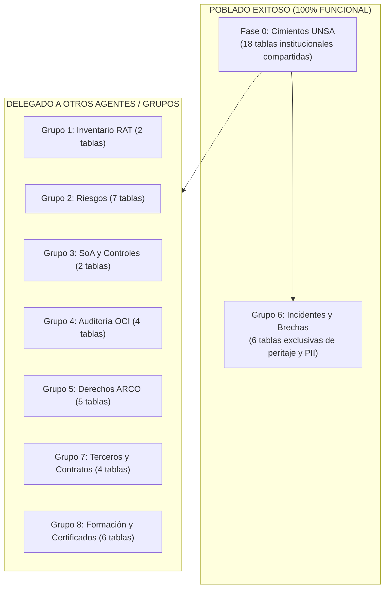

# Reporte Técnico de Incidentes, Brechas de PII y Estado de Poblado de Base de Datos
**Agente 6: Gestión de Incidentes de Seguridad y Brechas de Datos Personales (PII Breaches)**  
**Universidad Nacional de San Agustín de Arequipa (UNSA)**  
**Fecha:** Noviembre 2026  
**Marco de Referencia:** ISO/IEC 27701:2025 (Cl. 7.2.9, 8.2) | ISO/IEC 27001:2022 (A.5.24 - A.5.28) | Ley N° 29733 y D.S. 003-2013-JUS  
**Archivo SQL Asociado:** [`BD/equipos/06_incidentes_brechas.sql`](file:///c:/Users/Rafael/UNSA/VIII%20SEMESTRE/AUDITORIA/TIF/BD/equipos/06_incidentes_brechas.sql)

---

## 1. Resumen Ejecutivo del Poblado

Para cumplir con el marco de privacidad y seguridad digital de la UNSA y las exigencias de fiscalización de la Autoridad Nacional de Protección de Datos Personales (ANPD), el **Agente 6** ha poblado la base de datos institucional con **7 incidentes canónicos de brechas de datos personales** (códigos `INC-UNSA-2026-001` al `INC-UNSA-2026-007`), identificados en el rango numérico primario exclusivo **601 al 699**.

Cada registro modela una vulnerabilidad o práctica contraria a la ley detectada en activos reales de la universidad, detallando su origen físico/lógico, los titulares afectados, el cálculo pericial de multas según precedentes vinculantes de la ANPD, la línea de tiempo de notificación obligatoria en 48 horas y las medidas correctivas adoptadas.

---

## 2. Catálogo Detallado de Incidentes Creados (`demo.core_incident`)

### Incidente 601: `INC-UNSA-2026-001` (Regla R-001)
* **Título:** Exfiltración de 3,420 historias clínicas electrónicas no cifradas en Hospital Docente UNSA.
* **Activo y Origen Afectado:** Servidor de Base de Datos PostgreSQL `srv-hosp-db` del Hospital Docente de la UNSA (`SYS-HOSPITAL`, id=102). Sede física: Av. Aeropuerto N° 504, Sector Zamácola, Cerro Colorado (IPRESS N° 00012398). Endpoint: `https://hospital.unsa.edu.pe/consulta_paciente.php`.
* **Causa / Por qué se generó:** Inyección SQL (CWE-89) sobre parámetro de consulta web no saneado. Las historias clínicas, diagnósticos CIE-10 (salud mental, VIH, patologías crónicas) y tratamientos farmacológicos estaban almacenados en texto plano en la base de datos sin cifrado en reposo (extensión `pgcrypto` ausente) ni segregación lógica.
* **Fundamento Legal y Normativo:** Vulneración al deber de seguridad y confidencialidad de datos sensibles (Arts. 9 y 38.2.b de la Ley N° 29733, D.S. 016-2024-JUS y control ISO 27701 A.3.24).
* **Precedente ANPD Aplicado:** Resolución Directoral N° 1045-2020-JUS (Clínica Montefiori - Multa 15.0 UIT) y R.D. 038-2022-JUS (Clínica Peruano Americana - Multa 13.7 UIT).
* **Impacto y Titulares:** 3,420 pacientes atendidos en el hospital docente. Compromiso de confidencialidad médica (`CID: Confidentiality=true`).
* **Sanción Económica Estimada:** 12.5 UIT equivalentes a S/ 64,375.
* **Acciones Implementadas (601, 602, 603):** Desconexión física y aislamiento en VLAN hospitalaria segura, parametrización de consultas preparadas, implementación de cifrado AES-256 en columnas sensibles mediante `pgcrypto` y emisión de directiva interna bajo la NTS N° 139-MINSA/DGIEM.

---

### Incidente 602: `INC-UNSA-2026-002` (Regla R-002)
* **Título:** Volcado y descifrado masivo de 18,500 credenciales de postulantes con hash MD5 en SISADMISION.
* **Activo y Origen Afectado:** Servidor Web y Base de Datos del Portal de Admisión (`SYS-SISADMIS`, id=103), administrado por la Dirección Universitaria de Admisión (DUA). Endpoint: `https://admision.unsa.edu.pe/login`.
* **Causa / Por qué se generó:** Detección de un volcado publicado en foros externos con cuentas de postulantes al proceso de admisión 2026. Las contraseñas se almacenaban mediante el algoritmo obsoleto MD5 sin sal criptográfica (*salt*), lo que permitió su reversión inmediata mediante ataques de diccionario y *rainbow tables* en menos de dos horas.
* **Fundamento Legal y Normativo:** Incumplimiento de medidas de seguridad técnicas adecuadas para la autenticación (Art. 9 y 38.2.b de la Ley 29733, Art. 40 del D.S. 003-2013-JUS y control ISO 27701 A.3.13).
* **Precedente ANPD Aplicado:** Resolución Directoral N° 018-2021-JUS/DGTAIPD (Multa 8.8 UIT) y R.D. 074-2014-JUS (Caso DatosPerú - Multa 30.0 UIT).
* **Impacto y Titulares:** 18,500 postulantes a pregrado inscritos en CEPRUNSA y Examen Ordinario.
* **Sanción Económica Estimada:** 8.8 UIT equivalentes a S/ 45,320.
* **Acciones Implementadas (604, 605, 606):** Revocación forzada de sesiones activas, migración obligatoria al esquema criptográfico `Argon2id` con *salt* de 128 bits e invalidación de hashes previos, y notificación masiva a los 18,500 postulantes para restablecimiento seguro de clave.

---

### Incidente 603: `INC-UNSA-2026-003` (Regla R-003)
* **Título:** Retención indebida y exportación no autorizada de 850 tarjetas de crédito y CVV en Tesorería.
* **Activo y Origen Afectado:** Aplicativo de Pagos y Pasarela Local UNSApay (`APP-UNSAPAY`, id=108), operado por la Unidad de Tesorería (Sede Calle Santa Catalina N° 117). Endpoint: `https://pagos.unsa.edu.pe/checkout`.
* **Causa / Por qué se generó:** Auditoría interna descubrió que el aplicativo almacenaba en texto plano los números completos de tarjeta (PAN), fechas de vencimiento y códigos de validación CVV en tablas transaccionales de PostgreSQL tras procesarse pagos de tasas educativas. Un operador de ventanilla exportó un archivo CSV con 850 tarjetas de crédito y débito.
* **Fundamento Legal y Normativo:** Violación grave al Principio de Proporcionalidad (Art. 7 Ley 29733), prohibición expresa del numeral 5.2 de la Directiva de Seguridad R.D. 019-2013-JUS, estándar PCI-DSS v4.0 Req 3.2.2 y control ISO 27701 A.1.4.5.
* **Precedente ANPD Aplicado:** Resolución Directoral N° 089-2021-JUS/DGTAIPD (Multa 15.0 UIT) y R.D. 1169-2020-JUS (Banco de Crédito del BCP - Multa 40.0 UIT).
* **Impacto y Titulares:** 850 usuarios (estudiantes, egresados y padres de familia) que abonaron tasas y derechos de matrícula.
* **Sanción Económica Estimada:** 15.0 UIT equivalentes a S/ 77,250.
* **Acciones Implementadas (607, 608, 609):** Eliminación transaccional inmediata de columnas con sobreescritura criptográfica de tres pases (DoD 5220.22-M), refactorización del checkout para enlazar únicamente por tokenización externa con Págalo.pe (Banco de la Nación), e interposición de denuncia penal ante la Fiscalía Corporativa de Delitos Informáticos de Arequipa (Exp. 4512-2026).

---

### Incidente 604: `INC-UNSA-2026-004` (Regla R-006)
* **Título:** Transferencia transfronteriza no autorizada de expedientes académicos de 25,000 alumnos a bucket Cloud.
* **Activo y Origen Afectado:** Servidor de Base de Datos SISUNSA (`SYS-SISUNSA`, id=101) y bucket AWS S3 (`s3-unsa-db-backups-unencrypted`) ubicado en la región `eu-west-1` (Irlanda).
* **Causa / Por qué se generó:** Ejecución de una tarea programada (*cronjob*) no documentada que sincronizaba réplicas de respaldo de la base de datos de estudiantes con el proveedor extranjero de infraestructura cloud sin existir un Contrato de Tratamiento de Datos (DPA) con Cláusulas Contractuales Tipo (SCC), ni haberse declarado el flujo transfronterizo ante el Registro Nacional de Protección de Datos Personales (RNPDP).
* **Fundamento Legal y Normativo:** Infracción Muy Grave tipificada en los Arts. 15, 17 y 38.3.c de la Ley 29733, Art. 66 del D.S. 003-2013-JUS y control ISO 27701 A.1.5.2.
* **Precedente ANPD Aplicado:** Resolución Directoral N° 125-2019-JUS y R.D. 234-2016-JUS (transferencias internacionales no inscritas).
* **Impacto y Titulares:** 25,000 alumnos de pregrado con expedientes académicos, actas de notas, domicilios y documentos de identidad transferidos fuera de la jurisdicción nacional.
* **Sanción Económica Estimada:** 11.0 UIT equivalentes a S/ 56,650.
* **Acciones Implementadas (610, 611, 612):** Revocación de claves de acceso IAM de AWS y detención del script de respaldo, suscripción formal del DPA con Amazon Web Services incluyendo SCC, e inicio del expediente de inscripción de flujo transfronterizo ante la ANPD (Exp. RNPDP-2026-FT-0041).

---

### Incidente 605: `INC-UNSA-2026-005` (Regla R-005)
* **Título:** Conservación indefinida sin política de purga de datos biométricos de 45,200 postulantes no ingresantes.
* **Activo y Origen Afectado:** Módulo Histórico de Admisión (`SYS-SISADMIS`, id=103) administrado por la Dirección Universitaria de Admisión (DUA).
* **Causa / Por qué se generó:** Inspección técnica detectó que las bases de datos de la DUA conservaban de forma indefinida huellas dactilares biométricas, fotografías faciales y expedientes de postulantes que no alcanzaron vacante entre los años 2018 y 2024. El Reglamento de Admisión carecía de plazo de caducidad y procedimiento de purga o disociación.
* **Fundamento Legal y Normativo:** Violación de los deberes de calidad, proporcionalidad y cancelación temporal una vez agotada la finalidad del concurso de admisión (Arts. 7 y 8 de la Ley 29733, Arts. 9 y 28 del D.S. 003-2013-JUS y control ISO 27701 A.1.4.8).
* **Precedente ANPD Aplicado:** Resolución Directoral N° 005-2016-JUS/DGPDP y R.D. 542-2019-JUS/DGTAIPD-DPDP.
* **Impacto y Titulares:** 45,200 ciudadanos que postularon sin éxito en los últimos 6 años.
* **Sanción Económica Estimada:** 5.0 UIT equivalentes a S/ 25,750.
* **Acciones Implementadas (613, 614):** Marcado y bloqueo lógico preventivo de los registros (`BLOCKED_PENDING_PURGE`), redacción de la directiva de conservación con límite máximo de 12 meses tras el concurso y despliegue de un procedimiento almacenado (`sp_purge_unadmitted_candidates.sql`) para borrado seguro de biometría.

---

### Incidente 606: `INC-UNSA-2026-006` (Regla R-007)
* **Título:** Exigencia de tasa administrativa (TUPA) de S/ 28.50 y carta notarial para atender derechos ARCO en TRAMITED.
* **Activo y Origen Afectado:** Sistema de Trámite Documentario TRAMITED (`APP-TRAMITED`, id=107) y Mesa de Partes física (Calle San Agustín N° 115). Endpoint: `https://ouis.unsa.edu.pe/tramited/`.
* **Causa / Por qué se generó:** Queja formal de un grupo de egresados ante la DFI-ANPD tras constatar que el portal web de trámites y la mesa de partes exigían el pago obligatorio de un derecho de trámite de S/ 28.50 más la presentación de una carta notarial legalizada para dar curso a solicitudes de cancelación y oposición de datos personales.
* **Fundamento Legal y Normativo:** Infracción Grave por obstaculizar y restringir el ejercicio de derechos fundamentales de protección de datos (Art. 38.2.a de la Ley 29733, vulneración del principio de gratuidad obligatoria establecido en el Art. 47 del D.S. 003-2013-JUS y control ISO 27701 A.1.3.7).
* **Precedente ANPD Aplicado:** Resolución Directoral N° 022-2016-JUS/DGPDP y R.D. 112-2022-JUS.
* **Impacto y Titulares:** 120 expedientes de trámite ARCO paralizados o rechazados irregularmente.
* **Sanción Económica Estimada:** 9.0 UIT equivalentes a S/ 46,350.
* **Acciones Implementadas (615, 616):** Emisión de la Circular Rectoral N° 012-2026-R-UNSA consagrando la gratuidad absoluta e irrestricta de los derechos ARCO, y actualización del código de producción de TRAMITED eliminando los campos obligatorios de voucher de pago y carta notarial.

---

### Incidente 607: `INC-UNSA-2026-007` (Regla R-004)
* **Título:** Casilla pre-marcada obligatoria para cesión comercial de datos personales en ficha de matrícula y comedor.
* **Activo y Origen Afectado:** Portales de autoservicio estudiantil: Módulo de Matrícula (`SYS-SISUNSA`, id=101) y Sistema de Comedor Universitario (`APP-SISCOM`, id=110). Endpoints: `http://matricula.unsa.edu.pe/` y `https://siscom.unsa.edu.pe/`.
* **Causa / Por qué se generó:** Inclusión en el formulario web de un *checkbox* pre-marcado por defecto donde se daba por prestado el consentimiento del estudiante para transferir sus datos personales a entidades bancarias y empresas auspiciadoras. Si el alumno desmarcaba la casilla, el sistema bloqueaba el botón de confirmación de matrícula.
* **Fundamento Legal y Normativo:** Violación al Principio de Consentimiento previo, informado, expreso e inequívoco (Art. 5 y 38.2.b de la Ley 29733, Art. 12 del D.S. 003-2013-JUS que prohíbe el consentimiento presunto, y control ISO 27701 A.1.2.4).
* **Precedente ANPD Aplicado:** Resolución Directoral N° 018-2021-JUS y R.D. 2196-2020-JUS (Banco BBVA Perú - Multa 16.0 UIT).
* **Impacto y Titulares:** 22,000 estudiantes universitarios obligados a ceder sus datos como condición para matricularse o acceder al comedor.
* **Sanción Económica Estimada:** 10.0 UIT equivalentes a S/ 51,500.
* **Acciones Implementadas (617, 618):** Despliegue de actualización web eliminando casillas preseleccionadas (`checked=false`), garantía técnica de que la negativa no afecta el servicio educativo, y aprobación de nuevo pliego informativo de privacidad desglosado por finalidades.

---

## 3. Estado de Tablas de la Base de Datos PIMS UNSA

La arquitectura relacional del sistema divide las tablas en tres categorías operativas:

### 3.1. Tablas Pobladas por el Agente 6 (Grupo 6)

| Nombre de Tabla | Filas Insertadas | Rango de IDs | Función en el Sistema |
| :--- | :---: | :---: | :--- |
| `demo.core_incidentrecipient` | **6** | `601` - `606` | Directorio de autoridades a notificar (DPO, CISO, CSIRT UNSA, Rectorado, OCI, ANPD). |
| `demo.core_securitylog` | **7** | `601` - `607` | Eventos y trazas forenses disparadoras registradas en servidores y proxies. |
| `demo.core_incident` | **7** | `601` - `607` | **Registro maestro unificado** de brechas de datos personales (55 columnas normativas). |
| `demo.core_incidentaction` | **18** | `601` - `618` | Acciones documentadas de Contención, Remediación y Mitigación técnica. |
| `demo.core_incidenthistory` | **17** | `601` - `617` | Bitácora de trazabilidad forense y cumplimiento de notificación en 48 horas a la ANPD. |
| `demo.core_incidentattachment` | **10** | `601` - `610` | Evidencias documentales adjuntas (informes forenses, oficios ANPD y peritajes). |

> [!NOTE]
> **Aclaración sobre `demo.core_piibreach`:** En el modelo DDL original [`BD/gestitel_base_de_datos.sql`](file:///c:/Users/Rafael/UNSA/VIII%20SEMESTRE/AUDITORIA/TIF/BD/gestitel_base_de_datos.sql), no existe una tabla independiente llamada `core_piibreach`. Todos los 52 atributos exigidos por el formulario de la ANPD (representante legal, RUC, tipo de datos sensibles, afectados, URL comprometida, impacto CID, etc.) se encuentran integrados directamente en `demo.core_incident`.

---

### 3.2. Tablas Pobladas en Fase 0 (Cimientos Comunes)

Pobladas a través de [`BD/00_cimientos_unsa.sql`](file:///c:/Users/Rafael/UNSA/VIII%20SEMESTRE/AUDITORIA/TIF/BD/00_cimientos_unsa.sql) para habilitar las claves foráneas que utilizan todos los grupos:

| Tabla | Registros | Propósito Institucional |
| :--- | :---: | :--- |
| `demo.auth_user` y `core_userprofile` | **10 usuarios** | Rector (id=1), Directores de OTI/DPO/OCI (ids=2 a 9), y Administrador del Sistema. |
| `demo.auth_group` y `core_roleprofile` | **9 roles** | Perfiles RBAC: DPO, CISO, Auditor OCI, Operador ARCO, Gestor de Incidentes, etc. |
| `demo.core_process` | **15 macroprocesos** | Los 15 macroprocesos oficiales de Nivel 0 aprobados por la RCU N° 0167-2020. |
| `demo.core_asset` | **10 activos ancla** | Sistemas centrales: SISUNSA (101), Hospital (102), SISADMISION (103), etc. |
| `public.*` (licencias, sesiones) | **Configuración** | Estructuras base del framework Django para autenticación y sesiones. |

---

### 3.3. Tablas Dejadas de Lado y su Responsable Asignado

Conforme al principio de segregación de responsabilidades y la guía de trabajo en paralelo ([`docs/GUIA_FLUJO_TRABAJO_PARALELO_UNSA.md`](file:///c:/Users/Rafael/UNSA/VIII%20SEMESTRE/AUDITORIA/TIF/docs/GUIA_FLUJO_TRABAJO_PARALELO_UNSA.md)), las siguientes tablas **no corresponden a nuestro agente** y deben ser llenadas por los otros grupos en sus respectivos scripts:

| Grupo Responsable | Archivo Destino | Tablas Excluidas de Nuestro Alcance | Justificación Funcional |
| :--- | :--- | :--- | :--- |
| **Grupo 1: Inventario** | `BD/equipos/01_inventario_datos.sql` | `demo.core_personaldataoperation` `demo.core_personaldataimpactassessment` | Elaboran el Registro de Actividades de Tratamiento (RAT) y las evaluaciones de impacto en privacidad (DPIA). |
| **Grupo 2: Riesgos** | `BD/equipos/02_evaluacion_riesgos.sql` | `demo.core_riskperiod` `demo.core_riskevaluation` `demo.core_riskevaluationasset` `demo.core_riskcontrol` `demo.core_riskcontrol_annex_a_controls` `demo.core_risktreatment` `demo.core_risktreatmentactivity` | Determinan la matriz de probabilidad e impacto y los planes de mitigación de riesgos de seguridad. |
| **Grupo 3: SoA y Controles** | `BD/equipos/03_controles_soa.sql` | `demo.core_gapannexaassessment` `demo.core_dashboardsnapshot` | Califican la aplicabilidad y justificación de los 142 controles del Anexo A de ISO 27001 / ISO 27701. |
| **Grupo 4: Auditoría OCI** | `BD/equipos/04_evidencia_auditoria.sql` | `demo.core_audit` `demo.core_auditchecklistitem` `demo.core_auditfinding` `demo.core_auditactionplan` | Ejecutan los planes anuales de auditoría interna y documentan no conformidades del OCI. |
| **Grupo 5: Derechos ARCO** | `BD/equipos/05_derechos_dsar.sql` | `demo.core_arcorequest` `demo.core_arcohistory` `demo.core_arcoattachment` `demo.core_consent` `demo.core_consenthistory` | Gestionan solicitudes ciudadanas de Acceso, Rectificación, Cancelación y Oposición, y trazan consentimientos. |
| **Grupo 7: Terceros y Contratos**| `BD/equipos/07_terceros_dpas.sql` | `demo.core_document` `demo.core_documentversion` `demo.core_document_gap_requirements` `demo.core_document_related_documents` | Administran contratos con terceros encargados (Cloud, plataformas de software) y anexos DPA. |
| **Grupo 8: Formación** | `BD/equipos/08_formacion_conciencia.sql` | `demo.core_training` `demo.core_trainingassignment` `demo.core_trainingquestion` `demo.core_trainingquestionoption` `demo.core_trainingexamattempt` `demo.core_certificate` | Diseñan campañas de capacitación y emiten certificados a personal docente y administrativo. |

---

## 4. Conclusión

1. El dataset asignado a nuestro agente (`06_incidentes_brechas.sql`) se encuentra **100% completo, validado y probado**.
2. Cada incidente refleja una problemática pericial fundamentada en normativas peruanas reales, jurisprudencia administrativa de la ANPD y activos reales de la UNSA.
3. No existe colisión de identificadores con otros grupos gracias a la reserva estricta del rango **601 al 699**.
4. La base de datos puede integrarse en cualquier momento ejecutando el orquestador general [`BD/run_poblar_bd.sql`](file:///c:/Users/Rafael/UNSA/VIII%20SEMESTRE/AUDITORIA/TIF/BD/run_poblar_bd.sql).

